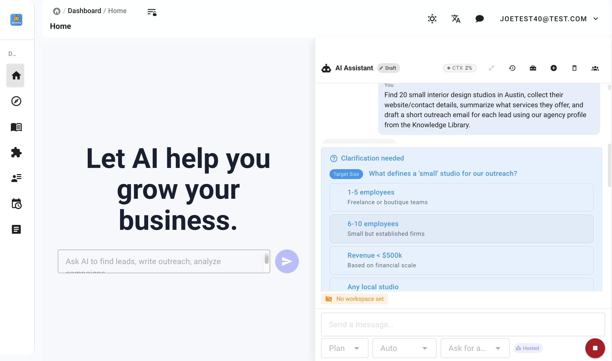
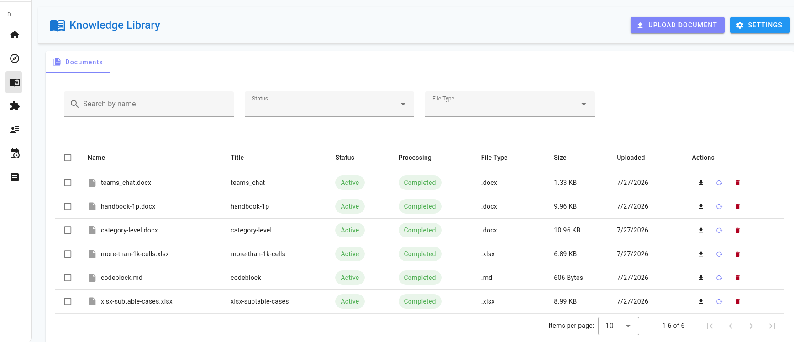
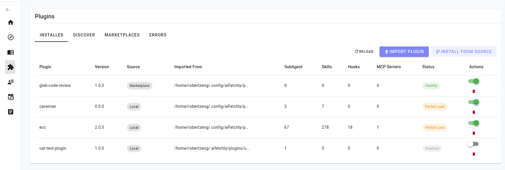
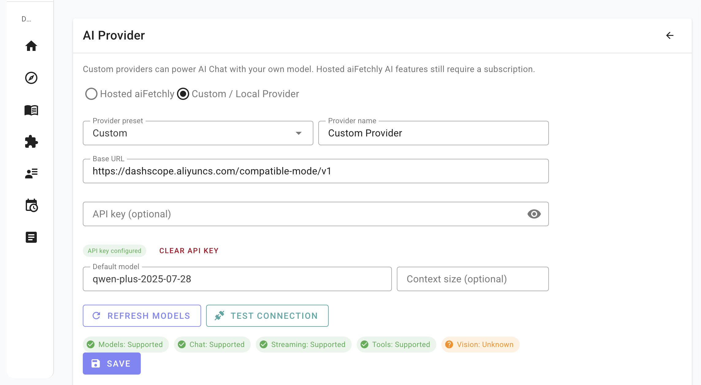

<h1 align="center">aiFetchly</h1>

<p align="center">
  <strong>Agente de IA de escritorio para automatización empresarial</strong>
</p>

<p align="center">
  <a href="./README.md">English</a> &middot;
  <a href="./README.zh.md">简体中文</a> &middot;
  Español &middot;
  <a href="./README.fr.md">Français</a> &middot;
  <a href="./README.de.md">Deutsch</a> &middot;
  <a href="./README.ja.md">日本語</a>
</p>

<p align="center">
  
</p>

---

**aiFetchly** es una plataforma abierta de agentes de IA de escritorio para trabajo empresarial. Combina conocimiento local, automatización del navegador, habilidades instalables, tareas programadas, plugins y subagentes especializados para que los equipos automaticen investigación, procesamiento de documentos, recopilación de información web, comunicación con clientes y operaciones recurrentes desde una sola aplicación.

aiFetchly comenzó con funciones de automatización de marketing como descubrimiento de leads, extracción de contactos y email outreach. Esos flujos siguen incluidos, pero el producto apunta a algo más amplio: un espacio de trabajo local-first para usuarios de negocio que necesitan herramientas, memoria, archivos, automatización web y ejecución controlable.

## ¿Qué es aiFetchly?

aiFetchly convierte una intención de negocio en flujos ejecutables:

- **Pide trabajo a un agente de IA**: investigación, análisis de archivos, extracción de datos, borradores de mensajes, resúmenes y uso de herramientas desde una interfaz de chat.
- **Usa tu conocimiento empresarial**: sube documentos a una biblioteca local y genera respuestas o borradores basados en tus propios archivos.
- **Automatiza navegador y datos**: recopila información de sitios web, extrae datos estructurados, procesa listas de URL y exporta resultados.
- **Deja que el agente conduzca un navegador real**: abre una ventana de Chrome visible que la IA observa y controla; mira cada paso, aprueba acciones relevantes y toma el control cuando aparezca un inicio de sesión o una verificación. Ver [Automatización con navegador gestionado](#automatización-con-navegador-gestionado).
- **Delega a subagentes especializados**: ejecuta agentes en segundo plano con su propio prompt, permisos de herramientas, límites de recursos y salida estructurada.
- **Extiende el espacio de trabajo**: instala habilidades y plugins para agregar herramientas, flujos de negocio e integraciones.
- **Mantén el control**: guarda los datos en SQLite local, revisa la actividad de herramientas, controla permisos y ejecuta todo en tu escritorio.

## Capturas

### Espacio de trabajo del agente de IA


### Biblioteca de conocimiento



### Gestión de habilidades y plugins



### Configuración de AI Provider



## Capacidades del agente

### Espacio de trabajo de IA

| Capacidad | Descripción |
|-----------|-------------|
| **Chat de IA con herramientas** | Trabaja con un asistente que puede usar herramientas aprobadas, contexto empresarial y tareas de varios pasos. |
| **AI Providers personalizados** | Usa cualquier proveedor compatible con OpenAI, incluidos Ollama, LM Studio, OpenAI, OpenRouter, vLLM, LocalAI o un endpoint personalizado. |
| **Ejecución de tareas empresariales** | Ejecuta investigación, extracción, procesamiento de archivos, borradores, programación y automatizaciones sin cambiar entre varias herramientas SaaS. |
| **Asistente de email para clientes** | Redacta, envía y responde emails con contexto de tus documentos y datos de trabajo. |
| **Subagentes especializados** | Ejecuta subagentes autónomos con prompt propio, lista de herramientas permitidas, límites de recursos y salida estructurada. |
| **Automatización con permisos** | Controla qué herramientas, plugins, hooks y subagentes pueden ejecutarse. |

### Conocimiento empresarial y RAG

| Capacidad | Descripción |
|-----------|-------------|
| **Biblioteca de conocimiento** | Sube PDF, TXT, DOC/DOCX, Markdown, HTML, CSV y Excel a una base local para generación aumentada por recuperación. |
| **Procesamiento de documentos** | Detecta duplicados, sigue el progreso, divide documentos y guarda embeddings vectoriales para búsqueda semántica. |
| **Configuración de embeddings** | Selecciona y actualiza el modelo de embeddings con metadatos visibles en la interfaz. |
| **Respuestas basadas en negocio** | Genera resúmenes, planes, emails, reportes y guías usando tus documentos como contexto. |

### Habilidades, plugins y extensibilidad

| Capacidad | Descripción |
|-----------|-------------|
| **Habilidades instalables** | Extiende el agente con paquetes reutilizables para archivos, análisis, automatización y dominios específicos. |
| **Gestión de habilidades** | Importa habilidades desde ZIP, lista habilidades integradas, instaladas o aportadas por plugins, y actívalas o desinstálalas. |
| **Gestión de plugins** | Importa plugins desde ZIP o carpetas fuente y administra estado, salud, formato, habilidades y servidores MCP. |
| **Compatibilidad con plugins estilo Claude** | Soporta el formato de aiFetchly y paquetes estilo Claude que aportan habilidades y servidores MCP. |
| **Gestión de hooks** | Crea hooks para eventos del ciclo de vida de AI/chat como inicio de sesión, envío de prompt, uso de herramientas y solicitudes de permiso. |

### Automatización web, datos y flujos

| Capacidad | Descripción |
|-----------|-------------|
| **Navegador gestionado controlado por IA** | Entrega una ventana real y visible de Chrome al agente: abrir sitios, leer la página, hacer clic, escribir, navegar, extraer datos y pausar para intervención humana. Funciona en sitios públicos sin cuenta guardada y reutiliza el inicio de sesión de una Tool Account cuando lo necesitas. |
| **Investigación web automatizada** | Busca en motores, recopila información empresarial, procesa URL y se recupera de errores de tarea. |
| **Extracción de datos estructurados** | Extrae emails, teléfonos, direcciones, perfiles sociales, datos de empresas y registros de directorios. |
| **Programación de tareas** | Programa tareas con cron, encadena trabajos dependientes, crea flujos recurrentes y revisa el historial. |
| **Exportación con un clic** | Descarga datasets como CSV y genera reportes desde datos recopilados o procesados. |
| **Gestión de proxies** | Administra proxies HTTP, HTTPS y SOCKS5, con importación masiva, validación y pruebas. |

### Flujos de crecimiento incluidos

| Flujo | Descripción |
|-------|-------------|
| **Investigación de empresas y leads** | Encuentra negocios en buscadores, Google Maps, Yandex Maps, Yellow Pages y directorios similares. |
| **Extracción de contactos** | Procesa listas de URL y extrae emails, teléfonos, direcciones y perfiles sociales con progreso en vivo. |
| **Redacción de emails con IA** | Genera emails personalizados usando RAG y tus documentos cargados. |
| **Envío y respuestas de emails** | Ayuda a enviar emails y crear respuestas con contexto de la base de conocimiento y datos de clientes. |
| **Operaciones en redes sociales** | Gestiona cuentas sociales y automatiza flujos donde estén soportados. |

## Primeros pasos

### Requisitos

- **Sistema operativo**: Windows 10+, macOS 10.15+ o Linux (Ubuntu 20.04+)
- **RAM**: mínimo 4 GB, recomendado 8 GB

### Configuración inicial

1. Abre aiFetchly e inicia sesión.
2. Importa documentos a la Biblioteca de conocimiento si quieres respuestas basadas en tus archivos.
3. Instala o activa habilidades y plugins para los flujos que necesitas.
4. Configura un proveedor personalizado en System Settings -> AI Provider si quieres usar tu propio modelo.
5. Configura proxies, cuentas sociales o SMTP solo si usarás flujos web, sociales o de email.

## Desarrollo

### Requisitos

- **Node.js** 18+
- **Yarn** 1.x classic

```bash
yarn install
cp .env.example .env
yarn init
yarn dev
yarn tsc
yarn vue-check
yarn build
yarn make
```

### Pruebas

```bash
yarn test
yarn testmain
yarn vitest-googlescraper
yarn testhttpclient
yarn testyoutubeupload
yarn testdownload
```

### Arquitectura

aiFetchly usa una arquitectura de tres capas con separación estricta:

```text
IPC Handler  ->  Module (lógica de negocio)  ->  Model (acceso a datos)
```

- **Models** (`src/model/`) gestionan TypeORM y consultas SQL.
- **Modules** (`src/modules/`) contienen lógica de negocio, validación y coordinación entre modelos.
- **IPC Handlers** (`src/main-process/`) solo comunican con el renderer y no acceden directamente a la base de datos.

Los workers en `src/childprocess/` ejecutan tareas intensivas como scraping y procesamiento de IA. Envían resultados al proceso principal por IPC y nunca acceden directamente a la base de datos.

## Configuración de AI Provider

AI Chat puede usar la IA alojada de aiFetchly o un proveedor compatible con OpenAI configurado por el usuario. Abre **System Settings -> AI Provider** para cambiar de modo y guardar un proveedor local o personalizado.

## Automatización con navegador gestionado

aiFetchly incluye un navegador que el agente de IA puede conducir de verdad. El agente abre una ventana normal de Chrome/Chromium con interfaz visible en tu escritorio, observa la página y ejecuta los pasos que pediste, mientras la aplicación muestra el estado de la sesión, las aprobaciones, el progreso y los resultados.

Está pensado para sitios y cuentas que posees o que estás autorizado a operar. No evita MFA, retos de inicio de sesión o seguridad, controles de seguridad de la plataforma ni restricciones de acceso.

### Cómo iniciar una sesión

- **AI Chat**: describe una tarea que necesite navegador y el agente carga las herramientas por sí solo.
- **Tool Account → Open managed browser**: reutiliza la sesión guardada de una cuenta para su plataforma.
- **Tarjeta de sesión en el espacio de trabajo**: ver, controlar o detener un navegador en marcha.

La navegación pública no requiere cuenta. Se puede abrir cualquier sitio, incluidas redes sociales y páginas que exigen iniciar sesión, sin Tool Account guardada; si el sitio necesita login, aiFetchly te entrega esa misma ventana en lugar de negarse a abrirla o cambiar a una descarga HTTP. Si se abre con una cuenta guardada, se reutiliza la sesión cifrada de cookies.

### Herramientas de navegador disponibles

| Herramienta | Uso |
|-------------|-----|
| `browser_start_session` | Iniciar una sesión para una URL o una Tool Account guardada |
| `browser_get_status` | Leer el estado de la sesión y la URL saneada actual |
| `browser_observe` | Obtener una instantánea semántica acotada de la página y sus elementos |
| `browser_navigate` | Navegar a una URL `http(s)` permitida |
| `browser_run_actions` | Ejecutar un programa estructurado acotado (clic, escribir, desplazar, esperar, extraer, repetir) |
| `browser_screenshot` | Capturar una miniatura de la página para la conversación |
| `browser_request_handoff` | Pausar y pedirte que tomes el control |
| `browser_resume_after_handoff` | Reanudar tras tu confirmación |
| `browser_evaluate_script` | Ejecutar JavaScript revisado dentro de la página, con aprobación |
| `browser_clear_cache` | Limpiar la caché de la cuenta actual tras confirmarlo |
| `browser_stop_session` | Detener y cerrar el navegador |

`browser_observe` devuelve referencias como `@e1 [button] "Search"` junto con una revisión de página; las referencias antiguas se rechazan tras navegar o recargar para no pulsar el elemento equivocado.

### Aprobaciones y seguridad

| Riesgo | Ejemplos | Comportamiento |
|--------|----------|----------------|
| Observar | Leer texto, inspeccionar elementos, captura | Aprobación por sesión |
| Interacción reversible | Buscar, filtrar, paginar, redactar | Aprobación por sesión |
| Entrada sensible | Correo, teléfono, mensaje privado, subida | Vista previa y aprobación explícita |
| Consecuente | Enviar, publicar, comentar, seguir, subir, borrar, comprar, cambiar ajustes | Aprobación puntual con cuenta, objetivo y efecto |
| Script privilegiado | Cualquier JavaScript en la página | Se muestran script, origen, fin, timeout y salida esperada antes de aprobar |
| Autenticación | Contraseña, MFA, passkey, CAPTCHA de seguridad | Siempre la completas tú |

El contenido de la página se trata como datos no confiables, así que una web no puede convencer al agente de saltarse una aprobación; el modelo no puede declarar su propia acción como segura y una denegación explícita se respeta. Las cookies nunca llegan al renderer, al modelo, a los resultados de herramientas, a los logs ni a la analítica: solo el proceso principal las descifra y solo el worker del navegador las aplica. Tras un inicio de sesión correcto la sesión renovada se guarda cifrada de nuevo.

### Ajustes y caché

**System Settings → Managed Browser** permite configurar:

| Ajuste | Valor por defecto | Efecto |
|--------|-------------------|--------|
| **Use built-in managed browser** | Activado | Permite nuevas sesiones controladas por IA |
| **Use managed browser cache** | Activado | Reutiliza recursos estáticos aislados por cuenta |
| **Maximum managed-browser cache** | 500 MB | Limita el uso de disco (100–2048 MB) |
| **Clear cache when aiFetchly closes** | Desactivado | Limpia la caché al cerrar la aplicación |

El panel muestra el tamaño aproximado de la caché, la última limpieza y las acciones para limpiar la caché de una cuenta o de todos los navegadores gestionados. Limpiar la caché nunca borra cookies cifradas, inicios de sesión guardados, cuentas ni descargas.

Los requisitos completos, el modelo de seguridad, la política de fingerprint y el plan de despliegue están en [`docs/prd/puppeteer-managed-social-browser-prd.md`](docs/prd/puppeteer-managed-social-browser-prd.md).

## Documentación

La documentación completa está en [docs.aifetchly.com](https://docs.aifetchly.com).

Navegador gestionado controlado por IA (sesiones visibles de Chrome, herramientas de navegador, aprobaciones, intervención humana, fingerprint, caché): [requisitos de producto](docs/prd/puppeteer-managed-social-browser-prd.md).

El sitio web oficial de la aplicación es [aifetchly.com](https://www.aifetchly.com).

## Apoya aiFetchly

Si aiFetchly te ahorra tiempo o te ayuda en tu trabajo, puedes apoyar su desarrollo continuo en Ko-fi.

<p>
  <a href="https://ko-fi.com/aifetchly">
    
  </a>
</p>

## Contribuir

Las contribuciones son bienvenidas: correcciones, nuevas funciones, mejoras de flujo, habilidades, plugins o traducciones. Lee [CLAUDE.md](./CLAUDE.md) antes de contribuir.

## Licencia

Este proyecto está licenciado bajo [Apache License Version 2.0](./LICENSE).
