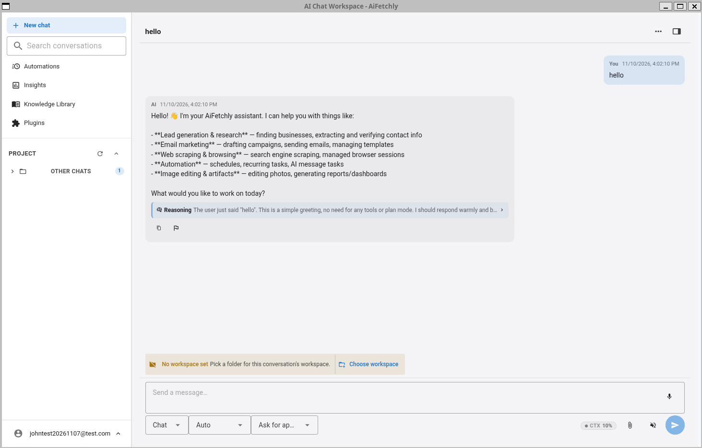
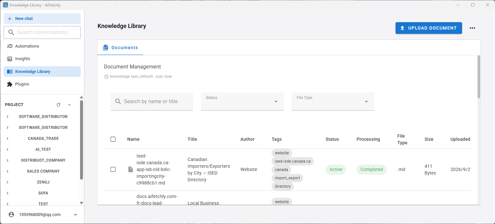
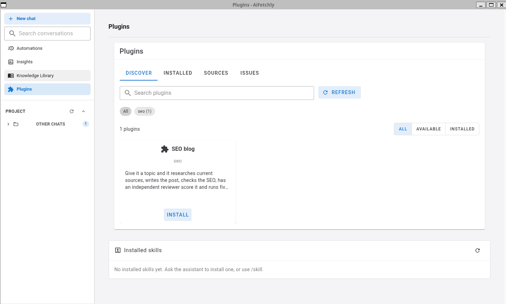
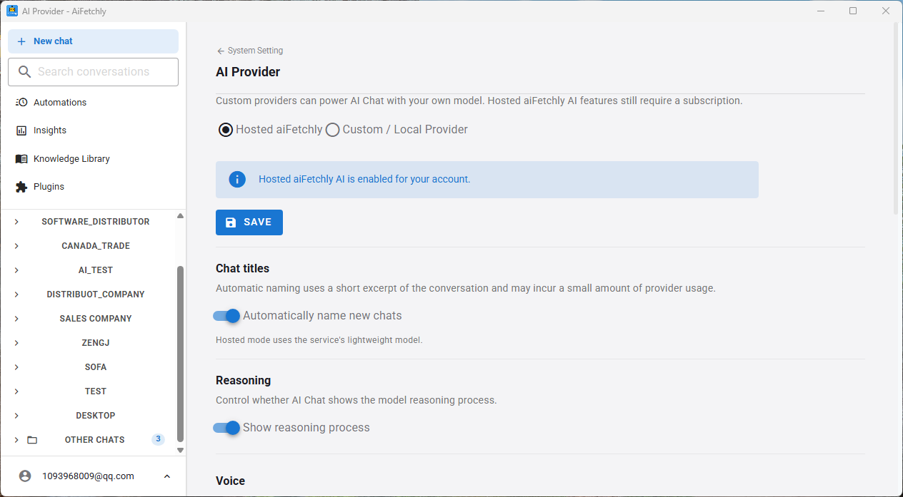
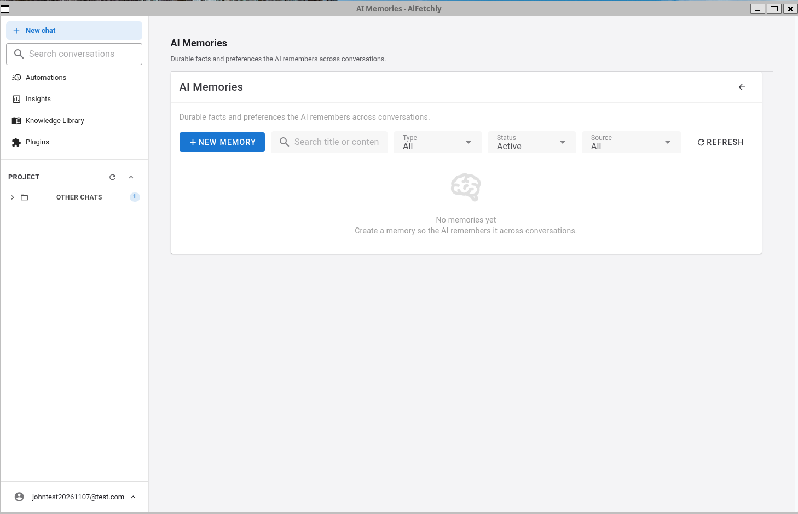

<h1 align="center">aiFetchly</h1>

<p align="center">
  <strong>ビジネス自動化のためのデスクトップ AI Agent</strong>
</p>

<p align="center">
  <a href="./README.md">English</a> &middot;
  <a href="./README.zh.md">简体中文</a> &middot;
  <a href="./README.es.md">Español</a> &middot;
  <a href="./README.fr.md">Français</a> &middot;
  <a href="./README.de.md">Deutsch</a> &middot;
  日本語
</p>

<p align="center">
  
</p>

---

**aiFetchly** は、ビジネス業務のためのオープンソースなデスクトップ AI Agent プラットフォームです。ローカル知識、ブラウザ自動化、インストール可能なスキル、スケジュールタスク、プラグイン、専門サブエージェントを 1 つのアプリにまとめ、調査、文書処理、Web 情報収集、顧客コミュニケーション、定期業務を自動化します。

aiFetchly は、リード発見、連絡先抽出、メールアウトリーチなどのマーケティング自動化から始まりました。これらのワークフローは現在も含まれていますが、製品の方向性はさらに広がっています。aiFetchly は、ツール、メモリ、ファイル、Web 自動化、制御可能な実行を必要とするビジネスユーザー向けの local-first AI Agent ワークスペースになりつつあります。

## aiFetchly とは？

aiFetchly はビジネス上の意図を実行可能なワークフローに変えます。

- **AI Agent に作業を依頼**：チャット画面から調査、ファイル分析、データ抽出、メッセージ下書き、文書要約、ツール操作を実行します。
- **自社の知識を利用**：文書をローカル知識ライブラリにアップロードし、自分のファイルに基づいた回答や下書きを生成します。
- **ブラウザとデータ作業を自動化**：Web サイトから情報を収集し、構造化データを抽出し、URL リストを処理して結果をエクスポートします。
- **AI に実際のブラウザを操作させる**：デスクトップ上に表示される Chrome ウィンドウを AI が観察・操作します。各ステップを確認でき、重要な操作を承認し、ログインや確認が必要なときは自分で引き継げます。詳しくは[管理ブラウザ自動化](#管理ブラウザ自動化)を参照してください。
- **専門サブエージェントに委任**：独自プロンプト、ツール権限、リソース制限、構造化出力を持つバックグラウンド Agent を実行します。
- **ワークスペースを拡張**：スキルとプラグインをインストールし、新しいツール、業務ワークフロー、連携を追加します。
- **制御を維持**：データをローカル SQLite に保存し、ツール活動を確認し、権限を管理して自分のデスクトップで実行します。

## スクリーンショット

### AI Agent ワークスペース


### 知識ライブラリ



### スキルとプラグイン管理



### AI Provider 設定



### AI メモリ管理



## Agent の機能

### AI Agent ワークスペース

| 機能 | 説明 |
|------|------|
| **ツールを使う AI Chat** | 承認されたツールと業務コンテキストを使い、複数ステップのタスクを実行できる AI アシスタントです。 |
| **AI メモリ管理** | 専用 UI で永続的な AI メモリを管理：ユーザーメモリ（会話をまたいで AI が記憶する事実や好み）およびワークスペースメモリ（プロジェクトスコープの知識）。メモリの作成、編集、アーカイブ、削除、タイプ/ステータス/ソース別のフィルタリング、検索、チャットやエージェントのアクティビティからのメモリ統合を実行できます。 |
| **カスタム AI Provider** | Ollama、LM Studio、OpenAI、OpenRouter、vLLM、LocalAI、カスタムエンドポイントなど OpenAI 互換 Provider を利用できます。 |
| **業務タスク実行** | 調査、抽出、ファイル処理、メッセージ下書き、スケジューリング、自動化を複数 SaaS に移動せず実行します。 |
| **AI 顧客メールアシスタント** | 文書とワークフローデータをコンテキストとして、顧客メールの作成、送信、返信を支援します。 |
| **専門サブエージェント** | 独自システムプロンプト、ツール許可リスト、リソース制限、構造化出力を持つサブエージェントを実行します。 |
| **権限制御された自動化** | 実行できるツール、プラグイン、Hook、サブエージェントを制御します。 |

### ビジネス知識と RAG

| 機能 | 説明 |
|------|------|
| **知識ライブラリ** | PDF、TXT、DOC/DOCX、Markdown、HTML、CSV、Excel をローカル知識ベースにアップロードし、RAG に利用します。 |
| **文書処理** | 重複アップロードを検出し、処理進捗を追跡し、文書を分割して semantic search 用の vector embedding を保存します。 |
| **Embedding モデル設定** | 知識ライブラリで使う embedding モデルを選択・更新し、次元数や利用可否を UI に表示します。 |
| **業務文書に基づく回答** | 自分の文書をコンテキストとして、要約、計画、メール、レポート、運用ガイドを生成します。 |

### スキル、プラグイン、拡張性

| 機能 | 説明 |
|------|------|
| **インストール可能なスキル** | ファイル処理、データ分析、自動化支援、ドメイン固有タスクのための再利用可能なスキルを追加できます。 |
| **スキル管理** | ZIP からスキルをインポートし、組み込み、ユーザーインストール、プラグイン提供スキルを管理します。 |
| **プラグイン管理** | ZIP またはソースフォルダからプラグインをインポートし、有効化、状態、形式、スキル、MCP サーバーを管理します。 |
| **Claude 形式プラグイン互換** | aiFetchly 形式と Claude 形式のプラグインをサポートし、スキルと MCP サーバー定義を追加できます。 |
| **Hook 管理** | セッション開始、プロンプト送信、ツール利用、権限要求、停止など AI/chat ライフサイクル用の Hook を作成します。 |

### ブラウザ、データ、ワークフロー自動化

| 機能 | 説明 |
|------|------|
| **AI が操作する管理ブラウザ** | 実在する可視の Chrome ウィンドウを AI Agent に渡します。サイトを開き、ページを読み、クリックや入力、移動、データ抽出を行い、人による引き継ぎが必要な場所で一時停止します。保存アカウントなしで公開サイトを開け、必要に応じて Tool Account のログイン状態を再利用できます。 |
| **Web 調査自動化** | 複数検索エンジンで検索し、業務情報を収集し、URL リストを処理してタスクエラーから回復します。 |
| **構造化データ抽出** | メール、電話番号、住所、SNS プロフィール、会社情報、ディレクトリレコードなどを抽出します。 |
| **タスクスケジューリング** | cron でタスクを予定し、依存ジョブを連結し、定期ワークフローと実行履歴を管理します。 |
| **ワンクリックエクスポート** | 収集または処理したデータを CSV としてダウンロードし、レポートを生成します。 |
| **プロキシ管理** | HTTP、HTTPS、SOCKS5 プロキシを一括インポート、検証、テストできます。 |

### 組み込みビジネス成長ワークフロー

| ワークフロー | 説明 |
|--------------|------|
| **企業・リード調査** | 検索エンジン、Google Maps、Yandex Maps、Yellow Pages、ディレクトリ系ソースから企業を探します。 |
| **連絡先抽出** | URL リストからメール、電話番号、住所、SNS プロフィールを抽出し、進捗をリアルタイムで追跡します。 |
| **AI メール下書き** | RAG とアップロード済み文書を使って、パーソナライズされた業務メールを生成します。 |
| **顧客メール送信と返信** | 知識ベース、顧客データ、過去のワークフロー結果を使ってメール送信と返信作成を支援します。 |
| **SNS プラットフォーム操作** | ソーシャルアカウントを管理し、対応している SNS ワークフローを自動化します。 |

## はじめに

### 必要環境

- **OS**：Windows 10+、macOS 10.15+、Linux（Ubuntu 20.04+）
- **RAM**：最小 4 GB、推奨 8 GB

### 初回セットアップ

1. aiFetchly を開き、アカウントにサインインします。
2. 自社ファイルに基づく回答が必要な場合は、文書を知識ライブラリにインポートします。
3. 必要なワークフローのためにスキルやプラグインをインストールまたは有効化します。
4. 自分のモデルを AI Chat で使う場合は、System Settings -> AI Provider でカスタム Provider を設定します。
5. Web 情報収集、SNS、メールワークフローを使う場合のみ、プロキシ、SNS アカウント、SMTP 認証情報を設定します。

## 開発

### 必要環境

- **Node.js** 18+
- **Yarn** 1.x classic

```bash
yarn install
cp .env.example .env
yarn init
yarn dev
yarn tsc
yarn vue-check
yarn build
yarn make
```

### テスト

```bash
yarn test
yarn testmain
yarn vitest-googlescraper
yarn testhttpclient
yarn testyoutubeupload
yarn testdownload
```

### アーキテクチャ

aiFetchly は責務を分離した 3 層アーキテクチャを採用しています。

```text
IPC Handler  ->  Module（業務ロジック） ->  Model（データアクセス）
```

- **Models**（`src/model/`）は TypeORM のデータベース操作と SQL クエリを扱います。
- **Modules**（`src/modules/`）は業務ロジック、検証、複数モデルの調整を扱います。
- **IPC Handlers**（`src/main-process/`）は通信のみを担当し、データベースへ直接アクセスしません。

`src/childprocess/` の worker は scraping や AI 処理など重いタスクを実行します。結果は IPC でメインプロセスへ送り、データベースには直接アクセスしません。

## AI Provider 設定

AI Chat は hosted aiFetchly AI またはユーザー設定の OpenAI 互換 Provider を利用できます。**System Settings -> AI Provider** を開いて、ローカルまたはカスタム Provider を保存します。

## 管理ブラウザ自動化（Browser Use） <a id="管理ブラウザ自動化"></a>

aiFetchly には AI Agent が直接駆動できる自律型ブラウザ実行環境（Browser Use）が組み込まれています。Agent はデスクトップ上に表示される通常の Chrome/Chromium ウィンドウを開き、ページのセマンティック構造を観察して要求された手順を実行します。アプリ側ではセッション状態、承認、進捗、結果をリアルタイムに確認できます。

この機能は、ユーザーが所有している、または運用を許可されている Web サイトやアカウントの自動化を目的としており、厳格な安全境界を遵守します。MFA、ログイン/セキュリティ確認、プラットフォームの安全ポリシー、アクセス制限を回避することはありません。

### アーキテクチャとプロセスの分離

Browser Use 実行環境は厳格な 3 層のプロセス分離モデルに従っています。

```text
Electron レンダラープロセス (Vue 3 UI)
  セッションカード、ライブステータス、承認モーダル、手動引き継ぎオーバーレイ
  生の Cookie、Worker ハンドル、CDP エンドポイント、内部資格情報には一切アクセス不可
             │
             │ contextBridge + Zod 検証済み IPC
             ▼
Electron メインプロセス
  ManagedBrowserSupervisor, ManagedBrowserLeaseService, ManagedBrowserAiToolService
  アカウント排他ロック、AES-256 Cookie 復号/再暗号化、アクションリスク判定、監査ログ
             │
             │ プライベート utilityProcess IPC (セッションごとに使い捨て)
             ▼
src/childprocess/managed-browser/
  ManagedBrowserRuntime, BrowserFingerprintPolicy, BrowserObservationService,
  PageReferenceRegistry, BrowserActionExecutor, ChallengeDetector
             │
             │ Puppeteer 25.x
             ▼
可視 Chrome / Chromium
  一時的な隔離プロファイル + アカウントスコープのリソースキャッシュ
```

- **メインプロセス**：ライフサイクル、アカウント単位の排他ロック（1 アカウントにつき最大 1 つのブラウザ）、Cookie 暗号化/復号、承認ポリシー、監査ログを管理します。Puppeteer の揮発性オブジェクトがメインプロセスに入ることはありません。
- **専用 Utility プロセス（`src/childprocess/managed-browser/`）**：セッションごとに生成される使い捨て Utility プロセスが Puppeteer 経由で Chrome を操作します。ブラウザハンドル、CDP セッション、DOM ノードはすべて子プロセス内に隔離されます。
- **レンダラープロセス**：Cookie、ネットワークトークン、CDP ポートから完全に分離されています。

### セッションの開始

管理ブラウザセッションを開始する 3 つの方法：

- **AI Chat**：ブラウザを必要とするタスク（例：「YouTube を開いて過去 1 週間の未返信コメントを探して」）を依頼すると、Agent がブラウザツールを自動で読み込みます。
- **Tool Account → Open managed browser**：保存済みアカウントの認証セッションを再利用してプラットフォームに直接接続します。
- **AI ワークスペースのセッションカード**：実行中のブラウザを確認、対話的に操作、手動で引き継ぎ、または停止できます。

**公開サイトの閲覧にアカウントは不要です。** SNS やログイン必須のサイトを含め、保存済み Tool Account なしで開けます。一時的な使い捨てプロファイルと直接ネットワークを使用します。ログインが必要になった場合、aiFetchly は開くのを拒否したり静的な HTTP 取得に切り替えたりせず、同じウィンドウをそのまま手動操作に引き渡します。保存済みアカウントで開く場合、メインプロセスが遷移前に暗号化 Cookie を復号して適用します。

### 利用できるブラウザツール

| ツール | 用途 |
|--------|------|
| `browser_start_session` | URL または保存済み Tool Account のセッションを開始 |
| `browser_get_status` | セッション状態とサニタイズ済みの現在 URL を取得 |
| `browser_observe` | ページと操作可能要素の有界なセマンティック snapshot を取得 |
| `browser_navigate` | 許可された `http(s)` URL へ移動 |
| `browser_run_actions` | 有界な構造化アクションプログラム（クリック、入力、キー操作、スクロール、待機、抽出、ループ）を実行 |
| `browser_screenshot` | 会話用に表示中ページのサムネイルを取得 |
| `browser_request_handoff` | 自動化を一時停止して手動操作への引き継ぎを要求 |
| `browser_resume_after_handoff` | 手動操作完了を確認して自動化を再開 |
| `browser_evaluate_script` | ページコンテキスト内でレビュー済み JavaScript を実行（承認必須） |
| `browser_clear_cache` | 確認後に現在のアカウントのキャッシュを削除 |
| `browser_stop_session` | Chrome を停止、Worker を終了し、アカウント排他ロックを解除 |

`browser_observe` は `@e1 [button] "Search"` のようなコンパクトなセマンティック参照をページリビジョン番号付きで返します。ページ遷移や DOM 変動でリビジョンが変わると古い参照は即座に拒否され、誤クリックを防止します。

`browser_run_actions` は構造化アクションプログラム DSL に対応しており、1 回のツール呼び出しで一連の連続操作（クリック、入力、キー押下、スクロール、待機、抽出、ホバー、有界ループ）を実行できます。`ToolJobRegistry` に登録され、リアルタイムの進捗通知と即時キャンセルが可能です。構造化アクションを超える高度な DOM 処理は `browser_evaluate_script` で実行され、Web ページ内の DOM コンテキストに厳格に制限されます（Node.js や Electron、ファイルシステムの権限は一切持ちません）。

### セッション状態とコントロール

実行中のセッションは、現在の状態（`starting`、`checking browser`、`applying login session`、`verifying login`、`login required`、`ready`、`working`、`awaiting approval`、`verification challenge`、`you have control`、`stopping`、`stopped`、`failed`）をアカウント、プラットフォーム、サニタイズ済みオリジン、プロキシ状態、経過時間とともにリアルタイムで通知します。

セッションカードの対話的コントロール：

- **AI を一時停止**：Agent が新しいアクションをブラウザに送信するのを防止；
- **手動で操作（Take over）**：デスクトップ上の Chrome ウィンドウを直接クリック・入力；
- **ログイン完了 / タスクを続行**：認証を確認し、更新されたセッションを保存して Agent に制御を返却；
- **時間を延長**：手動操作の時間を延長；
- **ブラウザを停止**：実行中のアクションを中断し、更新された Cookie を安全に保存し、Chrome と Worker を正常終了してアカウントを解放。

### 承認と安全性

| リスク | 例 | 動作 |
|--------|----|------|
| 観察 | テキスト読み取り、要素確認、スクリーンショット | セッション単位の承認 |
| 可逆的な操作 | 検索、絞り込み、ページ送り、下書き | セッション単位の承認 |
| 機密入力 | メール、電話番号、DM、アップロード | プレビューと明示的な承認 |
| 重大な操作 | 送信、公開、コメント、フォロー、アップロード、削除、購入、設定変更 | アカウント・対象・影響を示した都度承認 |
| 特権スクリプト | ページ内 JavaScript | スクリプト、オリジン、目的、タイムアウト、期待出力を表示して承認 |
| 認証 | パスワード、MFA、パスキー、セキュリティ CAPTCHA | 常にユーザーが手動で実施 |

安全性に関する保証：

- Web ページコンテンツは信頼できないデータとして扱われ、プロンプトインジェクションによって承認ルールが回避されることはありません。
- モデル自身が操作を安全と認定することはできず、ユーザーの拒否が最優先されます。
- ネイティブ fingerprint ポリシーは実環境の Chrome バイナリおよび OS に整合させ、偽装による Bot 検知の誤発動を防ぎます。
- Cookie は `safeStorage`（AES-256-GCM）で暗号化保存され、ドメインでフィルタリングされます。レンダラー、プロンプト、ツール戻り値、ログに漏洩することはありません。
- 手動ログインやタスク完了時、更新された Cookie は自動的に再暗号化されて永続化されます。

### 設定とキャッシュ

**System Settings → Managed Browser** で以下を設定できます。

| 設定 | 既定値 | 効果 |
|------|--------|------|
| **Use built-in managed browser** | オン | AI による新しいブラウザセッションを許可 |
| **Use managed browser cache** | オン | アカウント単位で分離した静的リソースを再利用 |
| **Maximum managed-browser cache** | 500 MB | ディスク使用量を制限（100〜2048 MB） |
| **Clear cache when aiFetchly closes** | オフ | 終了時にブラウザキャッシュを削除 |

パネルにはキャッシュサイズ、前回の削除時刻、特定アカウントまたは全ブラウザのキャッシュ削除操作が表示されます。キャッシュ削除で暗号化 Cookie、保存済みログイン、アカウント、ダウンロードが消えることはありません。

### 実装コードの参照

- `src/service/ManagedBrowserSupervisor.ts`, `ManagedBrowserLeaseService.ts`, `ManagedBrowserAiToolService.ts` — メインプロセスのスーパーバイザー、排他リース管理、ツールディスパッチ、リスク分類、承認調整。
- `src/modules/ManagedBrowserModule.ts`, `ManagedBrowserSettingsModule.ts`, `ManagedBrowserCacheModule.ts` — ビジネスロジック、アカウント Cookie 連携、設定の永続化。
- `src/childprocess/managed-browser/` — セッションごとの独立 Worker 子プロセス：Puppeteer ランタイム、ナビゲーション＆fingerprint ポリシー、セマンティック観察、アクションプログラム実行、チャレンジ検出、Cookie 適用。
- `src/childprocess/managed-browser-cache/` — バックグラウンドでのキャッシュ計算、破棄、クリーンアップ Worker。
- `src/views/components/aiChatV2/ManagedBrowserSessionCard.vue`, `ManagedBrowserHandoffDialog.vue`, `src/views/components/settings/ManagedBrowserSettingsPanel.vue` — セッションカード、承認ダイアログ、設定 UI。

詳細な要件および技術設計仕様は以下を参照してください：
- 製品要件：[`docs/prd/puppeteer-managed-social-browser-prd.md`](docs/prd/puppeteer-managed-social-browser-prd.md)
- 技術設計：[`docs/prd/puppeteer-managed-social-browser-technical-design.md`](docs/prd/puppeteer-managed-social-browser-technical-design.md)

## ドキュメント

完全なドキュメントは [docs.aifetchly.com](https://docs.aifetchly.com) で確認できます。

AI が操作する管理ブラウザ / Browser Use（可視 Chrome セッション、ブラウザツール、アクションプログラム、承認、手動引き継ぎ、fingerprint、キャッシュ）：[製品要件](docs/prd/puppeteer-managed-social-browser-prd.md) および [技術設計](docs/prd/puppeteer-managed-social-browser-technical-design.md)。

アプリケーションの公式 Web サイトは [aifetchly.com](https://www.aifetchly.com) です。

## aiFetchly を支援する

aiFetchly が時間の節約や仕事に役立った場合は、Ko-fi で継続的な開発を支援できます。

<p>
  <a href="https://ko-fi.com/aifetchly">
    
  </a>
</p>

## コントリビューション

バグ修正、新機能、ワークフロー改善、スキル、プラグイン、翻訳の貢献を歓迎します。貢献前に [CLAUDE.md](./CLAUDE.md) を読んでください。

## ライセンス

このプロジェクトは [Apache License Version 2.0](./LICENSE) の下でライセンスされています。
