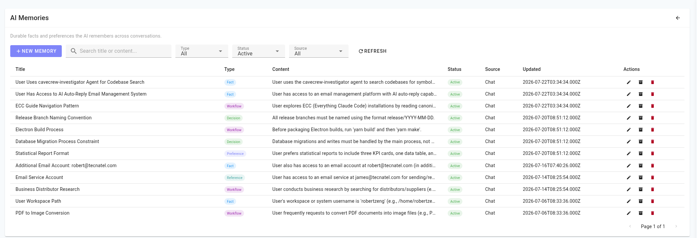

<h1 align="center">aiFetchly</h1>

<p align="center">
  <strong>Desktop AI Agent for Business Automation</strong>
</p>

<p align="center">
  English &middot;
  <a href="./README.zh.md">简体中文</a> &middot;
  <a href="./README.es.md">Español</a> &middot;
  <a href="./README.fr.md">Français</a> &middot;
  <a href="./README.de.md">Deutsch</a> &middot;
  <a href="./README.ja.md">日本語</a>
</p>

<p align="center">
  <a href="#what-is-aifetchly">What is aiFetchly?</a> &middot;
  <a href="#screenshots">Screenshots</a> &middot;
  <a href="#agent-capabilities">Agent Capabilities</a> &middot;
  <a href="#managed-browser-automation">Managed Browser</a> &middot;
  <a href="#getting-started">Getting Started</a> &middot;
  <a href="#development">Development</a> &middot;
  <a href="#documentation">Documentation</a> &middot;
  <a href="#contributing">Contributing</a>
</p>

<p align="center">
  
</p>

---

**aiFetchly** is an open-source desktop AI agent platform for business work. It combines local knowledge, browser automation, installable skills, scheduled tasks, plugins, and specialist subagents so teams can automate research, document processing, website information collection, customer communication, and recurring operations from one application.

aiFetchly started with marketing automation features such as lead discovery, contact extraction, and email outreach. Those workflows are still included, but the product direction is broader: aiFetchly is becoming a local-first AI agent workspace for business users who need tools, memory, files, web automation, and controllable execution.

## What is aiFetchly?

aiFetchly helps you turn business intent into executable workflows:

- **Ask an AI agent to do work** — run research, analyze files, extract data, prepare messages, summarize documents, and operate tools from a chat interface.
- **Use your business knowledge** — upload documents into a local knowledge library and generate answers or drafts grounded in your own files.
- **Automate browser and data tasks** — get information from websites, collect structured data, process URLs, and export results.
- **Let the agent drive a real browser** — start a visible Chrome window the AI can observe and control, watch every step, approve consequential actions, and take over yourself for logins or verification challenges. See [Managed Browser Automation](#managed-browser-automation).
- **Delegate to specialist subagents** — run background agents with their own prompts, tool permissions, resource limits, and structured outputs.
- **Extend the workspace** — install skills and plugins to add new tools, business workflows, and integrations.
- **Stay in control** — keep data in a local SQLite database, review tool activity, gate permissions, and run on your own desktop.

## Screenshots

### AI Agent Workspace


### Knowledge Library


### Skills and Plugin Management


### AI Provider Settings


### AI Memory Management



## Agent Capabilities

### AI Agent Workspace

| Capability | Description |
|------------|-------------|
| **Tool-Using AI Chat** | Work with an AI assistant that can call approved tools, use business context, and complete multi-step tasks from one desktop workspace. |
| **AI Memory Management** | Manage durable AI memory in a dedicated UI: user memory (facts and preferences the AI remembers across conversations) and workspace memory (project-scoped knowledge). Create, edit, archive, or delete memories, filter by type/status/source, search, and run memory consolidation from chat and agent activity. |
| **Custom AI Providers** | Power AI Chat with your own OpenAI-compatible provider, including Ollama, LM Studio, OpenAI, OpenRouter, vLLM, LocalAI, or a custom endpoint. |
| **Business Task Execution** | Run research, extraction, file processing, message drafting, scheduling, and automation workflows without switching across multiple SaaS tools. |
| **AI Customer Email Assistant** | Use AI to draft, send, and reply to customer emails with business context from your documents and workflow data. |
| **Application Support Subagents** | Deploy specialist AI subagents that run autonomously with their own system prompt, tool allowlist, resource limits, and structured output schema. Agent tasks persist with transcripts and tool-call audit trails. |
| **Permission-Gated Automation** | Control which tools, plugins, hooks, and subagents can run. Tool calls are policy-gated through global deny rules, agent allowlists, and per-task blocked tools. |

### Business Knowledge & RAG

| Capability | Description |
|------------|-------------|
| **Knowledge Library** | Upload PDF, TXT, DOC/DOCX, Markdown, HTML, CSV, and Excel files into a local knowledge base for retrieval-augmented generation. |
| **Document Processing** | Detect duplicate uploads, track processing progress, chunk documents, and store vector embeddings for semantic retrieval. |
| **Embedding Model Settings** | Select and update the embedding model used by the Knowledge Library, with model metadata such as dimensions and availability shown in the UI. |
| **Grounded Business Answers** | Generate summaries, plans, emails, reports, and operating guidance using your own documents as context. |

### Skills, Plugins & Extensibility

| Capability | Description |
|------------|-------------|
| **Installable Skills** | Extend the agent with reusable skill packages for file processing, data analysis, automation helpers, and domain-specific tasks. |
| **Skills Management** | Import skills from ZIP packages, list built-in/user-installed/plugin-provided skills, enable or disable them, and uninstall user-installed skills. |
| **Plugin Management** | Import plugin ZIPs or install plugins from source folders. Manage plugin enablement, health, format, included skills, and MCP servers from one screen. |
| **Claude-Style Plugin Compatibility** | Supports both aiFetchly plugin format and Claude-style plugin packages, so plugin bundles can contribute skills and MCP server definitions. |
| **Hooks Management** | Create command hooks for AI/chat lifecycle events such as session start, prompt submit, tool use, permission requests, and stop events. Hooks support matchers, conditions, timeouts, warn/block failure modes, global enablement, and audit logs. |

### Browser, Data & Workflow Automation

| Capability | Description |
|------------|-------------|
| **LLM-Controlled Managed Browser** | Hand a real, visible Chrome window to the AI agent: it can open a site, read the page, click, type, navigate, extract data, and pause for human handoff. Works for public websites without any saved account and reuses saved Tool Account logins when you want them. |
| **Web Research Automation** | Search across engines, collect business information, process URL lists, and recover from task errors in real time. |
| **Structured Data Extraction** | Extract emails, phone numbers, addresses, social profiles, company details, directory records, and other structured business data. |
| **Task Scheduling** | Schedule tasks with cron timing, chain dependent jobs, set up recurring workflows, and monitor execution history. |
| **One-Click Export** | Download datasets as CSV and generate reports from collected or processed business data. |
| **Proxy Management** | Manage rotating HTTP, HTTPS, and SOCKS5 proxies. Bulk import, validate, and test proxies for browser automation and website information collection workflows. |

### Included Business Growth Workflows

| Workflow | Description |
|----------|-------------|
| **Company & Lead Research** | Find businesses from search engines, Google Maps, Yandex Maps, Yellow Pages, and other directory-style sources. |
| **Contact Extraction** | Feed any list of URLs and extract emails, phone numbers, addresses, and social profiles with batch processing and live progress tracking. |
| **AI Email Drafting** | Generate personalized business emails using RAG technology and your own uploaded documents as context. |
| **Customer Email Sending & Replies** | Let AI help send customer emails and generate context-aware replies using your knowledge base, customer data, and previous workflow results. |
| **Social Platform Operations** | Manage social accounts and automate selected social media workflows where supported. |

### Desktop Infrastructure

| Capability | Description |
|------------|-------------|
| **Local-First Storage** | Store application data in local SQLite through TypeORM, with sqlite-vec support for vector operations. |
| **Multi-Language UI** | Use the interface in English, Chinese, Spanish, French, German, and Japanese. |
| **Electron Desktop App** | Run business automation from a desktop application across Windows, macOS, and Linux. |

## Getting Started

### Prerequisites

- **OS**: Windows 10+, macOS 10.15+, or Linux (Ubuntu 20.04+)
- **RAM**: 4 GB minimum, 8 GB recommended

### First-Time Setup

1. Open aiFetchly and sign in to your account.
2. Import business documents into the Knowledge Library if you want grounded AI responses.
3. Install or enable skills/plugins for the workflows you want the agent to run.
4. Configure a custom AI provider in System Settings -> AI Provider if you want AI Chat to use your own model instead of hosted aiFetchly AI.
5. Configure proxies, social accounts, or SMTP credentials only if you plan to use website information collection, social, or email workflows.
6. Install a supported Chrome/Chromium build and review **System Settings → Managed Browser** if you want the AI agent to drive a browser; public websites can be opened without any saved social account.

## Development

### Prerequisites

- **Node.js** 18+
- **Yarn** 1.x (classic)

```bash
# Install dependencies
yarn install

# Copy environment variables template
cp .env.example .env

# Initialize the local SQLite database
yarn init

# Start dev server with hot reload
yarn dev

# Type check in watch mode
yarn tsc

# Vue type checking
yarn vue-check

# Build for production
yarn build

# Package for current platform
yarn make

# Cross-platform builds
yarn make-win:prod     # Windows
yarn make-mac:prod     # macOS
yarn make-linux:prod   # Linux
```

### Testing

```bash
# Run all tests
yarn test

# Run main process tests
yarn testmain

# Run selected specialized tests
yarn vitest-googlescraper
yarn testhttpclient
yarn testyoutubeupload
yarn testdownload
```

### Project Structure

```text
src/
├── background.ts                  # Main Electron process entry point
├── preload.ts                     # Context bridge / preload scripts
├── buckEmail.ts                   # Email worker/task entry
├── taskCode.ts                    # Task execution entry
├── utilityCode.ts                 # Utility process entry
├── api/                           # Shared API clients and API tests
├── assets/                        # Images, installer assets, device assets, WebGL assets
├── childprocess/                  # Child/worker process entry points and worker-only code
│   ├── contact-extraction/        # Contact extraction worker implementation
│   ├── email-ai-enrichment/       # Email enrichment worker helpers
│   ├── embedding/                 # Local embedding worker implementation
│   ├── google-maps/               # Google Maps worker implementation
│   ├── managed-browser/           # LLM-controlled managed browser worker (Puppeteer + Chrome)
│   ├── managed-browser-cache/     # Managed-browser cache sizing, eviction, deletion worker
│   ├── yandex-maps/               # Yandex Maps worker implementation
│   └── utils/                     # Worker-only automation/recovery utilities
├── config/                        # App configuration and platform configuration
├── controller/                    # Business logic controllers
├── entity/                        # TypeORM entities
├── entityTypes/                   # Entity-related TypeScript types
├── main-process/                  # Electron main-process code
│   ├── communication/             # IPC handlers
│   └── menu/                      # Application menu setup
├── model/                         # Data access layer, extends BaseDb
├── modules/                       # Core business logic, extends BaseModule
│   ├── adapters/                  # Infrastructure adapters
│   ├── diagnostics/               # Diagnostics modules
│   ├── factories/                 # Factory helpers
│   ├── platforms/                 # Platform-specific integrations
│   └── rag/                       # RAG and vector-search modules
├── schemas/                       # Zod/typed schemas for tools, IPC, config, workers
├── scripts/                       # Project scripts
├── service/                       # Service layer and integrations
├── shims/                         # Runtime shims
├── sql/                           # SQL assets and scraper database files
├── types/                         # Shared TypeScript type declarations
├── utils/                         # Shared utilities
└── views/                         # Vue 3 frontend
    ├── api/                       # Frontend API layer, IPC calls
    ├── components/                # Reusable UI components
    ├── dashboard/                 # Dashboard views
    ├── lang/                      # i18n: en, zh, es, fr, de, ja
    ├── layout/                    # App layouts
    ├── pages/                     # Page components
    ├── plugins/                   # Frontend plugin setup
    ├── router/                    # Vue Router configuration
    ├── services/                  # Renderer-side services
    ├── store/                     # Pinia state management
    ├── styles/                    # Global styles
    └── utils/                     # Renderer utilities

test/
├── *Test.ts                       # Platform adapter and Yellow Pages test runners
├── modules/                       # Mocha module tests
├── mocks/                         # Shared test mocks and test doubles
├── rag/                           # RAG tests and integration tests
├── service/                       # Service tests
├── utils/                         # Utility tests
└── vitest/                        # Vitest suites for main, modules, taskCode, utilityCode
```

### Architecture

aiFetchly follows a three-layer architecture with strict separation of concerns:

```text
IPC Handler  ->  Module (business logic)  ->  Model (data access)
   communication only     extends BaseModule       extends BaseDb
```

- **Models** (`src/model/`) handle TypeORM database operations and direct SQL queries.
- **Modules** (`src/modules/`) handle business logic, validation, and coordination of multiple models.
- **IPC Handlers** (`src/main-process/`) handle communication only and never access the database directly.

Worker processes in `src/childprocess/` handle CPU-intensive tasks such as scraping and AI processing. They communicate results back to the main process through IPC and never access the database directly.

### Tech Stack

| Layer | Technology |
|-------|------------|
| Desktop | Electron |
| Frontend | Vue 3, Vuetify, Pinia, vue-i18n |
| Language | TypeScript |
| Build | Vite, Electron Forge |
| Database | SQLite, TypeORM, better-sqlite3, sqlite-vec |
| Automation | Puppeteer, headed Chrome/Chromium, LLM-controlled managed browser tools |
| AI | Hosted aiFetchly AI, OpenAI-compatible custom providers, RAG with vector embeddings, tool execution, subagents |
| Testing | Mocha, Vitest |

## AI Provider Configuration

AI Chat can use either hosted aiFetchly AI or a user-configured OpenAI-compatible provider. Open **System Settings -> AI Provider** to switch modes and save a local/custom provider.

Supported presets include Ollama, LM Studio, OpenAI, OpenRouter, vLLM, LocalAI, and Custom. Provider configuration requires a base URL and default model; API keys are optional for local providers and recommended for hosted third-party providers. aiFetchly normalizes provider URLs to the OpenAI `/v1` shape and calls `/models` plus `/chat/completions` from the Electron main process.

The settings screen can refresh available models, test chat and streaming support, and probe tool-call capability. If tool support is not confirmed for a custom provider, AI Chat falls back to plain chat without tool calls. Plaintext API keys are stored separately from the provider JSON and are never returned to the renderer.

## Managed Browser Automation

aiFetchly includes a built-in browser the AI agent can actually drive. The agent starts a normal, headed Chrome or Chromium window that you can see on your desktop, observes the page it is on, and performs the steps you asked for while the application shows session status, approvals, progress, and results.

It is meant for work you are authorized to do on sites and accounts you own or manage. It does not bypass MFA, login/security challenges, platform safety controls, or access restrictions.

### Starting a session

There are three ways to get into a managed browser:

- **AI Chat** — ask for something that needs a browser ("open YouTube and find comments from the last week"), and the agent loads the browser tools itself.
- **Tool Account → Open managed browser** — reuse a saved account's login session and connect to its platform.
- **Session card in the AI workspace** — see, control, or stop a browser that is already running.

**Public browsing needs no account.** Any website, including social networks and sites that require sign-in, can be opened without a saved Tool Account. The session uses a disposable profile and the normal network path; if the site needs a login, aiFetchly hands the same window to you instead of refusing to open it or falling back to a plain HTTP fetch. When the site is opened with a saved account, the stored encrypted cookie session is reused instead.

### What the agent can do in the browser

| Tool | Purpose |
|------|---------|
| `browser_start_session` | Start a managed session for a URL or saved Tool Account |
| `browser_get_status` | Read session state and the current sanitized URL |
| `browser_observe` | Get a bounded semantic snapshot of the page and its interactive elements |
| `browser_navigate` | Navigate to an approved `http(s)` URL |
| `browser_run_actions` | Run a bounded structured program (click, type, scroll, wait, extract, repeat) |
| `browser_screenshot` | Capture the visible page as a thumbnail for the conversation |
| `browser_request_handoff` | Pause and ask you to take control |
| `browser_resume_after_handoff` | Resume after you explicitly confirm |
| `browser_evaluate_script` | Run reviewed JavaScript inside the page context, with approval |
| `browser_clear_cache` | Clear the current account's managed cache after confirmation |
| `browser_stop_session` | Stop and close the browser |

`browser_observe` returns element references such as `@e1 [button] "Search"` with a page revision number. References are only valid for the revision that produced them, so stale references after a navigation or reload are rejected instead of clicking the wrong thing. DOM work that structured actions cannot express can be done with `browser_evaluate_script`, which runs inside the web page only — never as Node.js, Electron, shell, or filesystem code.

### Session states and controls

A running session reports a state (starting, checking browser, applying login session, verifying login, login required, ready, working, awaiting approval, verification challenge, you have control, stopping, stopped, failed) together with the account, platform, current origin, whether a proxy is active, and elapsed time.

While a session is active you can:

- **Pause AI** — stop the agent from sending further browser actions;
- **Take over** — type and click in the Chrome window yourself;
- **I've finished logging in / Continue task** — verify the login, save the refreshed session, and hand control back;
- **Extend time** — keep a handoff open longer;
- **Stop browser** — abort the current action, capture the refreshed session if it is safe, close Chrome and the worker, and release the account lease.

### Approvals and safety

| Risk | Examples | Behavior |
|------|----------|----------|
| Observe | Read text, inspect elements, screenshot | Session-level approval |
| Reversible interaction | Search, filter, paginate, draft text | Session-level approval |
| Sensitive input | Email, phone, private message, upload | Preview and explicit approval |
| Consequential | Send, publish, comment, follow, upload, delete, purchase, change settings | Just-in-time approval with account, target, and effect preview |
| Privileged script | Any page-context JavaScript | Script, origin, purpose, timeout, and expected output are shown before approval |
| Authentication | Password, MFA, passkey, security CAPTCHA | Always handed to you |

Additional guarantees:

- Page content is treated as untrusted data, so a webpage cannot talk the agent into skipping an approval.
- The model cannot mark its own action as safe, and an explicit denial stands.
- Bulk actions show a bounded count and representative preview first.
- If the target or page revision changes after approval, approval is invalidated.
- Cookies never reach the renderer, the model, tool results, logs, or analytics; only the main process decrypts them and only the browser worker applies them.
- A refreshed login session is captured and re-encrypted after successful handoff, so you do not need to re-export cookies for the next task.

### Settings and cache

**System Settings → Managed Browser** controls the feature:

| Setting | Default | Effect |
|---------|---------|--------|
| **Use built-in managed browser** | On | Allows new AI-controlled browser sessions |
| **Use managed browser cache** | On | Reuses account-isolated static resources between sessions |
| **Maximum managed-browser cache** | 500 MB | Bounds disk use (100–2048 MB) |
| **Clear cache when aiFetchly closes** | Off | Removes managed-browser resource caches at shutdown |

The panel also shows approximate cache size, the last successful clear, and **Clear selected account cache** / **Clear all managed-browser caches**. Clearing a cache never deletes encrypted cookies, saved logins, account records, or downloads; if a session is using the cache, you can stop it first or defer the clear until it closes. Session start is gated by the release flag, your setting, AI enablement, account/platform support, and a compatible Chrome install, and a missing Chrome is reported as a diagnosable dependency problem rather than silently disabling the feature.

### Where it is implemented

- `src/service/ManagedBrowserSupervisor.ts`, `ManagedBrowserLeaseService.ts`, `ManagedBrowserAiToolService.ts` — main-process orchestration, account leases, tool dispatch, approvals, and cache coordination.
- `src/modules/ManagedBrowserModule.ts`, `ManagedBrowserSettingsModule.ts`, `ManagedBrowserCacheModule.ts` — business logic and settings persistence.
- `src/childprocess/managed-browser/` — the disposable worker per session: runtime, navigation and fingerprint policy, observation, action execution, challenge detection, and cookie transfer.
- `src/childprocess/managed-browser-cache/` — off-thread cache sizing, eviction, and deletion.
- `src/views/components/aiChatV2/ManagedBrowserSessionCard.vue`, `ManagedBrowserHandoffDialog.vue`, and `src/views/components/settings/ManagedBrowserSettingsPanel.vue` — the UI.

The full product requirements, safety model, fingerprint policy, and rollout plan are in [`docs/prd/puppeteer-managed-social-browser-prd.md`](docs/prd/puppeteer-managed-social-browser-prd.md).

## Documentation

Full documentation is available at [docs.aifetchly.com](https://docs.aifetchly.com).

LLM-controlled managed browser (visible Chrome sessions, browser tools, approvals, handoff, fingerprint policy, cache): [product requirements](docs/prd/puppeteer-managed-social-browser-prd.md).

AI email forwarding, Trash, and organization proposal: [product requirements](docs/prd/ai-email-forward-trash-organization-prd.md) and [technical design](docs/prd/ai-email-forward-trash-organization-technical-design.md).

Workspace chat generator streaming proposal: [product requirements](docs/prd/ai-chat-workspace-generator-streaming-prd.md) and [technical design](docs/prd/ai-chat-workspace-generator-streaming-technical-design.md).

AI chat automatic titles and manual renaming proposal: [product requirements](docs/prd/ai-chat-automatic-titles-prd.md) and [technical design](docs/prd/ai-chat-automatic-titles-technical-design.md).

The official application website is [aifetchly.com](https://www.aifetchly.com).

## Support aiFetchly

If aiFetchly saves you time or helps your work, you can support continued development on Ko-fi.

<p>
  <a href="https://ko-fi.com/aifetchly">
    
  </a>
</p>

## Contributing

Contributions are welcome. Whether it is a bug fix, new feature, workflow improvement, skill, plugin, or translation update:

1. Fork the repository.
2. Create a feature branch: `git checkout -b feat/my-feature`.
3. Commit your changes following [conventional commits](https://www.conventionalcommits.org/).
4. Open a pull request.

Please read [CLAUDE.md](./CLAUDE.md) for architecture guidelines and coding conventions before contributing.

## License

This project is licensed under the [Apache License Version 2.0](./LICENSE).
