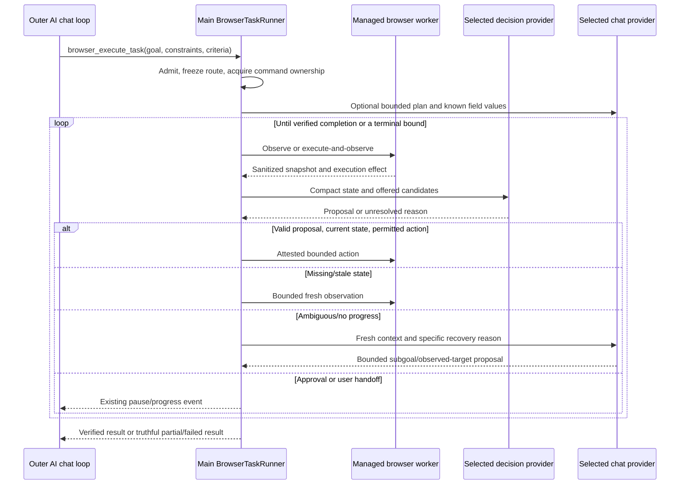

# Browser Decision Acceleration — Desktop Technical Design

## 1. Status and related contracts

Version 1.0, 2026-10-30. **Proposed implementation design**, inspected against `c01e6cd9c`. Names marked new below are planned modules, not existing code.

- Requirements: [Desktop PRD](browser-decision-acceleration-prd.md).
- Hosted inference: [Server PRD](../../../aifetchserver/doc/decision-model-routing-prd.md).
- Canonical hosted JSON and errors: [Server technical design, section 5](../../../aifetchserver/doc/decision-model-routing-technical-design.md#5-public-contract-v1).
- Existing foundations: [managed-browser design](puppeteer-managed-social-browser-technical-design.md), [custom-provider design](local-ai-provider-chat-technical-design.md).

The desktop owns the browser, action authority, provider selection, task state, and recovery. The AI server owns only hosted inference. Native and chat-based adapters share a semantic result without pretending that they have the same model behavior.

## 2. Verified implementation baseline

| Existing path | Current role | Change needed |
| --- | --- | --- |
| `src/config/skillsRegistry.ts` | Browser tool registration and timeout/async declarations | Register bounded `browser_execute_task` |
| `src/service/AIChatQueryLoop.ts` | Provider rounds, tool execution, permission pause/resume, cancellation | Treat runner as one outer tool, preserving progress and one final result |
| `src/service/ManagedBrowserAiToolService.ts` | Hosted AI gate, schemas, risk/approval, action attestation | Provider-aware availability plus shared authorized execution seam |
| `src/modules/ManagedBrowserModule.ts` | Main process session/worker coordination and last observation | Cache post-action observations/revisions; serialize runner ownership |
| `src/childprocess/managed-browser/WorkerSession.ts` | Browser commands; currently action result has null observation | Challenge-aware execute-and-observe result |
| `BrowserObservationService.ts` in that worker directory | Bounded DOM summaries, stamps, handles, redaction | Coverage, operation capabilities, options, and compact snapshots |
| `PageReferenceRegistry.ts` / `BrowserActionExecutor.ts` | Local handles, revisions, live target checks | Stronger freshness/context/occlusion checks; no unknown-effect continuation |
| `src/service/aiProvider/AIProviderResolver.ts` | Hosted/custom chat selection | Resolve a frozen browser task route bundle |
| `AIProviderSettingsService.ts` / `AIProviderSecretService.ts` | Versioned config and main-only secrets | Add optional decision model/native profiles without duplicating keys |
| `OpenAICompatibleProviderClient.ts` / `OpenAIRequestPayload.ts` | Direct custom chat transport | Reuse bounded nonstream requests; extend verified structured-output capabilities |
| `src/service/AIChatLightweightCompletionService.ts` | Provider-aware small/background completions | Reuse policy for planner/helper/recovery where appropriate; never override provider boundary |
| `src/service/ToolJobRegistry.ts` | Async job progress/cancellation/lifecycle | One job per runner task; no per-step jobs |
| `src/service/ManagedBrowserLeaseService.ts` | Account/session lease, including handoff lifetime | Preserve; add a separate command ownership lease, not a replacement |

The existing observation uses up to 120 interactive controls, 12,000 text characters, and 64 KiB serialized bytes. It is semantic, not a screenshot/raw DOM dump. Current collection reads records, metadata, and handles separately; do not describe it as an already atomic one-call snapshot. Existing transcript budgeting and tool catalog filtering remain valuable for planning/recovery.

## 3. Architecture and process boundaries



All provider HTTP and secrets remain in Electron main process. The worker performs page collection, input, settling, and challenge detection only. It never reads Token, opens a database, or receives provider keys. IPC handlers validate/sanitize and call services/modules; database logic remains in Model/Module layers with `Token`/`USERSDBPATH` through base classes.

Keep worker entry points in `src/childprocess/`. Reuse the existing managed-browser worker entry; no additional child process is required. If implementation later adds an entry, register it in Forge/Vite and keep it within that directory.

## 4. Proposed desktop modules

```text
src/entityTypes/browserDecisionTypes.ts
src/schemas/aiTools/browserTask.ts
src/schemas/ipc/browserDecisionSettings.ts
src/schemas/api/browserDecision.ts
src/service/browserDecision/
  BrowserAiAvailabilityService.ts
  BrowserDecisionProviderResolver.ts
  BrowserDecisionService.ts
  BrowserDecisionCapabilitiesService.ts
  BrowserDecisionBudgetService.ts
  BrowserCandidateBuilder.ts
  BrowserDecisionValidator.ts
  BrowserTaskRunner.ts
  BrowserTaskBudget.ts
  BrowserTaskCommandLease.ts
  BrowserTaskRecoveryService.ts
  BrowserTaskVerificationService.ts
  BrowserFieldValueService.ts
  adapters/HostedDecisionClient.ts
  adapters/SystemOneDecisionClient.ts
  adapters/ChatCompletionDecisionClient.ts
src/entity/BrowserTask.ts
src/model/BrowserTask.model.ts
src/modules/BrowserTaskModule.ts
```

These are responsibility boundaries, not a requirement for one class per trivial helper. TypeScript must use explicit interfaces/unions and return types, with `unknown` at untrusted boundaries and strict Zod schemas; never `any`. Network, execution, and persistence errors are separate typed outcomes.

## 5. Provider routing, settings, and feature admission

### 5.1 Provider-aware gate

Today the browser tool service checks `isAiEnabled()`/`USER_AI_ENABLED` even though chat can use a custom provider independently. Implement an explicit browser-specific availability policy before request parsing or work:

```text
Read hosted entitlement and active provider configuration
  hosted -> require USER_AI_ENABLED
  local/custom -> require USER_LOCAL_AI_ENABLED and valid user provider
Then check browser release/settings, session/account, and tool permissions
```

This is the product-authorized browser exception to the blanket hosted-only rule. Update the corresponding implementation guidance when coding it. Do not globally weaken `AiFeatureGate`, set hosted entitlement true for custom users, or unlock keyword/email/embedding/rerank features. Audit effective-browser-settings and lower service gates so an old hosted-only check does not still reject a valid custom-browser route.

Resolve gates from stored configuration before parsing model-generated arguments. A denial is a structured false/unavailable outcome with a clear translated message, before provider requests or session allocation.

### 5.2 Task route bundle

Freeze at task admission:

```text
providerMode: hosted | local
providerConfigVersion
chatRoute: hosted account OR user endpoint/model/secret reference
decisionRoute: hosted decision API OR user-native profile OR user-chat route
plannerModel / decisionModel / helperModel / recoveryModel
fallbackPolicy and permitted endpoint identities
effective capabilities, template revision, task budgets
```

The default custom decision route is the user's existing chat endpoint and real model. An optional browser model override changes only the model at that endpoint. Advanced native mode selects an explicitly configured native profile, potentially at a different user-chosen endpoint. This explicit route bundle defines the allowed destinations; it does not authorize sending a chat key to the native endpoint or vice versa.

Provider configuration changes increment the existing config version, abort inference, and prevent late responses from acting. Resume requires a new route snapshot, fresh observation, and normal admission. Do not silently switch mid-request or release mutation ownership until old execution settles.

### 5.3 Additive settings

Extend the existing redacted provider configuration with a versioned browser decision settings object:

| Field | Rule |
| --- | --- |
| `version` | `1` |
| `enabled` | Feature flag plus user preference; false during initial rollout |
| `mode` | `follow_chat` by default, or explicitly selected `native_profile` |
| `chatDecisionModel` | Optional real model ID; defaults to configured chat model |
| `nativeProfileId` | Optional selected profile reference, required in native mode |
| `contextSizeOverride` | Optional positive limit for the selected decision model, not all models |
| `allowSameBoundaryFallback` | Whether native failure can use the selected user chat route; defaults false for explicit native mode |
| `requestTimeoutMs` | Clamped by route/task bounds |

Native profile records contain display name, base URL, protocol/family, exact model/checkpoint, effective budget profile, and `apiKeyConfigured`. Use separately named main-process secret references. Migrate the existing single chat key without changing its meaning; never overwrite it when saving a native profile. A key can be reused only when the user explicitly selects that credential for that endpoint; default to its matching stored profile. Treat discovered provider metadata as untrusted: bounds may lower application ceilings, but cannot increase hard limits or change endpoint/credential ownership.

Reuse existing URL validation and HTTP(S) restrictions, including valid local-loopback use. A model response cannot change endpoints or supply headers. Renderer reads return masked/configured state only. Saving a profile does not activate it or run paid probes implicitly.

### 5.4 Provider/model capabilities

Extend capability records with per-model `structuredJsonSchema`, `jsonObject`, `forcedToolDecision`, and `nativeDecision` statuses (`supported`, `unsupported`, `unknown`, or `failed` as appropriate). A basic successful HTTP/chat request is transport evidence, not proof of schema conformance or browser accuracy.

Cache by normalized endpoint identity, selected model, profile/config version, protocol, and probe/template revision. Invalidate on endpoint/model/key changes. Do not cache a provider-wide successful schema probe across all its models.

For hosted mode use `GET /api/ai/v1/decision-models` and its catalog revision/expiry. For custom mode, `/models` and rich metadata are optional. Accept configured context limits and explicit native profiles where discovery is absent. Do not require every third party to implement AiFetchly discovery. Native support is explicit/probed; never infer it from a model name containing “laya” or OpenAI-compatible chat support.

## 6. Tool API, persistence, and task state

### 6.1 Outer tool

Register proposed `browser_execute_task` with strict arguments:

| Field | Bound |
| --- | --- |
| `session_id` | Existing opaque managed-browser session ID; session must be admitted normally |
| `goal` | 1–2,000 characters |
| `constraints` | Up to 16 strings, each 256 characters |
| `completion_criteria` | Up to 8 typed criteria, not arbitrary executable expressions |
| Optional budget reductions | May lower defaults; never raise hard ceilings |

Typed criteria can express observed URL/path, control value/state, result presence, and required extracted fields. Resolve dynamic targets through observations, not model-generated selectors. The caller cannot inject provider config, cookies, a filesystem path, script, or approval grant.

Session start remains `browser_start_session`; users can browse publicly or explicitly reuse an eligible account under existing behavior. `browser_execute_task` is an async/background-class tool through `ToolJobRegistry`, with progress and one final result. Query-loop async polling must follow the existing completion mechanism rather than asking the LLM to poll after each step. Bind duplicate admission to conversation/tool-call/task identity.

Final result includes `task_id`, `session_id`, terminal status, completion evidence/verification source, partial extracted output or artifact references, active elapsed time, counts by call type, total attempts, model/route attribution, and cost certainty. Raw intermediate observations stay out of main chat history; store bounded artifacts only under existing tool-result policy when needed.

### 6.2 Durable metadata

Use a new `BrowserTask` entity/model/module if implementing the durable cursor described here; this design assigns that persistence to `BrowserTaskModule`/`BrowserTask.model.ts`, never IPC or worker code.

Proposed fields: task ID; conversation/tool-call/session IDs; phase; provider mode and configuration revision; route/profile IDs without secrets; cursor/version; action/decision/helper/recovery counters; accumulated active time; budget ceiling snapshot; last observation ID/revision; pending action digest; effect state; terminal reason; verified outcome metadata; timestamps. Add uniqueness for the task/tool-call binding and optimistic cursor updates.

Store field values and live DOM handles only in memory. Avoid duplicating raw goals/page text in the task table; the outer conversation/tool result already has its own retention rules. Persist a minimal action journal intent before mutation, followed by confirmed/no-effect/unknown outcome. A crash with an intent lacking confirmation is interrupted with unknown effect, not an invitation to replay. Persistence failure before intent admission prevents mutation; persistence failure after input never causes another input.

No automatic mutation resume after restart. Mark unfinished tasks interrupted, preserve accounting/partial evidence, and require fresh browser/session admission for an explicit continuation. Existing browser cleanup/account leases remain authoritative.

### 6.3 State machine

```mermaid
stateDiagram-v2
    [*] --> admitting
    admitting --> planning
    planning --> observing
    observing --> deciding
    deciding --> validating
    validating --> executing: usable and authorized
    validating --> observing: stale or missing state
    validating --> recovering: unresolved inference
    validating --> awaiting_approval: local policy
    validating --> handoff: credentials or challenge
    executing --> observing: known result
    executing --> reconciling: effect unknown
    reconciling --> verifying: outcome can be checked
    reconciling --> handoff: unresolved effect
    recovering --> observing: bounded revised subgoal
    awaiting_approval --> observing: approved; revalidate exact pending action
    handoff --> observing: user resumes; fresh state
    validating --> verifying: DONE proposal
    verifying --> completed: independent criteria pass
    verifying --> recovering: incomplete and budget remains
    completed --> [*]
```



From every nonterminal state, cancellation/deadline/budget failure can terminate as `cancelled`, `failed`, or `interrupted`. A browser handoff pauses active-task accounting but remains subject to existing handoff timeouts. Denied approval stops the proposed operation; it is not a recovery prompt to bypass consent.

Map detailed phases onto existing queued/running/fetching/finalizing UI events rather than inventing an unrelated job framework. Persist approval/handoff cursor so permission resume returns to the pending task rather than recreating its plan or replaying earlier mutations. Existing query-loop permission reexecution must look up that cursor using a stable task identity.

## 7. Execute-and-observe and snapshot identity

### 7.1 Worker response ordering

Change `WorkerSession.runActions` to:

1. Check session/command ownership and cancellation.
2. Execute a bounded program and preserve exact execution effect/results.
3. Detect challenge/security state after execution, before declaring the next observation ready.
4. Settle only for useful state under a bounded deadline.
5. Build a sanitized snapshot if permitted; otherwise return null with explicit observation failure/handoff metadata.
6. Send one coherent action result with the actual effect and optional next observation.

An observation failure after a click is not a failed/no-effect click. Return the known execution outcome plus `observation_unavailable`; the runner may read again, not click again. Unknown effects stop further mutation in the program.

`ManagedBrowserModule.runActions` must update cached observation and page revision before the runner can classify another action. A failed/older snapshot cannot replace a newer one. Challenge state takes precedence over a generic ready state. Test event ordering so a result does not race a later challenge notification into another input.

Existing worker messages already have an optional observation field. New snapshot/control fields require strict-schema and protocol-handshake updates in `src/schemas/worker/managedBrowser.ts` and relevant entity types. If the schema is incompatible, increment the managed-browser protocol version and reject mixed bundles. Desktop and worker are shipped together; do not silently accept a half-upgraded protocol.

### 7.2 Snapshot and candidate map

Create a new opaque `observation_id` for each collected snapshot, distinct from navigation/document revision. Maintain a main-process map:

```text
observation_id -> session/document epoch, page_revision, captured_at,
  candidate_id -> local element ref, allowed operations,
                  sanitized descriptor, local freshness evidence,
                  option_id -> actual observed native option value
```

Candidate IDs are request-scoped opaque labels. Provider output cannot become a selector, handle, coordinate, or script. Invalidate maps on session stop, navigation/document change, cancellation/rebinding, or replacement by a new active snapshot. Retain only the bounded maps necessary for current execution/pending approval; registry TTL and entry limits remain enforced.

Collect related element/metadata state in one page evaluation where practical, while preserving safe handle identity and bounded references. A second handle retrieval is allowed if identity is guarded; performance must not be achieved by positional pairing that shifts after DOM mutation. Exclude collector-owned metadata changes from any freshness mechanism to avoid self-invalidating every observation.

Use target/form/context evidence to reject relevant changes immediately before input. Do not invalidate every prediction because an unrelated ad or animation changed. At the same time, do not weaken document revisions, main-attested role/name checks, or stale-reference protection just to improve latency. Changed form state and label-adjacent context can matter even when the target name is unchanged.

Check detached/disabled/hidden/covered controls, current geometry, and hit testing before input. Reuse Puppeteer's trustworthy actionability where available and add explicit checks required by the candidate contract. Sensitive inputs must be excluded by actual observed input type, not a model's role label.

## 8. Candidate preparation and text handling

Derive operations from observed tag/input type/role/editability. The current summary's generic input role is not sufficient to infer all capabilities. Add bounded sanitized capability fields, `checked`, `selected`, `expanded`, and native option IDs/labels. Keep secret values excluded. Do not expose hidden credentials, storage, cookies, or arbitrary HTML.

Visibility must account for viewport, overlays, active dialogs, and useful offscreen continuation. The existing collector caps an initial selector set before filtering, so tests must cover relevant controls after many hidden/offscreen elements. Improve coverage rather than merely reducing the final list.

Candidate builder stages:

1. Remove nonexecutable/sensitive/unsupported controls and suppress irrelevant background controls when a dialog owns interaction.
2. Include focused fields, visible autocomplete options, active dialog controls, and explicit subgoal matches.
3. Rank remaining candidates using inexpensive local lexical/structural signals first. An optional reranker is a separate measured cost/latency choice, not a mandatory extra request every step.
4. Apply the selected profile's effective token/option budget. Initially evaluate shortlist sizes around 8–16 for small-budget Laya profiles, not a universal limit.
5. Preserve essential constraints and include an escalation operation. If coverage is inadequate, expand/reobserve/scroll within bounds rather than guessing among incomplete candidates.

Measure candidate recall on held-out tasks separately from choice accuracy. A correct target removed before inference cannot be recovered by a confident model. Do not compress all inputs to the smallest configured model if a permitted larger-context route would preserve relevant evidence.

The planner establishes values such as search query, dates, and filters once. `BrowserFieldValueService` resolves field-to-binding mappings from trusted plan state only when unambiguous. Otherwise call a small selected-provider helper with goal, chosen field, relevant context, and bounded recent actions. Validate a simple string object, maximum proposed 2,000 characters, nonempty when required, and field policy. Existing helpers must not silently route custom users to hosted `small`.

Never automate password, OTP, payment/security secrets, or CAPTCHA entry in this path. A cached helper value survives a stale read only if every helper input is identical and no input could have executed. Unknown execution effect invalidates automatic helper replay.

Use event/condition-driven settling for suggestions and result changes. Proposed ordinary settle window is up to 1,500 ms, hard 5,000 ms when explicitly appropriate; short stable pages return earlier. WAIT is a desktop-defined bounded observation delay, proposed 250 ms, configurable 50–1,000 ms with a total per-task wait budget. Do not wait for global network-idle on permanently active social pages or apply the reference's 200 ms autocomplete cap universally.

## 9. Decision clients and normalized results

### 9.1 Shared interface

Use an interface with explicit return types:

```typescript
export interface BrowserDecisionClient {
  getCapabilities(signal: AbortSignal): Promise<BrowserDecisionCapabilities>;
  decide(
    input: BrowserDecisionInput,
    signal: AbortSignal,
  ): Promise<BrowserDecisionResult>;
}
```

The referenced records are proposed domain types. `BrowserDecisionResult` is a discriminated union with the five semantic statuses in the server contract. A decided action is itself a union: target required for CLICK/FILL/SELECT, option required only for SELECT, no target for SCROLL/WAIT/DONE. Normalize ESCALATE to `llm_required`. Preserve request/task/step/observation/revision correlation.

Uncertainty metadata is optional and tagged by source. `native_distribution` can have evaluated operation/target confidence and calibration version. Chat-based output uses source `unavailable` and null confidence by default. Validation success is not a calibrated probability.

### 9.2 HostedDecisionClient

Use existing authenticated hosted HTTP infrastructure, not a new renderer fetch. Discover via `/api/ai/v1/decision-models`; submit canonical v1 envelopes to `/api/ai/v1/decisions`. The existing marketing/gateway/proxy must forward these routes and trusted identity. Verify that deployment dependency before launch.

`model: auto` permits policy-based initial selection; explicit public profiles are pinned unless fallback is explicitly allowed. Server final preflight is authoritative. Echoed correlation and model/version are validated before accepting a result. Capabilities are cacheable hints, not a reason to skip validation.

A missing new endpoint on an older server means hosted acceleration is unavailable. Existing hosted browser tools may remain available through their normal explicit compatibility path. Custom tasks must never use that as a reason to switch to hosted inference.

### 9.3 SystemOneDecisionClient

Directly call the selected user-native endpoint using its own key and typed questions. Jev/Laya model-family budgeting and response validation mirror the server adapter semantics. Reuse transport/budget fixtures across languages/repositories rather than assuming Python and TypeScript tokenization are identical.

No native protocol support is inferred from `/chat/completions`. A generic provider serving a classifier is eligible only if the required dynamic choices/distributions are exposed. A profile's configured endpoint/model/version/limits determine behavior, not the word “Laya” in its display name.

### 9.4 ChatCompletionDecisionClient

Use `OpenAICompatibleProviderClient` with a compact nonstreaming request, a real selected model, bounded output, shared cancellation, and the task's request deadline. Include the goal/subgoal, relevant state, offered operations/candidates, and only bounded recent action outcomes. Do not send the main transcript or all tool definitions.

Prefer verified output capabilities in this order:

1. Strict JSON Schema with operation/target/option enums where the provider supports it.
2. A forced decision tool with a constrained schema, if supported.
3. JSON-object mode or plain JSON instruction with strict local parsing/validation.

Extend `OpenAIChatCompletionRequest.response_format`, currently typed only for JSON-object/text, before supporting JSON Schema. Tool/JSON support must be tested per model. Do not send unknown provider extensions or reasoning controls universally; preserve provider-specific compatibility handling. Low reasoning/short output can be configured when supported, but not assumed.

Example logical output:

```json
{"operation":"FILL","target_id":"c1","option_id":null}
```

Field binding/text is resolved after selecting c1, avoiding an independent speculative binding question that could disagree with the chosen field. Reject unknown IDs, invalid keys, incompatible operations, excess output, and malformed JSON. Do not execute partial streamed JSON or scrape actions from arbitrary prose. A format compatibility retry consumes the same two-attempt ceiling and requires an explicit safe reason; do not create an open repair loop.

A chat model remains generative and might not reduce inference latency as much as native models. Report its tokens, latency, and route honestly. Its self-reported confidence must not be normalized into native calibration. All local execution/freshness/permission checks apply regardless of output format guarantees.

## 10. Token budgeting and wire compatibility

The canonical server request bounds are: schema v1; 256 KiB body; goal 2,000/subgoal 1,000 characters; at most 120 candidates; 50 options per candidate and 120 total; 6 recent actions; 16 constraints; deadline default 3,000 ms/hard 10,000 ms; at most 2 upstream attempts. The authoritative table and complete example are in server design section 5. Do not maintain divergent numeric copies without fixture checks.

For hosted requests, desktop can prune excessive bytes/state early, but server prepares and counts the real provider input. For direct native/chat requests, the desktop adapter prepares and budgets the actual payload. Discovery is optional for custom providers and never requires a per-step preflight round trip.

Budget dimensions differ:

- Jev: request-wide state plus all questions and state plus each question.
- Laya: effective sequence and separate option/head allocation under the serving runtime.
- Chat: system/user messages, candidates/schema/tool definitions, framing, and reserved output/context margin.

Use exact tokenization when verified for that model/template; otherwise conservative estimates with explicit method metadata. Native unknown limits require an explicitly qualified conservative profile. Do not interpret null as unlimited. Never treat character counts as exact multilingual token counts. Keep provider-reported usage separate from estimates; omitted usage/cost stays unknown.

For custom chat model listing, reuse optional normalized `context_size`/`context_window`/`context_length` fields and a per-model user override. If unavailable, use a documented conservative application envelope and bounded failure; do not claim discovery proved the real context size. On a context-limit error, reduce only disposable context with preserved critical state, or escalate/report no-fit. No silent loss of constraints.

Keep v1 fixtures in proposed `test/fixtures/browser-decisions/v1/`, matched to server `tests/fixtures/decisions/v1/`. Validate both accepted examples and invalid combinations, every semantic status/error, and version mismatch. Late responses and replayed responses carry identical observation IDs but are still invalid if the current desktop snapshot changed.

## 11. Decision usability, authorization, and recovery

### 11.1 Ordered usability gate

1. Confirm task/job still active, provider revision unchanged, deadline not expired, and response belongs to the outstanding request.
2. Validate envelope/schema, candidate/option membership, operation compatibility, and any applicable native uncertainty policy.
3. Resolve candidate to the local snapshot/ref and require matching current session/document/observation/revision.
4. Revalidate live target/actionability and context immediately before execution.
5. Classify risk from current resolved descriptors through `ManagedBrowserAiToolService`, preserving main-process attestation and exact program digest/revision approval.
6. Write execution intent, execute once, record outcome, then observe/verify progress.

Native confidence is not permission. Evaluate operation and selected-target reliability independently; do not multiply scores and claim joint calibration. Input-language/workload eligibility is checked before confidence. Custom chat outputs receive no invented reliability score.

### 11.2 Execution policy

Run through the existing authorized action service or factor out a common policy method used by both old tools and the runner. Never call `ManagedBrowserModule.runActions` directly from the runner in a way that bypasses risk, AI availability, approvals, expected descriptors, or cancellation.

Initially execute one model-selected leaf action per decision. Small deterministic batches are permitted only when every target/precondition is observed, independently revalidated, and authorized; never concatenate future actions across navigation. Propagate page revision and expected descriptors consistently to action nodes, including any permitted composite nodes.

Consequential publish/send/delete/upload/submit and privileged script policies remain as existing rules. Approval binds to exact program digest and revision, is single-use, and is not bypassed by chat full-access or model confidence. After approval, reobserve/revalidate; if the pending authorized action changed, request a new approval. An LLM cannot grant approval.

Unknown effect stops mutation. A timeout, detached node during input, worker crash, or cancellation after possible dispatch cannot be converted into a pre-execution stale retry. Reconcile observed state or hand off. Do not automatically retype or reclick an uncertain action.

### 11.3 Recovery decision table

| Trigger | Action | LLM? |
| --- | --- | --- |
| Stale before input; known no effect | Fresh observation and new decision | No |
| Missing candidates / partial useful state | Expand/scroll/read within budgets | No initially |
| Input does not fit | Permitted same-boundary model route or explicit no-fit | No initially |
| Approval or login/challenge | Existing pause/handoff | No |
| Uncertain operation/selected target | One allowed alternative, then bounded recovery | Yes if unresolved |
| Three equivalent failures/no progress | Specific recovery prompt or terminal failure | Bounded |
| Unknown mutation outcome | Reconcile fresh state; handoff if unresolved | Optional analysis, never automatic replay |
| DONE proposal | Independent predicate verification | Optional selected-provider verifier |

Recovery input includes goal, immutable constraints, current subgoal, fresh compact observation, candidate map labels, recent outcomes, and a stable reason. It may return a typed observed target/action, bounded revised subgoal, request for richer observation/screenshot, or need for user input. Any screenshot uses the existing privileged/sensitive-state policy and only the allowed selected provider. Native v1 decisions remain text-only.

The recovery service cannot recursively spawn an unconstrained agent or reset task limits. It uses the task's selected chat route. The stronger planner/recovery model may differ from a cheap decision model at that same configured endpoint. Model changes/destinations outside the frozen route bundle require explicit configuration/admission, not a hidden fallback. Hosted alternate-model inference is owned by the server's single logical decision attempt loop; the desktop must not add another model retry for the same unchanged input after that attempt budget is exhausted. Direct native/chat fallback shares one desktop-owned attempt counter. A new observation or revised subgoal is a new logical decision and still consumes the overall task budget.

### 11.4 Independent verification

A fresh snapshot/result check validates every completion criterion. Prefer deterministic observed URL/control/value/result predicates and explicit extracted-data requirements. Do not prove success using only the decision model's explanation, the executed action list, or a DONE choice.

If semantic verification requires an LLM, use a separately counted selected-provider verifier with fresh evidence and a strict verdict. Verification failure reenters bounded recovery only if budget remains. Report `partial`/`failed` rather than fabricate success. Preserve uncertainty when the intended effect cannot be observed independently.

## 12. Scheduling, budgets, cancellation, and accounting

Use a separate command-ownership lease for a session's task. Existing account/session leases continue across handoff. Manual/legacy AI commands cannot race the runner; reads can be admitted only where safe. Release command ownership after worker work settles, not merely after the UI labels a job cancelled.

Proposed defaults/hard ceilings are inherited from PRD section 8: active runtime 120/240 s; leaf steps 30/100; decision requests 45/120; recovery calls 2/3; field helpers 4/10; one initial planner and one optional verifier; equivalent failures 3. Hosted request timeout 3/10 s, custom 10/30 s, always clamped to remaining time. Each logical decision has at most 2 actual provider attempts across retry/fallback/format repair. Count all actual chat-decision calls as generative calls; only distinguish cheap/expensive by real model attribution, not wording.

Maintain active monotonic elapsed time separately from user wait. Handoff uses existing 10-minute default/60-minute maximum policy, independently of model budgets. Network queueing, inference, settling, serialization, and verification are included in appropriate total measurements. Do not stop the clock before a slow final page load and call it task completion.

One abort signal tree spans job, decision transport, helpers/recovery/verifier, pending waits, and worker execution. On Stop: abort requests, cancel active worker command, disallow new attempts, quarantine late results, finalize partial/unknown effect, and settle ownership. Shutdown/conversation teardown use the same path. A provider disconnect can still have incurred cost; do not record zero merely because the response was lost.

Hosted request transport replay uses the same request UUID and identical canonical body; changed state/subgoal gets a new request UUID and step ID. Server idempotency is scoped by authenticated identity with a 300-second proposed replay window. A replay never authorizes executing a mutation twice: maintain local decision-consumption and execution journal markers. Client-native/custom providers may have no idempotency guarantee; do not assume their APIs honor the hosted request ID.

Keep separate counters and nullable actual usage/cost for planning, native decisions, chat decisions, field helpers, recovery, and verification. Attribute each provider attempt/model. For hosted calls use server attempt data; for custom calls use returned usage and configured rates if known. Distinguish estimated/unknown cost from known zero. Never bill custom-provider calls as hosted inference. The reference's text-helper price alone must not appear as a full browser-task cost estimate.

## 13. UI, translation, and configuration integration

Extend `src/views/components/settings/AIProviderSettingsPanel.vue` and capability display as appropriate. Default to following the current chat provider; advanced native settings should be optional. Explain the model override, endpoint capability test, context override, and why an unavailable route cannot run. Do not surface technical protocol details during ordinary browsing.

Reuse `ManagedBrowserSessionCard.vue` and `ManagedBrowserHandoffDialog.vue` for progress/approval/handoff where possible. Show active, waiting, stopped, failed, verified, and partial states clearly. Configuration changes cancel/rebind visibly; an inactive profile does not silently take over. Use bounded task progress/evidence, not raw prompt/probability dumps.

All user-facing strings must use `t()` with English fallback and update `src/views/lang/{en,zh,es,fr,de,ja}.ts`. Component behavior and tests ship together. Suggested translation namespaces are `browserDecision.settings`, `browserDecision.progress`, and `browserDecision.errors`; exact keys are implementation detail.

## 14. Tests and evidence

| Surface | Required cases |
| --- | --- |
| Availability/resolver | Hosted entitlement; valid unsubscribed custom route; invalid/disabled config; unrelated hosted features remain blocked |
| Route ownership | Native explicit profile, same-endpoint model override, no key crossing, no custom-to-hosted fallback, provider change mid-call |
| Contract/adapters | Shared server fixtures; missing endpoint; native selected-head behavior; JSON/tool/schema outputs; no fabricated confidence |
| Budgets | Multilingual estimates, exact boundary, schema/tool overhead, Laya options, unknown metadata, no per-step discovery/preflight |
| Observation/worker | Post-action cache update; challenge ordering; observation failure after successful input; many hidden controls; options/autocomplete |
| Executor/policy | Detached/covered/changed controls; stale snapshot; approved digest changed; full-access still confirms; unknown effects never retry |
| Lifecycle | One task/session owner, async job completion, pause/resume cursor, Stop through all model calls, late response, worker crash/restart |
| Recovery/verification | Ambiguous target, bounded repair, no-progress, budget survives pause, false DONE, independent outcome evidence |
| Persistence | Model/Module path handling, no worker DB, execution-intent crash, no double-consumption, metadata-only retention |
| UI/i18n | Provider/decision model settings, capability states, errors, progress/Stop, approval/handoff, six-language key parity |

Extend existing tests in `test/vitest/main/managedBrowser/` and provider tests; add proposed `test/vitest/main/browserDecision/` service tests. UI tests belong in `test/vitest/main/components/` (including settings/session/handoff components). Critical fake-provider E2E belongs in `test/e2e/specs/` with `.test.ts` files, for example `browserDecisionTask.test.ts`.

Default tests run against local deterministic pages and mock HTTP providers, never paid APIs or real customer accounts. E2E must assert final page state and that only intended endpoints received traffic. Include hosted-native, custom-chat, explicit custom-native, cancellation, and approval paths.

Implementation verification: affected main-process tests via `yarn testmain`; UI changes require passing `yarn test:components`; critical flow changes require `yarn test:e2e`; use nonwatch typecheck (`yarn typecheck`/`yarn vue-check`) and safe build as appropriate. **Never run local `yarn package`, `yarn make`, or other Forge packaging.** Safe local build paths are `yarn build` and `yarn build:e2e`; packaged-delivery/process-tree evidence is an operator/CI gate and must be recorded as environment-blocked locally.

Documentation creation itself does not claim any implementation tests passed. Delivery commits for future code must include required tests/translations per repository rules.

## 15. Performance qualification and rollout

Instrument separate observation, preparation, provider queue/network/inference, execution, settling, helper, recovery, verification, and persistence durations. Count full task time and all attempts. Use correlation IDs in protected logs, not unbounded metric dimensions; redact page/field/key content.

Compare baseline, action-observation optimization, Jev hybrid, hosted-Laya hybrid, and custom-chat hybrid. Include 50–100 held-out task templates/families with repeated trials, multilingual tasks, large/ambiguous candidate sets, and independent completion checks. Report candidate recall, success/failure counts, fallback, calibrated coverage, p50/p95, tokens, unknown-cost fraction, and cost per verified successful task including failed attempts. Show cold/warm/navigation/verification boundaries explicitly.

Proposed median latency and expensive-call reduction targets are 50% and 70% for eligible multi-step tasks, without material success regression. Do not promise these across every provider or task. Chat-based decisions can save context without delivering native inference speed.

Roll out baseline instrumentation/post-action observations first, then a mock runner, then hosted and custom-chat parity, then native profiles and qualified Laya routes. Use global/per-engine/per-workload kill switches; active disabling cancels safely. Keep previous browser tools available through normal policy, never as an automatic mutation replay. Requalify model/template/tokenizer/budget/calibration changes; versioned user config remains backward compatible.

## 16. Requirement traceability and implementation sequence

| Requirements | Main design sections | Implementation unit |
| --- | --- | --- |
| D-FR-01–04 | 5 | Provider availability, settings/secrets, route ownership |
| D-FR-05–10 | 6, 12 | Runner/tool/job/cursor lifecycle and persistence |
| D-FR-11–15 | 7–8 | Worker execute-and-observe and candidate coverage |
| D-FR-16–21 | 8–10 | Adapters, budgets, field values, contract validation |
| D-FR-22–24 | 11–12 | Recovery, execution policy, verification and counters |
| D-AC-01–11 | 13–15 | UI/i18n, E2E, compatibility and qualification |

Recommended commit-sized units: contract fixtures/types; availability/settings; post-action observations; candidate/identity checks; runner/cursor; hosted adapter; custom-chat adapter; native adapter; field/recovery/verifier; UI with translations/tests; qualification/operations. Commit each completed logical unit automatically; do not commit broken or partially compiling implementation.

## 17. Source evidence and limits

Reviewed 2026-10-30: [TypeSafe limits/models](https://docs.typesafe.ai/models), [fan-out](https://docs.typesafe.ai/patterns/fan-out), [confidence](https://docs.typesafe.ai/confidence), [Laya model card](https://huggingface.co/convaiinnovations/laya), and [reference browser measurements](https://github.com/browser-use/jev-ultrafast/blob/main/docs/performance.md).

The reference code has a MIT license; preserve required attribution if implementation copies/adapts it. It uses hosted Jev and optional generated field text. Its snapshot/runtime ideas are inspiration, not evidence that a drop-in model replacement meets AiFetchly requirements. It does not establish support for frames/shadow roots/canvas/uploads/multi-tab interactions, broad browser reliability, or end-to-end production savings. Laya's published domain-fine-tuned results and GPU forward-pass timing are not browser/API guarantees. Self-hosting has compute/operations costs; external hosting has its own effective limits and rates.
