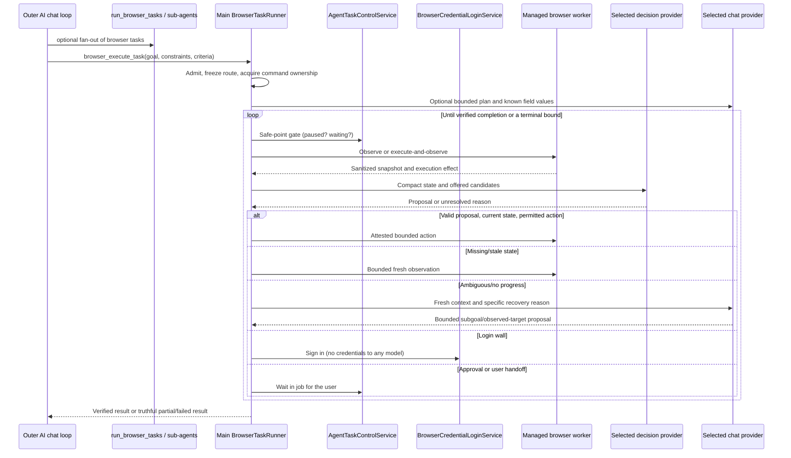

# Browser Decision Acceleration and Browser-Use Expansion — Desktop Technical Design

## 1. Status and related contracts

Version 1.1, 2026-11-01 (1.0, 2026-10-30). **Proposed implementation design**, inspected against `c01e6cd9c` and re-verified at `2b898c2ef` with no drift in referenced files. Names marked new below are planned modules, not existing code.

- Requirements: [Desktop PRD](browser-decision-acceleration-prd.md). Requirement IDs: `D-` decision runner, `A-` sign-in/credentials, `S-` site registry, `P-` proxy, `M-` multi-agent, `C-` user control.
- Hosted inference: [Server PRD](../../../aifetchserver/doc/decision-model-routing-prd.md).
- Canonical hosted JSON and errors: [Server technical design, section 5](../../../aifetchserver/doc/decision-model-routing-technical-design.md#5-public-contract-v1).
- Existing foundations: [managed-browser design](puppeteer-managed-social-browser-technical-design.md), [custom-provider design](local-ai-provider-chat-technical-design.md).

The desktop owns the browser, action authority, provider selection, credentials, task state, and recovery. The AI server owns only hosted inference. Native and chat-based adapters share a semantic result without pretending that they have the same model behavior.

## 2. Verified implementation baseline

| Existing path | Current role | Change needed |
| --- | --- | --- |
| `src/config/skillsRegistry.ts` | Browser tool registration and timeout/async declarations; `browser_run_actions` has `requiresConfirmation: true` and runs async at 8+ actions; `list_social_accounts` returns `user`; `proxy_*` tools hide passwords | Register `browser_execute_task`, `browser_sign_in`, `browser_site_upsert`, `browser_set_proxy`, `run_browser_tasks`; extend `browser_start_session` and `proxy_list` |
| `src/service/AIChatQueryLoop.ts` | Provider rounds, sequential tool execution (`for (const call of parsedCalls)`), permission pause/resume, steering (`before_model`/`before_tool`), cancellation, `pollAsyncJobToCompletion` capped by `ASYNC_POLL_MAX_MS = 30 min` | Treat runner and batch as one outer tool each; poll must not time out while a job waits for the user |
| `src/service/ManagedBrowserAiToolService.ts` | Hosted AI gate (`isAiEnabled()`) for every browser tool, schemas, risk/approval (`computeProgramDigest`, `consumeApprovalForProgram`, `notifyApprovalRequired`), `ensureSession` (existence only), `requireHandoff`, account-free fallback on `account_not_found`/`platform_not_in_pilot` | Provider-aware gate for all tools; semantic approval fingerprint; owner check in `ensureSession`; shared authorized execution seam |
| `src/modules/ManagedBrowserModule.ts` | Session/worker coordination; `observe` updates `lastObservation`/`pageRevision`, `runActions` does not; `requestHandoff`, `verifyManualLogin`, `resumeAfterHandoff`, `extendHandoff`, handoff timers (`enterHandoffWindow`, `scheduleHandoffExpiry`); `cancelActiveRequest`; `resolveAccountProxy`; `listEligibleAccounts`; `handleRefreshedCookies`; `guard()` via `assertCommandAllowed` | Cache post-action observations/revisions; owner metadata; pause reason; proxy switch; sign-in hooks |
| `src/childprocess/managed-browser/WorkerSession.ts` | Browser commands; `ACTION_RESULT` has `observation: null` and is sent before `detectAndReportChallenge()`; proxy via `--proxy-server` and CDP auth | Challenge-aware execute-and-observe; `FILL_LOGIN_FORM`; pause-between-actions |
| `BrowserActionExecutor.ts` | Executes programs; catch-all returns `effectUnknown: false`; nothing sets `effectUnknown: true`; fill/clear on sensitive inputs forces handoff; click `{ timeout: 5_000 }` | Classify post-dispatch failures as unknown; stop on unknown; yield point between actions |
| `BrowserObservationService.ts` / `ResultSanitizer.ts` | Bounded DOM summaries, stamps, handles, redaction; pre-filter to `maxInteractiveElements * 2` then pairs handles by index; text values in `valueSummary`, `summarizeInputValue` masks only password-type/secret-looking values | Coverage, operation capabilities, options; `[credential]` masking for sign-in-filled fields; identity-safe handle pairing |
| `PageReferenceRegistry.ts` | Random `e_` refs, 200 entries, 60 s TTL, oldest-first eviction, revision reset only on navigation | Per-observation scoping; pending-work-aware expiry |
| `BrowserActionRiskClassifier` | Credential URLs/fields → handoff; consequential actions → `approval_required` | Unchanged for LLM input; sign-in path is separate |
| `src/service/ManagedBrowserLeaseService.ts` | `acquire(accountId, { sessionId, ownerConversationId })` → `already_active`, `account_in_use`, `global_limit_reached`; lease spans handoff | Key account-free leases by session; owner includes agent task; configurable limit; per-site cap |
| `src/config/managedBrowser.ts` | `MANAGED_BROWSER_GLOBAL_SESSION_LIMIT = 1`, `MANAGED_BROWSER_PILOT_PLATFORM_IDS = [2]`, observation budgets, registry limits, action limits (25 per program, 100 total, 240 s wall, 3 failures), handoff 10/60 min | Setting-backed limits; remove pilot gating |
| `src/service/aiProvider/AIProviderResolver.ts` | Hosted/custom chat selection | Resolve a frozen browser task route bundle |
| `AIProviderSettingsService.ts` / `AIProviderSecretService.ts` | Versioned config and main-only secrets | Add optional decision model/native profiles without duplicating keys |
| `OpenAICompatibleProviderClient.ts` / `OpenAIRequestPayload.ts` | Direct custom chat transport | Reuse bounded nonstream requests |
| `src/api/aiChatApi.ts` | `OpenAIChatCompletionRequest.response_format?: { type: "json_object" \| "text" }` | Add JSON Schema variant (1.0 cited the wrong file) |
| `src/service/AIChatLightweightCompletionService.ts` | Provider-aware small/background completions | Reuse policy for planner/helper/recovery where appropriate; never override provider boundary |
| `src/service/ToolJobRegistry.ts` | Async job progress/cancellation/lifecycle; statuses `queued`, `running`, `completed`, `failed`, `cancelled` | One job per runner task/batch; add `waiting_for_user` sub-state |
| `src/service/AgentRuntime.ts` / `agentTools/runSubagentTool.ts` / `AgentToolPolicyService.ts` / `AgentDefinitionRegistry.ts` | In-process agents under `agent-v2-<uuid>`; wall-clock `setTimeout(maxRuntimeMs)`; permission prompt → `agentPermissionDenied`; `paused_for_permission` fails the task; `run_subagent` async with `context.signal`; allowlists without browser tools | `agent-browser-operator`; active-time deadline; control gate; parent-conversation routing |
| `src/service/BrowserChatNoticePublisher.ts` | Notices deduped by `${conversationId}/${sessionId}/${type}/${transitionNonce}` | Route child notices to the parent with a task label |
| `src/service/BuiltInToolCapabilitiesPromptSection.ts` | Browser tool-routing guidance toward `browser_observe`/`browser_run_actions` | Add routing for new tools |
| `src/entity/SocialAccount.entity.ts` / `socialAccountModule` | `social_type_id`, `user`, `pass` (encrypted with `FieldCipher` by the module; list/get return it decrypted), `status`, `name`, `phone`, `email`, many-to-many `proxy`; no site/domain column | Site link, credential-read method, failure columns, AI-use opt-in |
| `src/config/generate.ts` `SocialPlatformList`, `src/modules/PlatformSessionManifest.ts`, `src/modules/social_platform.ts` (`/api/socialplatform/list`) | Hardcoded platforms (manifest IDs 1, 2, 3, 4, 5, 14) and remote list | Seed `BrowserSite` |
| `src/model/Proxy.model.ts` / `src/entity/Proxy.entity.ts` | host, port, user, `pass` (plain text), protocol, `country_code` | Encrypt `pass`; expose browser usability |
| `SKILL_INSTALL_SUBMIT_SECRET` / `SkillInstallCard.vue` | Secure renderer-to-main secret pattern | Model for the credential card |
| UI: `ManagedBrowserSessionCard.vue`, `ManagedBrowserHandoffDialog.vue` (Verify, Extend, Cancel), `AiChatV2QuestionCard.vue`, `AIProviderSettingsPanel.vue` | Session, handoff, question, settings UI | Extend |

The existing observation uses up to 120 interactive controls, 12,000 text characters, and 64 KiB serialized bytes. It is semantic, not a screenshot/raw DOM dump. Current collection reads records, metadata, and handles separately; do not describe it as an already atomic one-call snapshot. Existing transcript budgeting and tool catalog filtering remain valuable for planning/recovery.

The existing action schema (`src/schemas/worker/managedBrowser.ts`) already includes `navigate`, `click`, `fill`, `select`, `press_key`, `scroll`, `wait_for`, `extract`, `hover`, and `go_back`, so widening the decision operation set (§8.1) is mainly a contract change, not new executor capability.

### 2.1 Corrections to version 1.0

| 1.0 statement | Correction |
| --- | --- |
| `yarn vue-check` is a nonwatch typecheck (§14) | It is `vue-tsc --noEmit --watch` and never exits; use `npx vue-tsc --noEmit` or add a one-shot script |
| `response_format` lives in the provider payload files (§9.4) | It is typed in `src/api/aiChatApi.ts` |
| Unknown execution effects exist and drive reconciliation | They do not exist yet; §7.3 adds them |
| Pause with exact program digest, then reobserve and request a new approval if changed | Digests include random refs, so every reobservation would loop; §11.2 binds approval to a semantic fingerprint and waits in-job |
| Registry TTL/limits remain enforced unchanged | 200 entries/60 s cannot cover runner reobservation and long waits; §7.2 scopes per observation |
| Rollback returns tasks to existing browser tools | Those tools are hosted-gated; §5.1 ships the provider-aware gate first for all tools |
| Uniform runtime budgets | 10 s custom requests × 30 steps exceed 240 s; §12 makes budgets route-specific |
| `BrowserTaskBudget.ts` and `BrowserDecisionBudgetService.ts` | Renamed `BrowserTaskLimits.ts` (task limits) and `DecisionInputBudget.ts` (token budgets) to avoid overlap |

## 3. Architecture and process boundaries



All provider HTTP, secrets, credential decryption, and persistence remain in the Electron main process. The worker performs page collection, input, settling, challenge detection, and deterministic login-form filling only. It never reads Token, opens a database, or receives provider keys; it receives a password only inside a single `FILL_LOGIN_FORM` request and wipes it after use. IPC handlers validate/sanitize with Zod (`registerValidatedHandler`/`registerAiValidatedHandler`) and call services/modules; database logic remains in Model/Module layers with `Token`/`USERSDBPATH` through base classes.

Keep worker entry points in `src/childprocess/`. Reuse the existing managed-browser worker entry; no additional child process is required. Sub-agent loops stay in the main process: they spend almost all their time waiting on network I/O, and every browser already runs in its own worker and Chrome. If implementation later adds an entry, register it in Forge/Vite and keep it within that directory. Every new `utilityProcess.fork`/spawn site must use `buildPackagedWorkerEnv`.

## 4. Proposed desktop modules

```text
src/entityTypes/browserDecisionTypes.ts
src/entityTypes/browserSiteTypes.ts
src/entityTypes/browserControlTypes.ts
src/schemas/aiTools/browserTask.ts
src/schemas/aiTools/browserSignIn.ts
src/schemas/aiTools/browserSite.ts
src/schemas/aiTools/browserProxy.ts
src/schemas/aiTools/browserBatch.ts
src/schemas/ipc/browserDecisionSettings.ts
src/schemas/ipc/browserCredential.ts
src/schemas/ipc/browserTaskControl.ts
src/schemas/api/browserDecision.ts
src/service/browserDecision/
  BrowserAiAvailabilityService.ts
  BrowserDecisionProviderResolver.ts
  BrowserDecisionService.ts
  BrowserDecisionCapabilitiesService.ts
  DecisionInputBudget.ts
  BrowserCandidateBuilder.ts
  BrowserDecisionValidator.ts
  BrowserTaskRunner.ts
  BrowserTaskLimits.ts
  BrowserTaskCommandLease.ts
  BrowserTaskRecoveryService.ts
  BrowserTaskVerificationService.ts
  BrowserFieldValueService.ts
  BrowserApprovalFingerprint.ts
  adapters/HostedDecisionClient.ts
  adapters/SystemOneDecisionClient.ts
  adapters/ChatCompletionDecisionClient.ts
src/service/browserLogin/
  BrowserCredentialLoginService.ts
  BrowserLoginOutcomeDetector.ts
src/service/browserProxy/BrowserProxySelectionService.ts
src/service/browserAgents/
  RunBrowserTasksService.ts
  AgentTaskControlService.ts
  HandoffCoordinator.ts
  BrowserNoticeRouter.ts
src/service/agentTools/runBrowserTasksTool.ts
src/childprocess/managed-browser/LoginFormFiller.ts
src/childprocess/managed-browser/adapters/GenericSignInAdapter.ts
src/entity/BrowserTask.ts
src/entity/BrowserSite.ts
src/model/BrowserTask.model.ts
src/model/BrowserSite.model.ts
src/modules/BrowserTaskModule.ts
src/modules/BrowserSiteModule.ts
src/views/components/aiChatV2/BrowserCredentialCard.vue
src/views/components/aiChatV2/BrowserAccountPickerCard.vue
src/views/components/aiChatV2/BrowserSiteConfirmCard.vue
src/views/components/aiChatV2/BrowserTaskBatchCard.vue
```

These are responsibility boundaries, not a requirement for one class per trivial helper. Register new entities in `src/config/dbEntities.ts`. TypeScript must use explicit interfaces/unions and return types, with `unknown` at untrusted boundaries and strict Zod schemas; never `any`. Network, execution, and persistence errors are separate typed outcomes.

## 5. Provider routing, settings, and feature admission

### 5.1 Provider-aware gate

Today the browser tool service checks `isAiEnabled()`/`USER_AI_ENABLED` for every browser tool even though chat can use a custom provider independently. Implement an explicit browser-specific availability policy before request parsing or work:

```text
Read hosted entitlement and active provider configuration
  hosted -> require USER_AI_ENABLED
  local/custom -> require USER_LOCAL_AI_ENABLED and valid user provider
Then check browser release/settings, session/account, and tool permissions
```

This is the product-authorized browser exception to the blanket hosted-only rule. Update the corresponding implementation guidance (CLAUDE.md, constitution, electron rules) when coding it. Do not globally weaken `AiFeatureGate`, set hosted entitlement true for custom users, or unlock keyword/email/embedding/rerank features. Audit effective-browser-settings and lower service gates so an old hosted-only check does not still reject a valid custom-browser route.

**Ship this gate first (phase 0) and apply it to every existing and new browser tool**, independent of the acceleration feature switch. Otherwise disabling acceleration would leave unsubscribed custom-provider users with no browser access.

Resolve gates from stored configuration before parsing model-generated arguments. A denial is a structured false/unavailable outcome with a clear translated message, before provider requests or session allocation.

### 5.2 Task route bundle

Freeze at task admission:

```text
providerMode: hosted | local
providerConfigVersion
chatRoute: hosted account OR user endpoint/model/secret reference
decisionRoute: hosted decision API OR user-native profile OR user-chat route
plannerModel / decisionModel / helperModel / recoveryModel / subAgentModel
fallbackPolicy and permitted endpoint identities
effective capabilities, template revision, task budgets
```

The default custom decision route is the user's existing chat endpoint and real model. An optional browser model override changes only the model at that endpoint. Advanced native mode selects an explicitly configured native profile, potentially at a different user-chosen endpoint. This explicit route bundle defines the allowed destinations; it does not authorize sending a chat key to the native endpoint or vice versa. The optional sub-agent model follows the same rule: a real model at the same provider endpoint.

Provider configuration changes increment the existing config version, abort inference, and prevent late responses from acting. Resume requires a new route snapshot, fresh observation, and normal admission. Do not silently switch mid-request or release mutation ownership until old execution settles.

### 5.3 Additive settings

Extend the existing redacted provider configuration with a versioned browser decision settings object:

| Field | Rule |
| --- | --- |
| `version` | `1` |
| `enabled` | Feature flag plus user preference; false during initial rollout |
| `mode` | `follow_chat` by default, or explicitly selected `native_profile` |
| `chatDecisionModel` | Optional real model ID; defaults to configured chat model |
| `nativeProfileId` | Optional selected profile reference, required in native mode |
| `contextSizeOverride` | Optional positive limit for the selected decision model, not all models |
| `allowSameBoundaryFallback` | Whether native failure can use the selected user chat route; defaults false for explicit native mode |
| `requestTimeoutMs` | Clamped by route/task bounds |
| `subAgentModel` | Optional real model ID for browser sub-agents at the same endpoint |

Browser-use settings (managed-browser settings object, versioned, validated with Zod at load):

| Field | Rule |
| --- | --- |
| `maxConcurrentSessions` | Default 3, hard maximum 5, further reduced by the free-memory check |
| `maxSessionsPerSite` | Default 2 |
| `signInEnabled` | Feature switch for `browser_sign_in` |
| `siteUpsertEnabled` | Feature switch for `browser_site_upsert` |
| `proxySwitchEnabled` | Feature switch for `browser_set_proxy` |
| `parallelAgentsEnabled` | Feature switch for `run_browser_tasks` |
| `pauseCapMs` | Default 60 minutes |

Native profile records contain display name, base URL, protocol/family, exact model/checkpoint, effective budget profile, and `apiKeyConfigured`. Use separately named main-process secret references. Migrate the existing single chat key without changing its meaning; never overwrite it when saving a native profile. A key can be reused only when the user explicitly selects that credential for that endpoint; default to its matching stored profile. Treat discovered provider metadata as untrusted: bounds may lower application ceilings, but cannot increase hard limits or change endpoint/credential ownership.

Reuse existing URL validation and HTTP(S) restrictions, including valid local-loopback use. A model response cannot change endpoints or supply headers. Renderer reads return masked/configured state only. Saving a profile does not activate it or run paid probes implicitly.

### 5.4 Provider/model capabilities

Extend capability records with per-model `structuredJsonSchema`, `jsonObject`, `forcedToolDecision`, and `nativeDecision` statuses (`supported`, `unsupported`, `unknown`, or `failed` as appropriate). A basic successful HTTP/chat request is transport evidence, not proof of schema conformance or browser accuracy.

Cache by normalized endpoint identity, selected model, profile/config version, protocol, and probe/template revision. Invalidate on endpoint/model/key changes. Do not cache a provider-wide successful schema probe across all its models.

For hosted mode use `GET /api/ai/v1/decision-models` and its catalog revision/expiry. For custom mode, `/models` and rich metadata are optional. Accept configured context limits and explicit native profiles where discovery is absent. Do not require every third party to implement AiFetchly discovery. Native support is explicit/probed; never infer it from a model name containing “laya” or OpenAI-compatible chat support.

## 6. Tool API, persistence, and task state

### 6.1 Outer tool

Register proposed `browser_execute_task` with strict arguments:

| Field | Bound |
| --- | --- |
| `session_id` | Existing opaque managed-browser session ID owned by the caller; session must be admitted normally |
| `goal` | 1–2,000 characters |
| `constraints` | Up to 16 strings, each 256 characters |
| `completion_criteria` | Up to 8 typed criteria, not arbitrary executable expressions |
| Optional budget reductions | May lower defaults; never raise hard ceilings |

Typed criteria can express observed URL/path, control value/state, result presence, and required extracted fields. Resolve dynamic targets through observations, not model-generated selectors. The caller cannot inject provider config, cookies, a filesystem path, script, credential, or approval grant.

Session start remains `browser_start_session`; users can browse publicly or explicitly reuse an eligible account under existing behavior. `browser_execute_task` is an async/background-class tool through `ToolJobRegistry`, with progress and one final result. The query loop uses the existing **blocking auto-await** completion path (`pollAsyncJobToCompletion`), not LLM polling after each step. Bind duplicate admission to conversation/tool-call/task identity.

Confirmation layers: the generic `requiresConfirmation` prompt applies once per `browser_execute_task` call (the task as a whole). Consequential-action approvals inside the task are separate, per action, and use §11.2. Neither replaces the other.

Final result includes `task_id`, `session_id`, terminal status, completion evidence/verification source, partial extracted output or artifact references, a **compact final observation** (URL, title, key visible controls/state, bounded text) for follow-up turns, active elapsed time, user wait time, `user_interventions`, counts by call type, total attempts, model/route attribution, and cost certainty. Raw intermediate observations stay out of main chat history; store bounded artifacts only under existing tool-result policy when needed.

Update `BuiltInToolCapabilitiesPromptSection.ts`:

- multi-step goals on one page/site → `browser_execute_task`;
- login wall → `browser_sign_in` (not `browser_request_handoff`);
- unreachable/geo-blocked site → `proxy_list` then `browser_set_proxy`;
- unknown site that needs an account → `browser_site_upsert`;
- several independent browser goals → `run_browser_tasks`;
- single inspection or one-off action → existing `browser_observe`/`browser_run_actions`.

### 6.2 Durable metadata

Use a new `BrowserTask` entity/model/module for the durable cursor; this design assigns that persistence to `BrowserTaskModule`/`BrowserTask.model.ts`, never IPC or worker code.

Proposed fields: task ID; conversation/tool-call/session IDs; root conversation ID and agent task ID (for sub-agent tasks); batch ID and task index; phase; control state; provider mode and configuration revision; route/profile IDs without secrets; cursor/version; action/decision/helper/recovery counters; accumulated active time; accumulated user wait time; budget ceiling snapshot; last observation ID/revision; pending action fingerprint; effect state; terminal reason; verified outcome metadata; intervention summary; timestamps. Add uniqueness for the task/tool-call binding, `@Index()` on FK columns (`*_id`) and `phase`/control state, and optimistic cursor updates.

Store field values, credentials, and live DOM handles only in memory. Avoid duplicating raw goals/page text in the task table; the outer conversation/tool result already has its own retention rules. Persist a minimal action journal intent before mutation, followed by confirmed/no-effect/unknown outcome. A crash with an intent lacking confirmation is interrupted with unknown effect, not an invitation to replay. Persistence failure before intent admission prevents mutation; persistence failure after input never causes another input.

No automatic mutation resume after restart. Mark unfinished, paused, and waiting tasks `interrupted`, preserve accounting/partial evidence, and require fresh browser/session admission for an explicit continuation. Existing browser cleanup/account leases remain authoritative.

### 6.3 State machine

```mermaid
stateDiagram-v2
    [*] --> admitting
    admitting --> planning
    planning --> observing
    planning --> failed: planning failure
    observing --> deciding
    observing --> handoff: challenge detected
    deciding --> validating
    validating --> executing: usable and authorized
    validating --> observing: stale or missing state
    validating --> recovering: unresolved inference
    validating --> awaiting_approval: local policy
    validating --> signing_in: login wall
    validating --> handoff: credentials or challenge
    validating --> verifying: DONE proposal
    executing --> observing: known result
    executing --> reconciling: effect unknown
    executing --> handoff: worker HANDOFF_REQUIRED
    reconciling --> observing: effect confirmed or ruled out
    reconciling --> verifying: outcome can be checked
    reconciling --> handoff: unresolved effect
    recovering --> observing: bounded revised subgoal
    recovering --> awaiting_user_input: needs user input
    awaiting_user_input --> observing: user answered
    awaiting_approval --> observing: approved; revalidate fingerprint
    awaiting_approval --> failed: denied
    signing_in --> observing: signed in
    signing_in --> handoff: sign-in failed or challenge
    handoff --> observing: user resumes; fresh state
    handoff --> interrupted: handoff expired
    verifying --> completed: independent criteria pass
    verifying --> recovering: incomplete and budget remains
    completed --> [*]
```



From every nonterminal state, cancellation/deadline/budget failure can terminate as `cancelled`, `failed`, or `interrupted`; user Pause/Take control moves any nonterminal state to `paused` at the next safe point and resume returns to `observing` (§18). `awaiting_approval`, `awaiting_user_input`, `signing_in` (waiting for the credential card), `handoff`, and `paused` all stop active-time accounting and are subject to their own wait limits. Denied approval stops the proposed operation; it is not a recovery prompt to bypass consent.

Map detailed phases onto existing queued/running/fetching/finalizing UI events plus the new `waiting_for_user` sub-state rather than inventing an unrelated job framework. Persist the approval/handoff cursor so the in-job wait resumes the pending step rather than recreating its plan or replaying earlier mutations.

## 7. Execute-and-observe, snapshot identity, and effects

### 7.1 Worker response ordering

Change `WorkerSession.runActions` to:

1. Check session/command ownership, pause gate, and cancellation.
2. Execute a bounded program and preserve exact execution effect/results, yielding between actions to the pause/cancel check.
3. Detect challenge/security state after execution, before declaring the next observation ready.
4. Settle only for useful state under a bounded deadline.
5. Build a sanitized snapshot if permitted; otherwise return null with explicit observation failure/handoff metadata.
6. Send one coherent action result with the actual effect and optional next observation.

An observation failure after a click is not a failed/no-effect click. Return the known execution outcome plus `observation_unavailable`; the runner may read again, not click again. Unknown effects stop further mutation in the program.

`ManagedBrowserModule.runActions` must update cached observation and page revision before the runner can classify another action. A failed/older snapshot cannot replace a newer one. Challenge state takes precedence over a generic ready state. Test event ordering so a result does not race a later challenge notification into another input.

Existing worker messages already have an optional observation field. New snapshot/control fields, `FILL_LOGIN_FORM`, `PAUSE_REQUEST`, and proxy relaunch require strict-schema and protocol-handshake updates in `src/schemas/worker/managedBrowser.ts` and relevant entity types. Increment `MANAGED_BROWSER_PROTOCOL_VERSION` and reject mixed bundles. Desktop and worker are shipped together; do not silently accept a half-upgraded protocol.

### 7.2 Snapshot and candidate map

Create a new opaque `observation_id` for each collected snapshot, distinct from navigation/document revision. Maintain a main-process map:

```text
observation_id -> session/document epoch, page_revision, captured_at,
  candidate_id -> local element ref, allowed operations,
                  sanitized descriptor (role, name, context), local freshness evidence,
                  option_id -> actual observed native option value
```

Candidate IDs are request-scoped opaque labels. Provider output cannot become a selector, handle, coordinate, or script. Invalidate maps on session stop, navigation/document change, cancellation/rebinding, resume after user control, or replacement by a new active snapshot.

**Registry scoping.** The current `PageReferenceRegistry` (200 entries, 60 s TTL, oldest-first eviction) would evict a pending observation's refs when the runner reobserves at the same revision (up to 120 refs per observation), and 60 s is shorter than approval/handoff waits and close to slow custom decisions. Change it to:

- allocate refs per `observation_id` (an epoch), and evict whole observations, never part of one;
- pin observations referenced by a pending decision, approval, or handoff cursor; their TTL runs from when the pending work ends;
- keep a bounded number of unpinned observations (proposed 2) plus pinned ones, with a hard total cap;
- keep the 60 s TTL for unpinned observations.

Collect related element/metadata state in one page evaluation where practical, while preserving safe handle identity and bounded references. The current collector pre-filters to `maxInteractiveElements * 2` and pairs handles by index; a second handle retrieval is allowed only if identity is guarded (stamp attribute check). Performance must not be achieved by positional pairing that shifts after DOM mutation. Exclude collector-owned metadata changes from any freshness mechanism to avoid self-invalidating every observation.

Use target/form/context evidence to reject relevant changes immediately before input. Do not invalidate every prediction because an unrelated ad or animation changed. At the same time, do not weaken document revisions, main-attested role/name checks, or stale-reference protection just to improve latency. Changed form state and label-adjacent context can matter even when the target name is unchanged.

Check detached/disabled/hidden/covered controls, current geometry, and hit testing before input. Reuse Puppeteer's trustworthy actionability where available and add explicit checks required by the candidate contract. Sensitive inputs must be excluded by actual observed input type, not a model's role label.

### 7.3 Unknown-effect classification

`BrowserActionExecutor` must distinguish dispatch phases per action:

| Failure point | Classification |
| --- | --- |
| Target resolution, stale ref, detached before input, disabled/covered check, validation | `effectUnknown: false` (known no effect) |
| Click/press timeout or exception after the input event was dispatched | `effectUnknown: true` |
| Typing failed after at least one character was sent | `effectUnknown: true` |
| Element detached during input | `effectUnknown: true` |
| Navigation started then failed | `effectUnknown: true` |
| Worker crash, cancellation, or pause after dispatch | `effectUnknown: true` |
| Read-only actions (`extract`, `wait_for`, scroll) | `effectUnknown: false` |

Track a per-action `dispatched` flag set immediately before the first input call. The catch-all must use it instead of always returning `false`. The program stops at the first unknown effect. Correct the `cancelActiveRequest` comment and make the behavior match it. The runner treats unknown as `reconciling` (§6.3), never as a retryable stale failure.

## 8. Candidate preparation and text handling

### 8.1 Operations

Widen the decision operation set to `CLICK`, `FILL`, `SELECT`, `PRESS_KEY` (Enter, Escape, Tab, arrow keys only), `NAVIGATE` (same-site URL from an observed link or the plan; cross-site needs the existing navigation policy), `GO_BACK`, `HOVER`, `SCROLL_UP`, `SCROLL_DOWN`, `WAIT`, `EXTRACT` (into a declared field schema from the task's completion criteria), `DONE`, and `ESCALATE`. All map to existing action-program types. The server contract's operation enum must be widened in the same contract version, with fixtures. If a hosted server is older, mark task families that need the missing operations (Enter-submitted search, URL pagination, hover menus, extraction) ineligible for acceleration and leave them on the existing tools.

### 8.2 Candidate builder

Derive operations from observed tag/input type/role/editability. The current summary's generic input role is not sufficient to infer all capabilities. Add bounded sanitized capability fields, `checked`, `selected`, `expanded`, and native option IDs/labels. Keep secret values excluded; fields filled by the sign-in service report `[credential]`. Do not expose hidden credentials, storage, cookies, or arbitrary HTML.

Visibility must account for viewport, overlays, active dialogs, and useful offscreen continuation. The existing collector caps an initial selector set before filtering, so tests must cover relevant controls after many hidden/offscreen elements. Improve coverage rather than merely reducing the final list.

Candidate builder stages:

1. Remove nonexecutable/sensitive/unsupported controls and suppress irrelevant background controls when a dialog owns interaction.
2. Include focused fields, visible autocomplete options, active dialog controls, and explicit subgoal matches.
3. Rank remaining candidates using inexpensive local lexical/structural signals first. An optional reranker is a separate measured cost/latency choice, not a mandatory extra request every step.
4. Apply the selected profile's effective token/option budget. Initially evaluate shortlist sizes around 8–16 for small-budget Laya profiles, not a universal limit.
5. Preserve essential constraints and include an escalation operation. If coverage is inadequate, expand/reobserve/scroll within bounds rather than guessing among incomplete candidates.

Measure candidate recall on held-out tasks separately from choice accuracy. A correct target removed before inference cannot be recovered by a confident model. Do not compress all inputs to the smallest configured model if a permitted larger-context route would preserve relevant evidence.

### 8.3 Field values and settling

The planner establishes values such as search query, dates, and filters once. `BrowserFieldValueService` resolves field-to-binding mappings from trusted plan state only when unambiguous. Otherwise call a small selected-provider helper with goal, chosen field, relevant context, and bounded recent actions. Validate a simple string object, maximum proposed 2,000 characters, nonempty when required, and field policy. Existing helpers must not silently route custom users to hosted `small`.

Never automate password, OTP, payment/security secrets, or CAPTCHA entry in this path. Login walls go to `BrowserCredentialLoginService` (§13) as a runner step. A cached helper value survives a stale read only if every helper input is identical and no input could have executed. Unknown execution effect invalidates automatic helper replay.

Use event/condition-driven settling for suggestions and result changes. Proposed ordinary settle window is up to 1,500 ms, hard 5,000 ms when explicitly appropriate; short stable pages return earlier. WAIT is a desktop-defined bounded observation delay, proposed 250 ms, configurable 50–1,000 ms with a total per-task wait budget. Do not wait for global network-idle on permanently active social pages or apply the reference's 200 ms autocomplete cap universally.

## 9. Decision clients and normalized results

### 9.1 Shared interface

Use an interface with explicit return types:

```typescript
export interface BrowserDecisionClient {
  getCapabilities(signal: AbortSignal): Promise<BrowserDecisionCapabilities>;
  decide(
    input: BrowserDecisionInput,
    signal: AbortSignal,
  ): Promise<BrowserDecisionResult>;
}
```

The referenced records are proposed domain types. `BrowserDecisionResult` is a discriminated union with the five semantic statuses in the server contract. A decided action is itself a union: target required for CLICK/FILL/SELECT/HOVER/EXTRACT, option required only for SELECT, key required for PRESS_KEY, URL or link candidate for NAVIGATE, no target for SCROLL/WAIT/GO_BACK/DONE. Normalize ESCALATE to `llm_required`. Preserve request/task/step/observation/revision correlation.

Uncertainty metadata is optional and tagged by source. `native_distribution` can have evaluated operation/target confidence and calibration version. Chat-based output uses source `unavailable` and null confidence by default. Validation success is not a calibrated probability.

### 9.2 HostedDecisionClient

Use existing authenticated hosted HTTP infrastructure, not a new renderer fetch. Discover via `/api/ai/v1/decision-models`; submit canonical v1 envelopes to `/api/ai/v1/decisions`. The existing marketing/gateway/proxy must forward these routes and trusted identity. Verify that deployment dependency before launch.

`model: auto` permits policy-based initial selection; explicit public profiles are pinned unless fallback is explicitly allowed. Server final preflight is authoritative. Echoed correlation and model/version are validated before accepting a result. Capabilities are cacheable hints, not a reason to skip validation.

A missing new endpoint on an older server means hosted acceleration is unavailable. Existing hosted browser tools may remain available through their normal explicit compatibility path. Custom tasks must never use that as a reason to switch to hosted inference.

### 9.3 SystemOneDecisionClient

Directly call the selected user-native endpoint using its own key and typed questions. Jev/Laya model-family budgeting and response validation mirror the server adapter semantics. Reuse transport/budget fixtures across languages/repositories rather than assuming Python and TypeScript tokenization are identical.

No native protocol support is inferred from `/chat/completions`. A generic provider serving a classifier is eligible only if the required dynamic choices/distributions are exposed. A profile's configured endpoint/model/version/limits determine behavior, not the word “Laya” in its display name.

### 9.4 ChatCompletionDecisionClient

Use `OpenAICompatibleProviderClient` with a compact nonstreaming request, a real selected model, bounded output, shared cancellation, and the task's request deadline. Include the goal/subgoal, relevant state, offered operations/candidates, and only bounded recent action outcomes. Do not send the main transcript or all tool definitions.

Prefer verified output capabilities in this order:

1. Strict JSON Schema with operation/target/option enums where the provider supports it.
2. A forced decision tool with a constrained schema, if supported.
3. JSON-object mode or plain JSON instruction with strict local parsing/validation.

Extend `OpenAIChatCompletionRequest.response_format` in `src/api/aiChatApi.ts`, currently typed only for `json_object`/`text`, with a JSON Schema variant before supporting it. Tool/JSON support must be tested per model. Do not send unknown provider extensions or reasoning controls universally; preserve provider-specific compatibility handling. Low reasoning/short output can be configured when supported, but not assumed.

Example logical output:

```json
{"operation":"FILL","target_id":"c1","option_id":null}
```

Field binding/text is resolved after selecting c1, avoiding an independent speculative binding question that could disagree with the chosen field. Reject unknown IDs, invalid keys, incompatible operations, excess output, and malformed JSON. Do not execute partial streamed JSON or scrape actions from arbitrary prose. A format compatibility retry consumes the same two-attempt ceiling and requires an explicit safe reason; do not create an open repair loop.

The chat prompt must state that `ESCALATE` is the correct answer when no offered candidate clearly fits, and the adapter must treat it as a normal outcome, not an error. Because chat output has no calibrated uncertainty, the runner adds a deterministic progress check every 5 steps on chat routes (§11.3).

A chat model remains generative and might not reduce inference latency as much as native models. Report its tokens, latency, and route honestly. Its self-reported confidence must not be normalized into native calibration. All local execution/freshness/permission checks apply regardless of output format guarantees.

## 10. Token budgeting and wire compatibility

The canonical server request bounds are: schema v1; 256 KiB body; goal 2,000/subgoal 1,000 characters; at most 120 candidates; 50 options per candidate and 120 total; 6 recent actions; 16 constraints; deadline default 3,000 ms/hard 10,000 ms; at most 2 upstream attempts. The authoritative table and complete example are in server design section 5. Do not maintain divergent numeric copies without fixture checks. The widened operation enum (§8.1) is a coordinated contract change.

For hosted requests, desktop can prune excessive bytes/state early, but server prepares and counts the real provider input. For direct native/chat requests, the desktop adapter (`DecisionInputBudget`) prepares and budgets the actual payload. Discovery is optional for custom providers and never requires a per-step preflight round trip.

Budget dimensions differ:

- Jev: request-wide state plus all questions and state plus each question.
- Laya: effective sequence and separate option/head allocation under the serving runtime.
- Chat: system/user messages, candidates/schema/tool definitions, framing, and reserved output/context margin.

Use exact tokenization when verified for that model/template; otherwise conservative estimates with explicit method metadata. Native unknown limits require an explicitly qualified conservative profile. Do not interpret null as unlimited. Never treat character counts as exact multilingual token counts. Keep provider-reported usage separate from estimates; omitted usage/cost stays unknown.

For custom chat model listing, reuse optional normalized `context_size`/`context_window`/`context_length` fields and a per-model user override. If unavailable, use a documented conservative application envelope and bounded failure; do not claim discovery proved the real context size. On a context-limit error, reduce only disposable context with preserved critical state, or escalate/report no-fit. No silent loss of constraints.

Keep v1 fixtures in proposed `test/fixtures/browser-decisions/v1/`, matched to server `tests/fixtures/decisions/v1/`. Validate both accepted examples and invalid combinations, every semantic status/error, and version mismatch. Late responses and replayed responses carry identical observation IDs but are still invalid if the current desktop snapshot changed.

## 11. Decision usability, authorization, and recovery

### 11.1 Ordered usability gate

1. Confirm task/job still active and not paused, provider revision unchanged, deadline not expired, and response belongs to the outstanding request.
2. Validate envelope/schema, candidate/option membership, operation compatibility, and any applicable native uncertainty policy.
3. Resolve candidate to the local snapshot/ref and require matching current session/document/observation/revision.
4. Revalidate live target/actionability and context immediately before execution.
5. Classify risk from current resolved descriptors through `ManagedBrowserAiToolService`, preserving main-process attestation and the approval fingerprint (§11.2).
6. Write execution intent, execute once, record outcome, then observe/verify progress.

Native confidence is not permission. Evaluate operation and selected-target reliability independently; do not multiply scores and claim joint calibration. Input-language/workload eligibility is checked before confidence. Custom chat outputs receive no invented reliability score.

### 11.2 Execution policy and approvals

Run through the existing authorized action service or factor out a common policy method used by both old tools and the runner. Never call `ManagedBrowserModule.runActions` directly from the runner in a way that bypasses risk, AI availability, approvals, expected descriptors, ownership, or cancellation.

Initially execute one model-selected leaf action per decision. Small deterministic batches are permitted only when every target/precondition is observed, independently revalidated, and authorized; never concatenate future actions across navigation. Propagate page revision and expected descriptors consistently to action nodes, including any permitted composite nodes.

Consequential publish/send/delete/upload/submit and privileged script policies remain as existing rules. **Approval binding (new `BrowserApprovalFingerprint`):**

```text
fingerprint = sha256(canonical JSON of [
  for each action: operation, target semantic descriptor (role, accessible name,
  form/label context, frame origin), value digest (never the value), key/option ID
], site registrable domain, observation_id, page_revision)
```

Today `computeProgramDigest` hashes the raw actions JSON including random `e_` refs, so every reobservation changes the digest and an approval-then-reobserve flow would request approval forever. With the semantic fingerprint:

- the runner (and old tools) compute the fingerprint from main-attested descriptors, not from refs;
- after approval, reobserve; if the same semantic action resolves to a live target with the same fingerprint inputs (observation/revision allowed to advance only through a pinned approval cursor), it executes once; if any semantic part changed, request a new approval;
- approvals stay single-use, bound to the session and owner, and are not bypassed by chat full-access or model confidence; an LLM cannot grant approval;
- the runner waits for the decision **inside its job** (`awaiting_approval`), pinning the observation so its refs survive (§7.2). Old tools keep reject-and-recall but use the fingerprint, which fixes their loop too.

Unknown effect stops mutation. A timeout, detached node during input, worker crash, cancellation, or pause after possible dispatch cannot be converted into a pre-execution stale retry. Reconcile observed state or hand off. Do not automatically retype or reclick an uncertain action.

### 11.3 Recovery decision table

| Trigger | Action | LLM? |
| --- | --- | --- |
| Stale before input; known no effect | Fresh observation and new decision | No |
| Missing candidates / partial useful state | Expand/scroll/read within budgets | No initially |
| Input does not fit | Permitted same-boundary model route or explicit no-fit | No initially |
| Approval | Wait in job; denied → stop that operation | No |
| Login wall | `BrowserCredentialLoginService` | No |
| Credential field/challenge | Handoff (§18) | No |
| Uncertain operation/selected target | One allowed alternative, then bounded recovery | Yes if unresolved |
| Chat route: ESCALATE, or no progress at a 5-step check | Bounded recovery | Yes |
| Three equivalent failures/no progress | Specific recovery prompt or terminal failure | Bounded |
| Unknown mutation outcome | Reconcile fresh state; handoff if unresolved | Optional analysis, never automatic replay |
| Recovery needs user input | `awaiting_user_input` card in the parent conversation, or end with `needs_user` | No |
| DONE proposal | Independent predicate verification | Optional selected-provider verifier |

Definitions used by the runner:

- **Equivalent failure:** same operation, same semantic target descriptor, same error class.
- **Progress:** URL change, a completion predicate becoming true, a target control's value/state change, or result-region content change (digest compared).

Recovery input includes goal, immutable constraints, current subgoal, fresh compact observation, candidate map labels, recent outcomes, and a stable reason. It may return a typed observed target/action, bounded revised subgoal, request for richer observation/screenshot, or need for user input. Any screenshot uses the existing privileged/sensitive-state policy and only the allowed selected provider. Native v1 decisions remain text-only.

The recovery service cannot recursively spawn an unconstrained agent or reset task limits. It uses the task's selected chat route. The stronger planner/recovery model may differ from a cheap decision model at that same configured endpoint. Model changes/destinations outside the frozen route bundle require explicit configuration/admission, not a hidden fallback. Hosted alternate-model inference is owned by the server's single logical decision attempt loop; the desktop must not add another model retry for the same unchanged input after that attempt budget is exhausted. Direct native/chat fallback shares one desktop-owned attempt counter. A new observation or revised subgoal is a new logical decision and still consumes the overall task budget.

### 11.4 Independent verification

A fresh snapshot/result check validates every completion criterion. Prefer deterministic observed URL/control/value/result predicates and explicit extracted-data requirements. Do not prove success using only the decision model's explanation, the executed action list, or a DONE choice.

If semantic verification requires an LLM, use a separately counted selected-provider verifier with fresh evidence and a strict verdict. Verification failure reenters bounded recovery only if budget remains. Report `partial`/`failed` rather than fabricate success. Preserve uncertainty when the intended effect cannot be observed independently.

## 12. Scheduling, budgets, cancellation, and accounting

Use a separate command-ownership lease for a session's task. Existing account/session leases continue across handoff and pause. Manual/legacy AI commands and other agents cannot race the runner; reads can be admitted only where safe. Release command ownership after worker work settles, not merely after the UI labels a job cancelled.

`BrowserTaskLimits` holds route-specific defaults/hard ceilings from PRD §8:

| Limit | Hosted route | Custom chat/native route |
| --- | --- | --- |
| Active runtime | 120 s / 240 s | 300 s / 600 s |
| Leaf steps | 30 / 100 | 30 / 100 |
| Decision requests | 45 / 120 | 45 / 120 |
| Request timeout | 3 s / 10 s | 10 s / 30 s |
| Per-leaf-step worker timeout | 15 s / 30 s | 15 s / 30 s |
| Recovery / helpers | 2/3, 4/10 | 2/3, 4/10 |
| Planner / verifier | 1 / 1 | 1 / 1 |
| Equivalent failures | 3 | 3 |

Each logical decision has at most 2 actual provider attempts across retry/fallback/format repair. Count all actual chat-decision calls as generative calls; only distinguish cheap/expensive by real model attribution, not wording. The runner sends single-leaf programs with the per-step worker timeout, not the 240 s `programWallTimeMs`.

Maintain active monotonic elapsed time separately from user wait. Handoff uses the existing 10-minute default/60-minute maximum policy; pause uses `pauseCapMs`; both are independent of model budgets. Network queueing, inference, settling, serialization, and verification are included in appropriate total measurements. Do not stop the clock before a slow final page load and call it task completion.

One abort signal tree spans batch, job, decision transport, helpers/recovery/verifier, sign-in, pending waits, and worker execution. On Stop: abort requests, cancel active worker command, disallow new attempts, quarantine late results, finalize partial/unknown effect, and settle ownership. Shutdown/conversation teardown use the same path. A provider disconnect can still have incurred cost; do not record zero merely because the response was lost.

Hosted request transport replay uses the same request UUID and identical canonical body; changed state/subgoal gets a new request UUID and step ID. Server idempotency is scoped by authenticated identity with a 300-second proposed replay window. A replay never authorizes executing a mutation twice: maintain local decision-consumption and execution journal markers. Client-native/custom providers may have no idempotency guarantee; do not assume their APIs honor the hosted request ID.

Keep separate counters and nullable actual usage/cost for planning, native decisions, chat decisions, field helpers, recovery, verification, and sub-agent turns. Attribute each provider attempt/model. For hosted calls use server attempt data; for custom calls use returned usage and configured rates if known. Distinguish estimated/unknown cost from known zero. Never bill custom-provider calls as hosted inference. The reference's text-helper price alone must not appear as a full browser-task cost estimate.

## 13. Saved-account sign-in and credentials

### 13.1 Tool

```text
browser_sign_in({
  session_id,                       // must be owned by the caller
  intent: "login" | "register",
  account_id?: number,              // LLM may choose among list_social_accounts results
  username_hint?: string            // pre-fills the credential card; max 256 chars
}) -> {
  status: "signed_in" | "awaiting_user_credentials" | "handoff_required" | "failed",
  account_id?: number, username?: string, site_id?: number,
  reason_code?: "wrong_password" | "challenge_2fa" | "challenge_captcha" | "passkey"
              | "cooldown" | "origin_mismatch" | "insecure_page" | "form_not_found"
              | "user_cancelled" | "registration_not_confirmed"
}
```

No password, field ref, selector, or URL parameter exists. Zod schema in `src/schemas/aiTools/browserSignIn.ts`; `rejectSecretShaped` (from `skillInstallationTypes.ts`) rejects password-shaped values in `username_hint`. The tool is async through `ToolJobRegistry` so it can wait for the credential card or handoff without blocking chat rendering. The username may appear in the result (PRD A-FR-04); the password never does.

### 13.2 `BrowserCredentialLoginService` (main process)

```text
1. Gate: provider-aware availability, signInEnabled, session ownership.
2. origin = worker-reported top-frame URL; require https:; site = BrowserSiteModule.matchByUrl(origin)
   using tldts registrable domain against site.allowed_domain_suffixes.
   No site -> offer browser_site_upsert flow (S-FR-03) or return origin_mismatch.
3. Cooldown check (per account+site). Fail -> cooldown.
4. Candidates = SocialAccountModule.findForSite(site.id) (AI-use opt-in respected, Q-01).
   0  -> credential card (13.3); wait in job.
   1  -> use it.
   >1 -> account_id if supplied and valid; else account-picker card; wait in job.
5. Cookie first: restore the account's encrypted cookie snapshot into the session profile
   (existing account-session path); reload; assess. Authenticated -> step 8.
6. credential = SocialAccountModule.getCredentialForLogin(accountId, currentRegistrableDomain)
   -> returns { username, password } only if the domain matches the account's site; else origin_mismatch.
7. Worker FILL_LOGIN_FORM (13.4); wipe local copy; await outcome (13.5).
8. Success -> handleRefreshedCookies(account), bind account to session, record success.
   Failure -> record last_login_failure_at/reason, HandoffCoordinator (§18) with reason.
```

Persistence goes through `SocialAccountModule`/model and `BrowserSiteModule`, never IPC handlers. The service never logs credential objects; its error types carry reason codes only.

### 13.3 Credential card and secure IPC

- New channel `MANAGED_BROWSER_SUBMIT_LOGIN_CREDENTIAL` in `src/config/channellist.ts`, exposed in `src/preload.ts`, renderer API in `src/views/api/`, handled by a validated handler. Payload: `{ requestId, username, password, save: boolean }`, Zod-validated with length bounds. The request ID is single-use and bound to the owner conversation, session, and site.
- The handler passes the values directly to `SocialAccountModule.save` (encrypted with `FieldCipher`) when `save` is true, or to a one-time in-memory store keyed by request ID (cleared after use or after 10 minutes) when false. Values never enter chat messages, tool results, transcripts, notices, or logs.
- `BrowserCredentialCard.vue` shows the site domain (from main), username (pre-filled from `username_hint` or the saved account), password, “Save for future use”, “I'll sign in myself” (opens `ManagedBrowserHandoffDialog`), and Cancel. If a saved account has a username but no password, only the password field is shown. For `register`, the wording is “Create account” and confirmation is required.
- `BrowserAccountPickerCard.vue` lists matching accounts by display name and username, with “Use another account”.

### 13.4 Worker `FILL_LOGIN_FORM`

```text
FILL_LOGIN_FORM {
  requestId, mode: "login" | "register",
  allowedDomainSuffixes: string[],
  recipe?: LoginRecipe,
  username?: string, password: string
}
```

`LoginFormFiller` (worker) applies §14's rules, supports two-step logins in a bounded loop (max 3 pages), submits through the password field's form, and returns `{ outcome, filledFieldStamps, reasonCode }` with no values. After use it overwrites its local references; the filled fields' stamps are recorded so `summarizeInputValue` reports `[credential]` for them in later observations. `ManagedBrowserWorkerClient`, electron-log, and crash reporting must redact `FILL_LOGIN_FORM` payloads (allowlist logging by message type, never the payload).

### 13.5 Outcome detection

`BrowserLoginOutcomeDetector`:

- **Success:** the platform adapter's `assessAuthentication` reports authenticated (YouTube), or `GenericSignInAdapter` sees no visible password input, the URL left the login path, and no error region appeared.
- **Wrong credential:** still on the login page, or visible error text near the form.
- **Challenge:** `ChallengeDetector` classifies 2FA/OTP/CAPTCHA/passkey/security challenge.
- **Unknown:** bounded settle (5 s) elapsed without a classification → handoff.

### 13.6 Data model changes

`social_accounts` (via migration):

| Column | Purpose |
| --- | --- |
| `site_id` (nullable, indexed) | Link to `BrowserSite`; backfilled from `social_type_id` (same IDs) |
| `ai_use_enabled` (boolean) | Per-account opt-in (Q-01) |
| `last_login_failure_at`, `last_login_failure_reason` | Cooldown and UI |
| `proxy_country_lock` (nullable) | Consistent proxy country (§16) |

`SocialAccountModule.getCredentialForLogin(accountId, registrableDomain)` is the only decrypting read used by sign-in; existing list/get methods are not changed in this feature but must not be used by it. `list_social_accounts` keeps returning `user` and adds `site_id`, `has_password`, `has_cookies`, `ai_use_enabled`.

### 13.7 Registration

`intent: "register"` requires `signInEnabled` and a separate registration switch, an explicit confirmation through the approval path, and the card's “Create account” wording. Verification steps (email/phone/CAPTCHA) hand off. A generated or user-entered password is stored through the same encrypted path. Never register with an existing account's data without the user confirming in the card.

## 14. Password-field safety

### 14.1 Layer A: hard rules evaluated in-page immediately before input

```typescript
// Any false → abort, clear filled fields, return reasonCode, main hands off.
el instanceof HTMLInputElement &&
el.type === "password" &&                    // never text/search/textarea/contenteditable
!el.disabled && !el.readOnly && isVisibleAndHitTestable(el) &&
frameRegistrableDomainAllowed(el, allowedDomainSuffixes) &&
location.protocol === "https:" &&
(mode === "login" ? visiblePasswordInputs(el.form ?? document) === 1 : true)
```

- `type === "password"` is the one signal page text cannot fake. A “show password” toggle that changes the type to `text` causes refusal.
- Cross-origin frames outside the allowed domains and HTTP pages never receive values.
- Username only into `email`, `text`, or `tel` inputs in the same form as the password input (or, in two-step logins, the sole visible username-like input on a page within the allowed domains).
- Submit with `el.form.requestSubmit()` or Enter in the password field; never click a control outside that form.
- In `register` mode, `autocomplete="new-password"` fields are expected and a confirm-password field is allowed.

### 14.2 Layer B: verify the input landed where intended

- Set the value with the native `HTMLInputElement.prototype` value setter and dispatch `input`/`change` events. No keystrokes means no focus-stealing popup can capture characters.
- Fall back to typing only if the page rejects the programmatic value (value empty after events, or framework validation fails), with `document.activeElement === el` checked before and after.
- Read back the length only: `el.value.length === expectedLength`.
- Snapshot all other inputs' value lengths before and after; any unexpected change clears all fields touched, stops, and hands off.
- One automated attempt per account and site per cooldown.

### 14.3 Layer C: detection order and recipes

1. Saved recipe on the site record.
2. Deterministic detection: exactly one visible password input and a username candidate in the same form; `autocomplete="username"`/`"current-password"`; `"new-password"` means registration.
3. Ambiguous → the main process asks the LLM to choose among offered refs (`username = e_12, password = e_15`). The LLM never sees the password, and Layer A still validates its choice.
4. After success, save `LoginRecipe { steps: [{ usernameField?, passwordField?, submitVia }], formAction, version }`, where fields are fingerprints (name, id, autocomplete, type). If it stops matching, fall back to step 2 and update the recipe after the next success.

The worst remaining failure is a username typed into a search box, which is low impact. A password can only go into a single visible, HTTPS, on-domain password input.

## 15. Site registry

### 15.1 `BrowserSite` entity

| Column | Notes |
| --- | --- |
| `id` | Seeded rows keep existing platform IDs; new rows from 100000 |
| `name`, `homepage_url` | Display |
| `registrable_domain` | Unique, indexed |
| `allowed_domain_suffixes`, `required_domain_suffixes` | JSON arrays; control credential/cookie release |
| `login_url`, `verification_url` | Optional |
| `login_recipe` | JSON (§14.3) |
| `browser_profile_import_enabled` | From the manifest |
| `source` | `builtin` / `ai` / `user` |
| `status` | `unverified` / `verified` (verified after a successful sign-in or user confirmation) |
| `created_in_conversation_id` | Audit |
| `created_at`, `updated_at` | Timestamps |

Model `BrowserSite.model.ts` (extends `BaseDb`), module `BrowserSiteModule.ts` (extends `BaseModule`). Seed migration reads `SocialPlatformList` and `PLATFORM_SESSION_MANIFEST` and maps `PlatformSessionDefinition` fields (`platformId`, `platformName`, `loginUrl`, `verificationUrl`, `allowedDomainSuffixes`, `requiredDomainSuffixes`, `browserProfileImportEnabled`). The remote `/api/socialplatform/list` IDs stay below 100000; the module rejects inserting a new row whose ID would collide and allocates from a sequence that starts at 100000.

### 15.2 `browser_site_upsert`

```text
browser_site_upsert({ name, url }) -> { site_id, registrable_domain, status, created: boolean,
                                         needs_confirmation?: { domains: string[] } }
```

- The main process parses the URL, requires HTTPS, derives the registrable domain with `tldts`, and rejects public suffixes, IP literals, and localhost (outside E2E).
- Dedupe by registrable domain; an existing site is returned unchanged.
- A new site's `allowed_domain_suffixes` is exactly its registrable domain.
- Extra domains (SSO such as `accounts.google.com`) can only be proposed by `BrowserCredentialLoginService` from domains the session actually visited during the login redirect, and are added only after the user confirms in `BrowserSiteConfirmCard.vue`. Changing domains on a site with saved credentials or cookies always needs confirmation.
- An LLM argument can never set `allowed_domain_suffixes` directly; this closes the prompt-injection path “add evil.com to site X”.

### 15.3 Switch-over

Replace the pilot gate (`MANAGED_BROWSER_PILOT_PLATFORM_IDS`) with: site has a verified recipe, a dedicated adapter, or the generic sign-in adapter is enabled. Move `socialaccountdetail.vue` platform selection, the `list_social_accounts` platform filter, `socialAccountModule` and the social account controller lookups, and `PlatformSessionManifest` callers to `BrowserSiteModule` (renderer through new IPC). Keep `SocialPlatformList` only as seed data. Add the site list page to the AI navigation manifest only if a safe parameter-free page is created.

## 16. Proxy support

### 16.1 Selection at start

`browser_start_session` gains `proxy?: { proxy_id: number } | { auto: true, country_code?: string } | "direct"`. `BrowserProxySelectionService`:

- account session without an explicit proxy → existing `resolveAccountProxy` (first usable HTTP(S) linked proxy);
- explicit `proxy_id` on an account session whose linked proxy differs, or a different country from `proxy_country_lock`, or `direct` → user confirmation card;
- `auto` → choose a browser-usable proxy (matching country if given) with a recent passing check;
- SOCKS stays rejected; credentials keep going through CDP auth, never on the command line.

### 16.2 Switching

`browser_set_proxy(session_id, proxy_id | "direct")`:

1. Owner and gate checks; per-task switch cap (3).
2. `proxy_check` basic mode on the target proxy; failure → structured reason, no switch.
3. Wait for in-flight actions to settle (command lease), persist cookies (`handleRefreshedCookies`).
4. Relaunch the worker with the new `--proxy-server` (protocol-versioned `RELAUNCH_WITH_PROXY` or stop/start under the same session ID and lease).
5. Reopen the last URL with a plain GET; return a fresh observation and new revision.
6. For an account session, link the new proxy to the account after successful use (consistent IP).

Account-free sessions may later use `browser.createBrowserContext({ proxyServer })` to avoid relaunch; such contexts do not persist cookies, so account sessions keep the relaunch path.

### 16.3 Errors and consistency

- Map Chromium errors to `proxy_connect_failed` (`ERR_PROXY_CONNECTION_FAILED`), `proxy_auth_failed` (HTTP 407), `tunnel_failed` (`ERR_TUNNEL_CONNECTION_FAILED`). Always fail closed; never fall back to direct.
- Set the fingerprint policy's `locale` and `timezoneId` from the proxy's `country_code`.
- Add a WebRTC policy so UDP cannot bypass the proxy (for example `--force-webrtc-ip-handling-policy=disable_non_proxied_udp`), verified against the bundled Chromium and the fingerprint self-test.
- Switching is for reachability and geo-blocks. Challenges still hand off; no automatic rotation to evade CAPTCHAs or bans.

### 16.4 Data changes

- Encrypt `proxy.pass` with `FieldCipher` in the proxy module/model, with a migration for existing rows; reads for browser launch decrypt in main only.
- `proxy_list` adds `country_code`, last check result/time, and `browser_usable` (HTTP/HTTPS). Passwords stay hidden.
- `ManagedBrowserSessionCard.vue` shows the proxy label/country and a direct-connection badge.

## 17. Parallel browser sub-agents

### 17.1 Agent definition

`AgentDefinitionRegistry` gains `agent-browser-operator`:

- allowlist: `browser_start_session`, `browser_get_status`, `browser_observe`, `browser_navigate`, `browser_run_actions`, `browser_request_handoff`, `browser_stop_session`, `browser_sign_in`, `browser_set_proxy`, `browser_execute_task` (when enabled), `check_tool_job_status`, `cancel_tool_job`;
- explicitly denied: `browser_evaluate_script`, `browser_clear_cache`, `browser_resume_after_handoff`, all non-browser write tools;
- limits: 40 tool calls, 10 minutes active time (§18.4);
- output schema (strict): `status`, `summary` (≤1,000 chars), `extracted` (bounded, else `ToolResultModule.grantAccess` reference), `final_url`, `evidence`, `needs_user`, `user_interventions`, `session_id` (only with `keep_open`);
- prompt contract: one task, one owned session, stop it at the end unless `keep_open`, never use another session ID, consequential actions are returned as proposals.

### 17.2 `run_browser_tasks`

```text
run_browser_tasks({
  tasks: [{ goal, start_url?, account_id?, proxy_id?, keep_open? }],   // 1..5
  concurrency: 1..3,
  executor?: "llm_agent" | "fast_runner"                               // default llm_agent
}) -> { batch_id, results: [{ task_index, status, summary, extracted, final_url,
                               evidence, needs_user, user_interventions, session_id? }] }
```

- Implemented in `RunBrowserTasksService`, modeled on `process_artifact_batch` bounded concurrency. One async job; per-task progress events; the parent waits once via the blocking auto-await path.
- `requiresConfirmation: true` once per batch; the card lists tasks and sites. The grant covers routine automation for that batch's agent task IDs and expires with the batch.
- Consequential actions: sub-agents return `needs_user: { type: "approval", proposed_action }` in v1. A later phase lets them wait in-job using §18's mechanism.
- Making the chat loop execute all async tool calls concurrently was rejected for v1 because it interacts with steering, permissions, and transcript ordering.

### 17.3 Sessions, leases, and ownership

- `ManagedBrowserLeaseService` keys account-free leases by session ID (`public:<sessionId>`); each gets a temporary profile directory removed on stop.
- Account leases stay one per account; a second task needing the same account waits in a per-account queue (task state `queued_for_account`), not `account_in_use`.
- Global limit from `maxConcurrentSessions`; before each start check `os.freemem()` against a per-session estimate (proposed 800 MB) and return `insufficient_memory` if short.
- Per-site cap `maxSessionsPerSite` by registrable domain.
- Session record gains `owner: { rootConversationId, agentTaskId | null }`. `ensureSession(sessionId, caller)` rejects non-owners with `session_not_owned`. The parent may call read-only tools on child sessions and may take ownership of a `keep_open` session after the child finishes.

### 17.4 Notice routing

`BrowserNoticeRouter` maps an agent task's notices to `rootConversationId` with `{ batchId, taskIndex, taskLabel }`. `BrowserChatNoticePublisher` dedupe keys become `${rootConversationId}/${sessionId}/${type}/${transitionNonce}` with the task label as payload. Credential cards, account pickers, site confirmations, approval prompts, and handoff dialogs all render in the parent conversation.

### 17.5 Failure isolation, rate limits, and cost

- One parent `AbortController` per batch with a child per task; Stop cancels all, stops sessions, releases leases. A task crash or worker exit marks only that task `failed`; the batch returns partial results. App quit and conversation deletion run the same cleanup.
- Per-provider concurrency limiter (proposed 3 in-flight requests per endpoint) with exponential backoff on 429; batch-level token/cost budget; loop detection (same action failing repeatedly).
- Extracted data is returned; the parent dedupes before any save. Sub-agents do not write shared tables.
- Optional `subAgentModel` (§5.3). Report total batch tokens/cost alongside parent-context size; parent context is smaller, total may not be.
- Background throttling: evaluate `--disable-backgrounding-occluded-windows` and `--disable-renderer-backgrounding` against the fingerprint self-test; offset/tile windows on launch.
- `executor: "fast_runner"` runs each task through `BrowserTaskRunner` without a per-step LLM, once qualified.

## 18. User takeover, pause, resume, and stop

### 18.1 State model

| Layer | States | Owner |
| --- | --- | --- |
| Browser control | `ai_control` / `user_control` (existing `handoff`, `user_login_in_progress`; new handoff reason `user_paused`) | `ManagedBrowserModule` |
| Agent task | `running`, `waiting_for_user`, `paused`, `cancelling`, `completed`, `failed`, `cancelled`, `interrupted` | New `AgentTaskControlService` (main) |

Every takeover sets both: the browser moves to user control (so `guard()`/`assertCommandAllowed` rejects AI commands even if an agent misbehaves), and the agent loop stops at a safe point.

### 18.2 Agent-requested handoff (login failure, CAPTCHA, 2FA)

`HandoffCoordinator.awaitUserResolution(sessionId, reason, signal)`:

1. `ManagedBrowserModule.requestHandoff(sessionId, reason)` (existing window and timers).
2. `AgentTaskControlService.setState(taskId, "waiting_for_user", reason)`; job sub-state `waiting_for_user`.
3. Publish the existing handoff dialog to the parent conversation with the task label.
4. Resolve on one of:
   - user Verify succeeded (`verifyManualLogin` → `manual_login_verified`) or Resume (`resumeAfterHandoff`) → `{ handoff: "resolved" }`;
   - user Cancel task → abort the task;
   - handoff expiry (`scheduleHandoffExpiry` stops the session) → `{ handoff: "expired" }`;
   - Stop / parent abort → `cancelled`.

Inside a sub-agent or runner, `browser_request_handoff` and challenge detections call the coordinator and block, instead of throwing `challenge_requires_handoff`. The waiting time is excluded from tool-call and runtime budgets. After `resolved` the agent must observe before acting. In the main chat (no runner), today's behavior may stay, or adopt the same blocking wait as a later improvement.

### 18.3 User-initiated pause, take control, resume, stop

IPC (renderer-only, Zod-validated in `src/schemas/ipc/browserTaskControl.ts`): `BROWSER_TASK_PAUSE`, `BROWSER_TASK_TAKE_CONTROL`, `BROWSER_TASK_RESUME` (`{ taskId, instructions? }`), `BROWSER_TASK_STOP`, `BROWSER_BATCH_RETURN_NOW`, `BROWSER_TASK_FOCUS_WINDOW`. No model tool maps to these.

**Control gate.** `AgentTaskControlService` holds a gate per task:

```typescript
export interface AgentTaskControlGate {
  readonly state: AgentTaskControlState;
  waitUntilOpen(signal: AbortSignal): Promise<void>;   // resolves on resume, rejects on stop
}
```

Checked at safe points:

- `AgentRuntime` loop: before each model call and before each tool call (mirrors the main loop's steering points `before_model`/`before_tool`);
- `BrowserTaskRunner`: before each decision and each execution;
- worker program execution: between actions, via `PAUSE_REQUEST` (like `CANCEL_REQUEST` but returns executed results with reason `user_paused`).

**On Pause / Take control:**

1. Close the gate.
2. If a program is running, send `PAUSE_REQUEST`; record executed results; any action in flight follows §7.3 (unknown if dispatched).
3. `requestHandoff(sessionId, "user_paused")` so the session is in user control.
4. If a model request is in flight, let it complete but hold its tool calls (not executed). Stop aborts instead.
5. Task state `paused`; active clock stops; pause cap timer starts.

**On Resume (optionally with instructions):**

1. Advance the page revision and drop unpinned observations (old refs invalid).
2. `resumeAfterHandoff(sessionId)`.
3. Discard held tool calls; append a system note to the agent transcript: “The user controlled the browser from T1 to T2. The page may have changed. Observe before acting and do not repeat earlier actions blindly.” Append user instructions, if any, like a steering message.
4. Recheck the current URL against the session's allowed sites/navigation policy; for account sessions run `assessAuthentication` and confirm the same account.
5. Open the gate; task state `running`.

**Stop:** abort the task's signal tree (existing cancellation path), stop the session unless `keep_open`, release leases.

**Return results now (batch):** finish unfinished tasks as `partial` with their latest evidence; the batch job completes.

### 18.4 Timers

- Replace `AgentRuntime`'s wall-clock `setTimeout(maxRuntimeMs)` with an active-time deadline that pauses while the task is `waiting_for_user` or `paused`. User waits have their own limits: handoff 10/60 minutes (existing), pause `pauseCapMs` (60 minutes) → `interrupted`.
- `ToolJobRegistry`: add a `waiting_for_user` sub-state with reason and since-time; keep the admission lease; publish it to the UI.
- `pollAsyncJobToCompletion`: exclude time while the job (or any child task) reports `waiting_for_user`/`paused` from `ASYNC_POLL_MAX_MS`, using a heartbeat from the job. Otherwise the parent would give up at 30 minutes during a 60-minute handoff.
- Account leases are not released during waits (existing behavior during handoff).

### 18.5 UI

- `BrowserTaskBatchCard.vue`: one row per task with state chip (Running, Waiting for you + reason + countdown, Paused by you, Resuming, Stopped, Completed, Failed), Pause / Take control / Resume / Resume with instructions / Stop / Open browser, batch “Return results now”.
- Handoff queue: one dialog at a time; badge “N tasks need you”; first-come order.
- Never steal focus automatically; `BROWSER_TASK_FOCUS_WINDOW` brings a task's Chrome window to the front on request.
- Window title prefix “AI is controlling this window” while in `ai_control` (title only; nothing injected into the page).
- Results include `user_interventions: [{ reason, started_at, duration_ms }]`.

### 18.6 Edge cases

| Case | Behavior |
| --- | --- |
| User clicks in the browser without pressing Pause | Cannot be reliably detected (Puppeteer input is also trusted); repeated unexpected page changes trigger automatic pause |
| Result arrives after Pause | Recorded against the paused state; never retried |
| Several tasks need the user | Queued dialogs; other tasks keep running |
| User closes the Chrome window | Worker exit → that task `failed` with `browser_closed`; others continue |
| Parent cancelled during a handoff | Abort signal resolves the coordinator as cancelled; session stopped; lease released |
| Handoff expires | Session stops (existing); task `interrupted`; batch continues |
| App restart while paused/waiting | Task `interrupted`; no automatic resume |
| Manual sign-in during takeover | Cookies saved through `handleRefreshedCookies`; password stays with the user |

## 19. UI, translation, and configuration integration

Extend `src/views/components/settings/AIProviderSettingsPanel.vue` and capability display as appropriate. Default to following the current chat provider; advanced native settings should be optional. Explain the model override, endpoint capability test, context override, sub-agent model, and why an unavailable route cannot run. Include the data-disclosure statement (PRD §12), including that usernames go to the active provider. Do not surface technical protocol details during ordinary browsing.

Reuse `ManagedBrowserSessionCard.vue` and `ManagedBrowserHandoffDialog.vue` for progress/approval/handoff where possible; add proxy badge and task label. Add `BrowserCredentialCard.vue`, `BrowserAccountPickerCard.vue`, `BrowserSiteConfirmCard.vue`, and `BrowserTaskBatchCard.vue`. Show active, waiting, paused, stopped, failed, verified, and partial states clearly. Configuration changes cancel/rebind visibly; an inactive profile does not silently take over. Use bounded task progress/evidence, not raw prompt/probability dumps. Add browser-use settings (concurrent sessions, per-site cap, feature switches, pause cap) and per-account AI-use opt-in on the account detail page.

All user-facing strings must use `t()` with English fallback and update `src/views/lang/{en,zh,es,fr,de,ja}.ts`. Component behavior and tests ship together. Suggested translation namespaces: `browserDecision.settings`, `browserDecision.progress`, `browserDecision.errors`, `browserSignIn`, `browserSite`, `browserProxy`, `browserTasks`, `browserControl`; exact keys are implementation detail.

## 20. Tests and evidence

| Surface | Required cases |
| --- | --- |
| Availability/resolver | Hosted entitlement; valid unsubscribed custom route for all browser tools; invalid/disabled config; unrelated hosted features remain blocked; acceleration off still allows custom users |
| Route ownership | Native explicit profile, same-endpoint model override, sub-agent model, no key crossing, no custom-to-hosted fallback, provider change mid-call |
| Contract/adapters | Shared server fixtures including widened operations; missing endpoint; native selected-head behavior; JSON/tool/schema outputs; ESCALATE as normal outcome; no fabricated confidence |
| Budgets | Route-specific limits; multilingual estimates, exact boundary, schema/tool overhead, Laya options, unknown metadata, no per-step discovery/preflight |
| Observation/worker | Post-action cache update; challenge ordering; observation failure after successful input; many hidden controls; options/autocomplete; per-observation registry scoping; pinned refs survive a 5-minute approval |
| Executor/policy | Post-dispatch timeout → unknown; partial typing → unknown; detached/covered/changed controls; stale snapshot; semantic fingerprint stable across reobservation; changed action re-requests approval; full-access still confirms; unknown effects never retry |
| Lifecycle | One task/session owner, async job completion, in-job approval/handoff, Stop through all model calls, late response, worker crash/restart, planning failure, handoff expiry |
| Recovery/verification | Ambiguous target, bounded repair, no-progress, equivalent-failure definition, chat progress check, budget survives pause, false DONE, independent outcome evidence |
| Persistence | Model/Module path handling, no worker DB, execution-intent crash, no double-consumption, metadata-only retention, migrations for `social_accounts`, `BrowserSite` seed IDs, proxy password encryption |
| Sign-in | Origin matching (lookalike domains, HTTP, cross-origin frames), cooldown, cookie-first path, account picker, credential card single-use request ID, sentinel password never in tool results/observations/notices/transcripts/logs/worker messages |
| Password-field safety | Decoy search box, `type=text` toggle, two password inputs in login mode, other-field change detection, two-step login, recipe save and fallback |
| Site registry | Public-suffix rejection, dedupe, ID range, prompt-injected domain addition requires confirmation, pilot gate replacement |
| Proxy | Start with proxy/auto/direct, switch with relaunch and cookie persistence, 407/connect/tunnel reasons, fail-closed, switch cap, account country lock confirmation, locale/timezone, WebRTC policy |
| Sub-agents | Session-keyed public leases, owner rejection, per-account queue, per-site cap, memory check, notice routing to parent, batch confirmation scope, consequential action returned as proposal, partial results on crash, 429 backoff |
| User control | Gate at each safe point, pause mid-program, held tool calls discarded, resume invalidates refs and adds transcript note, resume with instructions, agent cannot resume itself, active clock paused, poll not timing out during 45-minute wait, handoff queue, return results now |
| UI/i18n | Provider/decision/sub-agent settings, capability states, credential/picker/site/batch cards, task states and buttons, proxy badge, errors, six-language key parity |

Extend existing tests in `test/vitest/main/managedBrowser/` and provider tests; add proposed `test/vitest/main/browserDecision/`, `test/vitest/main/browserLogin/`, `test/vitest/main/browserAgents/` service tests and Mocha module tests in `test/modules/` for `BrowserSiteModule`, `BrowserTaskModule`, and the `SocialAccountModule` credential method. UI tests belong in `test/vitest/main/components/` (settings, session, handoff, and each new card). Critical fake-provider/fake-site E2E belongs in `test/e2e/specs/` with `.test.ts` files, for example `browserDecisionTask.test.ts`, `browserSignIn.test.ts` (fake login page with decoy search box and show-password toggle; wrong password → handoff), and `browserParallelTasks.test.ts` (two local fake sites; one fake CAPTCHA wait; user resolves; Stop cancels both).

Default tests run against local deterministic pages and mock HTTP providers/proxies, never paid APIs, real proxies, or real customer accounts. E2E must assert final page state and that only intended endpoints received traffic. Include hosted-native, custom-chat, explicit custom-native, cancellation, approval, sign-in, proxy, and parallel paths.

Implementation verification: affected main-process tests via `yarn testmain`; UI changes require passing `yarn test:components`; critical flow changes require `yarn test:e2e`; one-shot typecheck with `yarn typecheck` and `npx vue-tsc --noEmit` (`yarn vue-check` is watch mode and never exits); safe build as appropriate. **Never run local `yarn package`, `yarn make`, or other Forge packaging.** Safe local build paths are `yarn build` and `yarn build:e2e`; packaged-delivery/process-tree evidence is an operator/CI gate and must be recorded as environment-blocked locally.

Documentation creation itself does not claim any implementation tests passed. Delivery commits for future code must include required tests/translations per repository rules.

## 21. Performance qualification and rollout

Instrument separate observation, preparation, provider queue/network/inference, execution, settling, helper, recovery, verification, sign-in, proxy relaunch, user wait, and persistence durations. Count full task time and all attempts. Use correlation IDs in protected logs, not unbounded metric dimensions; redact page/field/key/credential content.

Compare baseline, action-observation optimization, Jev hybrid, hosted-Laya hybrid, and custom-chat hybrid. Include 50–100 held-out task templates/families with repeated trials, multilingual tasks, large/ambiguous candidate sets, and independent completion checks. Report candidate recall, success/failure counts, fallback, calibrated coverage, p50/p95, tokens, unknown-cost fraction, and cost per verified successful task including failed attempts. Show cold/warm/navigation/verification boundaries explicitly. Because the baseline already batches up to 25 actions per program, report savings per task family. For parallel batches report wall time, total tokens/cost, and parent-context size separately.

Proposed median latency and expensive-call reduction targets are 50% and 70% for eligible multi-step tasks, without material success regression. Do not promise these across every provider or task. Chat-based decisions can save context without delivering native inference speed.

Rollout order follows PRD §10: provider-aware gate for all browser tools; baseline instrumentation, post-action observations, unknown effects, registry scoping, semantic approvals; sessions/ownership/notice routing; proxy; site registry; sign-in; sub-agents and user control; mock runner; hosted and custom-chat parity; native profiles and qualified Laya routes. Use global/per-engine/per-workload kill switches plus `signInEnabled`, `siteUpsertEnabled`, `proxySwitchEnabled`, and `parallelAgentsEnabled`; active disabling cancels safely. Keep previous browser tools available through normal policy, never as an automatic mutation replay. Requalify model/template/tokenizer/budget/calibration changes; versioned user config remains backward compatible.

## 22. Requirement traceability and implementation sequence

| Requirements | Main design sections | Implementation unit |
| --- | --- | --- |
| D-FR-01–04 | 5 | Provider availability (all browser tools), settings/secrets, route ownership |
| D-FR-05–10c | 6, 12 | Runner/tool/job/cursor lifecycle, persistence, in-job waits, final observation, routing prompt |
| D-FR-11–15a | 7–8 | Worker execute-and-observe, registry scoping, candidate coverage |
| D-FR-16–21 | 8–10 | Widened operations, adapters, budgets, field values, contract validation |
| D-FR-22–25 | 11–12 | Recovery, execution policy, verification, counters, progress definitions |
| D-FR-26–27 | 7.3, 11.2 | Unknown-effect classification, semantic approval fingerprint |
| A-FR-01–15 | 13 | Sign-in tool, login service, credential card/IPC, worker fill, outcome detection, data model |
| A-FR-16–21 | 14 | Password-field Layers A/B/C |
| S-FR-01–06 | 15 | `BrowserSite` entity/model/module, seed, upsert tool, switch-over |
| P-FR-01–09 | 16 | Proxy selection, switching, errors, encryption, UI |
| M-FR-01–13 | 17 | Browser operator agent, batch tool, leases/ownership, notice routing, isolation, rate limits |
| C-FR-01–16 | 18 | Control service, handoff coordinator, gate, IPC, timers, UI, edge cases |
| All ACs | 19–21 | UI/i18n, E2E, compatibility and qualification |

Recommended commit-sized units:

1. provider-aware gate for all browser tools;
2. contract fixtures/types including widened operations;
3. unknown-effect classification;
4. registry scoping and semantic approval fingerprint;
5. post-action observations;
6. session-keyed leases, configurable limit, memory check, owner checks;
7. notice routing to the parent;
8. proxy selection and reason codes;
9. `browser_set_proxy` and proxy password encryption;
10. `BrowserSite` entity/seed/UI switch-over;
11. `browser_site_upsert` with guardrails;
12. credential card and secure IPC;
13. worker Layers A/B and the generic sign-in adapter;
14. recipe learning;
15. active-time deadlines, `waiting_for_user`, and the poll fix;
16. blocking handoff coordinator;
17. `agent-browser-operator` and `run_browser_tasks`;
18. pause/take control/resume/stop;
19. candidate/identity checks;
20. runner/cursor;
21. hosted adapter;
22. custom-chat adapter;
23. native adapter;
24. field/recovery/verifier;
25. UI with translations/tests per unit;
26. qualification/operations.

Commit each completed logical unit automatically; do not commit broken or partially compiling implementation.

## 23. Source evidence and limits

Reviewed 2026-10-30: [TypeSafe limits/models](https://docs.typesafe.ai/models), [fan-out](https://docs.typesafe.ai/patterns/fan-out), [confidence](https://docs.typesafe.ai/confidence), [Laya model card](https://huggingface.co/convaiinnovations/laya), and [reference browser measurements](https://github.com/browser-use/jev-ultrafast/blob/main/docs/performance.md). These external facts were not re-verified during the 1.1 revision.

The reference code has a MIT license; preserve required attribution if implementation copies/adapts it. It uses hosted Jev and optional generated field text. Its snapshot/runtime ideas are inspiration, not evidence that a drop-in model replacement meets AiFetchly requirements. It does not establish support for frames/shadow roots/canvas/uploads/multi-tab interactions, broad browser reliability, or end-to-end production savings. Laya's published domain-fine-tuned results and GPU forward-pass timing are not browser/API guarantees. Self-hosting has compute/operations costs; external hosting has its own effective limits and rates.

Code facts in §2 were verified against the repository at `2b898c2ef` on 2026-11-01.
