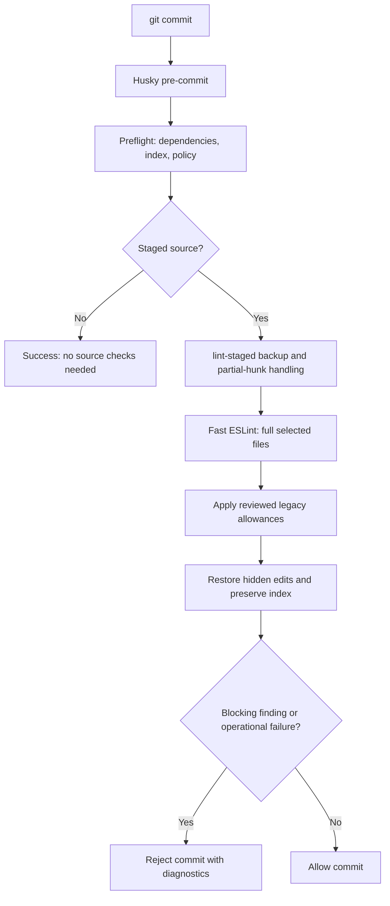

# Local Commit Quality Gate — Technical Design

Status: Proposed; paths and commands marked proposed are not implemented.  
Date: 2026-10-21  
Requirements: [PRD.md](PRD.md)

## 1. Technical decision

Use Husky to invoke a Node coordinator that runs lint-staged once. lint-staged invokes a local Node lint runner using an explicit fast ESLint configuration. The runner evaluates the complete staged versions exposed by lint-staged, applies narrowly reviewed legacy allowances, and returns a blocking exit status when appropriate.

Keep the existing Vue parser integration. Add selected SonarJS rules rather than adopting every rule in a moving recommended preset. Use no type information in the fast profile. A separate deep command enables type-aware rules and invokes the existing non-watch TypeScript checks.

No hosted CI service is a runtime dependency. All quality tooling is development-only and must stay outside Electron bundles.

## 2. Current implementation and migration

| Current file | Observed behavior | Proposed change |
|---|---|---|
| `.husky/pre-commit` | Multiple lint passes and full type checks | Single `node scripts/quality/pre-commit.mjs` entry |
| `package.json` | Husky prepare, lint-staged shell task, duplicate ESLint policy | Preserve prepare; use one explicit lint-staged config and authoritative shared rule policy |
| `.eslintrc.json` | TypeScript/Vue recommended rules; warnings for `any` and unused variables | Extract compatible shared policy; explicit severity overrides in gate profile |
| `scripts/lint-staged-eslint.sh` | Shell-string batches and automatic fixes | Retire from hook; Node API preserves filenames and performs no fixes |
| `yarn typecheck` | `tsc --noEmit` | Reuse in explicit deep validation |
| `yarn vue-typecheck` | Non-watch Vue checking | Reuse in explicit deep validation |
| `.github/workflows/*` | Existing remote checks | No change required by this feature |

Resolved locally during design: ESLint 8.57.1, TypeScript parser 7.18.0, Vue ESLint plugin 9.33.0, lint-staged 16.2.7. These observations are not a compatibility guarantee for a new SonarJS release.

## 3. Dependency compatibility gate

Before choosing an exact SonarJS version:

1. Inspect its published engines, peer dependencies, license, configuration exports, and rule metadata.
2. Select an exact version compatible with the installed ESLint 8/parser stack and Node support; commit the lockfile.
3. Prove parsing and rule execution for JS, CommonJS, JSX, TS, TSX, Vue `<script>`, Vue `<script setup lang="ts">`, and Vue templates.
4. Check each enabled rule's `requiresTypeChecking` behavior and aliases/deprecations in that pinned release.
5. Verify existing `yarn lint` still works after configuration consolidation.
6. Add any directly imported parser or plugin as an explicit development dependency rather than relying on transitive hoisting.

Do not blindly install the latest plugin or copy an ESLint 9 flat configuration into this ESLint 8 repository. If no acceptable maintained compatible release exists, treat an ESLint migration as a separately estimated prerequisite, with Vue CLI compatibility tests. Do not silently broaden this feature into a tooling migration.

Node minimum must match the actual selected dependencies, which may be stricter than the current `>=22.0.0` package declaration. Record the verified minimum and test it. The implementation compatibility report is a release artifact.

## 4. Proposed files and responsibilities

| Proposed path | Responsibility |
|---|---|
| `scripts/quality/pre-commit.mjs` | Preflight, policy consistency, lint-staged invocation, summary |
| `scripts/quality/lint-files.mjs` | Fast ESLint Node API runner; no fixes; stable diagnostics |
| `scripts/quality/policy.cjs` | Shared rule IDs, scopes, thresholds, ignore list |
| `scripts/quality/eslint-fast.cjs` | Legacy-compatible explicit fast configuration |
| `scripts/quality/eslint-deep.cjs` | Explicit typed profile |
| `scripts/quality/lint-staged.config.mjs` | Single source of staged task configuration |
| `scripts/quality/exceptions.json` | Reviewed, bounded legacy allowances |
| `scripts/quality/check-exceptions.mjs` | Manifest validation and allowance application |
| `scripts/quality/doctor.mjs` | Node/dependency/config/hooksPath diagnostics |
| `scripts/quality/deep.mjs` | Sequential typed lint and existing type checks |
| `scripts/quality/rules/` | Only custom syntax rules needed for architecture boundaries |
| `test/quality-gate/` | Isolated Node integration tests and invalid-code fixtures |
| `docs/development/local-quality-gate.md` | Setup, commands, failures, recovery, and limitations |

Use Node's built-in test runner for hook integration tests so they do not import Electron or rebuild native SQLite. Invalid fixture source must be excluded from normal repository lint and included only by its explicit test harness. These scripts run as developer tools, not application workers; `src/childprocess/` does not apply to them.

## 5. Execution flow



Policy-only changes validate policy/configuration before the no-source exit. They do not automatically run a whole-project audit; contributors run the explicit audit command as part of changing policy.

## 6. Git index and filesystem contract

### 6.1 Preflight

Resolve the repository root through Git and normalize task paths relative to it. Respect worktrees and `GIT_INDEX_FILE`. Enumerate paths using NUL-delimited Git output; never parse human-formatted status or concatenate filenames into a shell command. Check unresolved index stages and fail clearly on unmerged paths.

Determine staged candidates using added/copied/modified/renamed statuses. Lint rename destinations. Skip deletions and submodules. A source-path symlink must be rejected with an explanation rather than followed outside the repository or silently treated as checked. Handle unsupported encodings and unreadable source as failures.

The coordinator must detect unstaged edits to effective policy/control inputs: ESLint configuration, quality scripts, exception manifest, lint-staged configuration, package manifest/lockfile, and ignore files. Reject until those edits are staged or restored. This avoids allowing an unstaged weaker configuration to determine a staged commit's result. New staged configuration may legitimately modify policy; a local hook is not a tamper-proof authority.

### 6.2 Staged content

Use lint-staged's default backup and partial-staging isolation behavior. Do not enable `--no-stash` or `--no-hide-partially-staged`, and do not use `--fix`. Fast rules must not resolve imported source content for type analysis; otherwise unstaged dependency changes could affect results.

The task receives full paths as distinct arguments and passes them as an array to ESLint's Node API. Use lint-staged's argument chunking and sequential task execution; do not rebuild the old shell batching code. Ensure multiple chunks produce an aggregated nonzero result if any fails.

Before and after execution compare the Git index tree identity. Because the gate is read-only, unexpected index changes invalidate the result. Treat concurrent staging during a run as a failed check requiring a retry, not an opportunity to reset user changes. Verify partial-staging behavior against the pinned lint-staged version through real temporary repositories.

### 6.3 Recovery

lint-staged owns its temporary backup lifecycle. The coordinator must not run blanket stash deletion, checkout/reset, or destructive cleanup. On failure preserve original exit information and print recovery guidance from lint-staged. On an uncatchable interruption, backup restoration may require manual action; never promise automatic recovery from all process termination modes.

No-content initial commits need a fixture test: Git has no `HEAD`, but lint-staged must still check staged additions. Never use a command requiring `HEAD` without handling an unborn branch.

## 7. ESLint profiles

### Fast profile

Use an explicit configuration with `useEslintrc: false` in the ESLint 8 API so ambiguous parent/package configuration discovery cannot alter the gate. Import the shared policy deliberately. Configure ignore handling explicitly and fail if an eligible selected file is ignored without an approved exclusion.

- Vue files use `vue-eslint-parser` at the top level with the TypeScript parser delegated for script sections.
- TS/TSX use the TypeScript parser; configure JSX where appropriate.
- JS/JSX/CJS/MJS use appropriate source types and environments.
- Tests define their framework globals through overrides.
- TypeScript-specific rules are scoped to files they can analyze correctly.
- No `parserOptions.project` or project-service startup in this profile.
- `fix: false`; avoid caches initially so invalidation cannot undermine staged-content correctness.
- Enable only selected rules; do not convert every warning into a blocker with a blanket zero-warning policy.

### Initial rule contract

Verify rule names against the pinned packages before enabling:

| Rule | Fast behavior | Purpose |
|---|---|---|
| `@typescript-eslint/no-explicit-any` | Error | Enforce repository typing policy |
| `@typescript-eslint/no-unused-vars` | Error with existing underscore exceptions | Find unused imports/variables |
| `@typescript-eslint/explicit-function-return-type` | Error with documented options | Enforce explicit return types |
| `sonarjs/cognitive-complexity` | Error, initial threshold 15 | Limit function reasoning complexity |
| `sonarjs/no-identical-functions` | Error if available without types | Find duplicated implementation |
| `sonarjs/no-all-duplicated-branches` | Error if available without types | Find ineffective branching |
| `no-dupe-else-if` | Error | Find repeated conditions |
| `no-unreachable` | Error | Find unreachable statements |
| Vue recommended correctness rules | Preserve and review severities | Template and component correctness |
| Project architecture rules | Error in selected directories | Enforce direct dependency boundaries |

Avoid duplicate core and TypeScript reports for the same unused symbol. Existing repository warnings remain visible without automatically becoming errors. An inventory must identify conflict/noise before full rollout.

### Deep profile

Enable `@typescript-eslint/no-floating-promises` and `@typescript-eslint/no-misused-promises` with compatible parser services. On the existing TypeScript ESLint 7 stack, use the supported `parserOptions.project` configuration with dedicated TSConfig inclusion; do not assume newer project-service examples apply.

Include relevant source, test, and tooling files explicitly. Validate Vue typed-script handling against real fixtures. An excluded file or unavailable parser service is a setup failure, not permission to silently disable a requested typed rule. Report any intentional scope exclusions.

Deep validation uses the working tree and says so in its output. It is not an index-exact commit validator. It sequentially runs typed lint, `yarn typecheck`, and `yarn vue-typecheck`; it stops on failure and never invokes watch scripts. Test suites remain independently selected according to the code change.

## 8. Architecture rules and limits

Implement AST-based direct-import restrictions for both ES imports/exports and literal `require`/dynamic imports. Normalize `@/` aliases and relative paths lexically against the importing file. Compare normalized repository paths, including explicit extension and index-file variants, without executing modules.

| Importer | Prohibited direct dependency |
|---|---|
| `src/childprocess/**` | `src/model/**`, `src/entity/**` runtime imports, `src/config/SqliteDb`, `typeorm`, `better-sqlite3`, and other identified DB driver entry points |
| `src/main-process/communication/**` | Model/database implementation imports and TypeORM repository APIs; use modules/controllers |

Permit `src/entityTypes/**` and genuinely type-only imports where they cannot initialize persistence. Specify tests for type-only handling; do not treat all entity-shaped names as runtime database access.

For release one, direct import checks do not prove a worker cannot transitively reach a database through a shared module, nor detect every computed import. Report this limitation. A later dependency-graph audit can cover transitive access. The rule must not pretend to prove that AI enable checks occur before all work; dedicated handler tests are required for that semantic requirement.

## 9. Legacy exceptions

Proposed manifest structure:

```json
{
  "schemaVersion": 1,
  "exceptions": [
    {
      "path": "src/modules/LegacyExample.ts",
      "ruleId": "sonarjs/cognitive-complexity",
      "maxCount": 1,
      "maxComplexity": 24,
      "reason": "Split orchestration during the scheduled module refactor",
      "owner": "maintainer",
      "expiresOn": "2026-12-01"
    }
  ]
}
```

This is an example, not an allowance for a real file. Start the implementation manifest with only reviewed actual findings. Require exact paths and rule IDs, finite nonnegative ceilings, nonempty reason/owner, valid expiry dates, and unique path/rule pairs. Forbid wildcard rules, syntax/parser exceptions, and operational-error exceptions.

For ordinary rules, compare current findings to `maxCount`. For cognitive complexity, compare both count and the maximum observed function complexity to `maxComplexity`. The selected plugin's message representation must be verified; ESLint diagnostics do not necessarily expose structured numeric complexity. Isolate extraction in a version-specific adapter with fixtures. Unknown message formats fail closed for exceptional complexity findings. Do not use an untested regex as a silent fallback.

This maximum ceiling does not track individual function identity: one function can worsen below another function's existing ceiling. Document that limitation. To satisfy PRD AC-09, the initial exception inventory must permit only one complex function per exceptional file; files with multiple above-threshold functions require function-level fingerprints and ceilings before receiving a complexity allowance, or must be refactored. Ordinary count allowances retain the documented replacement limitation.

On rename, a legacy allowance does not transfer automatically. Update its path explicitly in the same commit with rationale. Deletions leave stale entries that full audit reports for removal. Full audit lists debt, expiry, stale paths, and candidates for tightening allowances. It must not rewrite or increase allowances automatically.

## 10. Commands and exit status

Proposed commands:

| Command | Scope |
|---|---|
| `yarn quality:staged` | Same coordinator as the hook; staged snapshot semantics |
| `yarn quality:deep` | Working-tree typed lint and full non-watch type checks |
| `yarn quality:audit` | Full source inventory, exception validation, JSON/text summary |
| `yarn quality:fix <paths>` | Explicit working-tree fixes; never stage automatically |
| `yarn quality:doctor` | Installation and hook/config diagnostics |
| `yarn test:quality-gate` | Node-based isolated tests |

Internal runners use 0 for pass, 1 for policy violations, and 2 for operational/configuration failures. lint-staged/Husky may normalize nonzero statuses; end-to-end assertions require rejection and an explanatory message rather than preservation of a particular nonzero code. Warnings and accepted legacy debt must be labeled distinctly from errors.

Human output includes file/rule/location and totals. JSON output uses a versioned schema containing mode, files checked, elapsed time, findings, accepted debt, blockers, and operational errors. Bound output volume while reporting the total and a way to retrieve full local output. Never print source snippets containing secrets unnecessarily.

## 11. Safety, performance, and local operation

- Use installed binaries or Node APIs. No implicit `npx` installation and no network in hook execution.
- Spawn programs with argument arrays and `shell: false`; support Windows command execution deliberately through Node entry points where possible.
- Keep normal linting single-process initially. Measure before introducing parallel parser memory overhead.
- Apply a configurable safety timeout, initially 120 seconds; on timeout fail and preserve recoverability. It is not the performance target.
- Skip ignored generated paths before parser startup and report why a selected eligible file was excluded.
- Do not load application modules, run migrations, rebuild native modules, or initialize Electron.
- Do not send metrics or findings to remote endpoints.
- Ensure source and policy files are read from within the repository boundary; reject unsafe symlink traversal.
- Developer-owned hooks remain bypassable. This feature improves normal development feedback, not adversarial enforcement.

## 12. Tests and acceptance mapping

| Test group | Coverage | PRD coverage |
|---|---|---|
| Rule fixtures | TS/JS/Vue valid/invalid cases, severity, threshold boundaries | AC-01–03 |
| Git integration | Real commits in disposable repositories, partial staging, unborn HEAD, renames, deletions | AC-04–07 |
| Exception unit tests | Counts, expiry, duplicate entries, ceiling parsing, rename behavior | AC-08–09 |
| Failure injection | Missing tools, bad config, parser errors, timeout, restoration errors | AC-10, AC-15 |
| Architecture fixtures | Alias/relative imports, require, literal dynamic import, type-only distinction | AC-11–12 |
| Offline harness | Disable network access after installation and run hook | AC-13 |
| Deep command orchestration | Correct order, failure propagation, no watch scripts | AC-14 |
| Policy consistency | Unstaged config rejected, staged config parsed, unexpected ignores rejected | AC-16–17 |
| Fresh checkout | Prepare/doctor/hook fixture succeeds without global tool reliance | AC-18 |

For index preservation tests, compare staged blob IDs and worktree bytes before/after both success and rejection; include pre-existing user stashes. Use process interruption fixtures only inside disposable repositories. Test filename edge cases supported by each OS. Test Linux, macOS, and Windows; identify any platform limitation before enabling the gate for that platform.

Benchmark the workloads and percentile procedure in PRD section 10. Record actual numbers and package versions in the implementation report. Do not assert an unmeasured speedup over FTA or the current hook.

No renderer code changes are required, so Vue application component/E2E tests are not newly required for this tooling-only feature. The tooling must nevertheless contain Vue parser fixtures. If implementation changes application UI, repository UI-testing and translation requirements apply normally.

## 13. Implementation sequence and review checkpoints

1. Add compatibility fixtures, pin dependencies, prove Vue/TS behavior, and record licenses/engines.
2. Run inventory and establish shared policy without changing commit behavior.
3. Add exception validation and architecture-rule fixtures; review each real legacy allowance.
4. Implement the coordinator and read-only runner; verify disposable Git scenarios.
5. Replace the existing hook and retire duplicate lint-staged configuration/shell batching atomically.
6. Add deep/fix/audit/doctor commands and operator documentation.
7. Run focused tests, existing lint compatibility checks, offline/platform checks, and benchmarks.

Commit each complete logical unit according to repository policy. Do not weaken hooks temporarily or introduce automatic bypasses to get implementation commits through. If a pre-existing hook fails, report the failure and fix only issues within authorized scope.

## 14. Rollback and maintenance

Rollback the hook/config/dependency implementation as one coherent change; retain diagnostic evidence. A rollback should restore the preceding behavior, not leave hooks silently disabled. Pin SonarJS and update deliberately because rule behavior and numeric complexity diagnostics can change. Re-run compatibility and exception-adapter fixtures for upgrades.

Run the full audit explicitly when changing rules or exemptions. Expired debt belongs to maintainers; the hook should not invent a new deadline. Consider Oxlint only after profiling establishes a bottleneck and a fixture comparison proves adequate rule/Vue coverage. Consider Semgrep only for a separate defined set of security patterns.

## 15. Sources and implementation caveats

- [SonarJS plugin documentation](https://github.com/SonarSource/SonarJS/blob/master/packages/analysis/src/jsts/rules/README.md): rule capabilities and configuration guidance; verify the pinned release rather than assuming `master` matches it.
- [lint-staged documentation](https://github.com/lint-staged/lint-staged): backup, partial staging, task arguments, and configuration. Preserve default safety behavior and test it end to end.
- [TypeScript ESLint typed linting](https://typescript-eslint.io/getting-started/typed-linting/): type-aware analysis loads project information and has a different cost profile. Current examples may target newer versions than this repository.
- [Husky documentation](https://typicode.github.io/husky/): local hook installation and operation.

Thresholds, filenames, commands, acceptance budgets, and exception mechanics in this design are proposed AiFetchly decisions. They are not claims that these behaviors already exist in the third-party packages.
