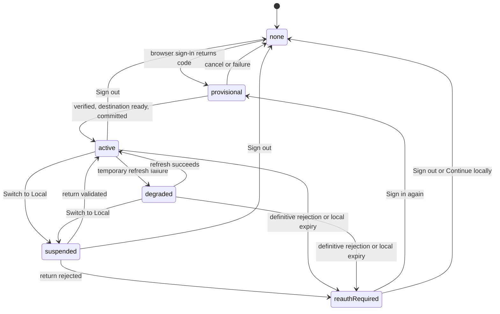

# Local Workspace Without Sign-In — Technical Design

- **Status:** Proposed | **Version:** 1.1 | **Date:** 2026-11-25
- **Source requirements:** [Product requirements](./local-workspace-without-sign-in-prd.md) v1.2
- **Owner:** Desktop Engineering

## 1. Current implementation and design boundary

| Area | Existing behavior | Proposed boundary |
| --- | --- | --- |
| [Renderer guard](../../src/views/permission.ts) | Routes depend on cached name/email; every non-whitelisted route redirects to `/login`. | Route access derives from active workspace and capability state. |
| [Startup](../../src/background.ts), [account setup](../../src/controller/UserController.ts), [sign-out](../../src/modules/user.ts) | The shared `USERSDBPATH` value can point at a temporary or email-based directory and is cleared at sign-out. Sign-out navigates the renderer to `login`. | Main process explicitly selects, initializes, and switches workspaces. Sign-out and auth expiry land in Local workspace. |
| [Sign-in completion](../../src/modules/desktopLoginCompletion.ts), [deep-link handling](../../src/background.ts) | Tokens are persisted before the user is verified; the database switch is non-blocking and navigation proceeds even if it fails; any failed sign-in clears all saved tokens. | Provisional sign-in: commit the session and activate the workspace only after verification and destination readiness. Failures discard only provisional state. |
| [Token refresh](../../src/modules/tokenRefresh.ts), [HTTP client](../../src/modules/lib/httpclient.ts), [expiry guard](../../src/service/AuthSessionExpiryGuard.ts) | One process-wide in-flight refresh; tokens are written after the network call without a session check; both `401` and `403` trigger refresh; failures are classified partly by message text; the timer and HTTP client apply different sign-out policies; the expiry guard's in-flight flag never resets after a successful sign-out; every request is replayed after refresh unless it opts out. | One main-process `AuthSessionManager` owns session state, refresh, recovery, and replay policy, bound to session and workspace generation (§3). |
| [Entitlement cache](../../src/controller/UserController.ts) | `USER_AI_ENABLED` and `USERPLANS` are global `Token` values that survive sign-out. | Scope to the account workspace; hosted gates also require an active account workspace. |
| [Chat resolver](../../src/service/aiProvider/AIProviderResolver.ts), [chat IPC](../../src/main-process/communication/ai-chat-v2-ipc.ts) | A configured provider can serve chat without a hosted plan; some paths still call hosted APIs. | Preserve the resolver split and enforce it for the whole local chat flow. |
| [Provider key storage](../../src/service/aiProvider/AIProviderSecretService.ts), [Token store](../../src/modules/token.ts) | The provider key is stored through `Token`; the store uses an app-embedded key. | New local provider secrets must not use `Token`. |
| [Field cipher](../../src/modules/fieldCipher/FieldCipher.ts), [account key service](../../src/modules/fieldCipher/UserSecretKeyService.ts) | `ENC1` uses AES-256-GCM; the field key is fetched and cached for the signed-in user. | Keep the existing cipher and key contract for account rows; select an independent device key for local rows. |

## 2. Workspace identity and lifecycle (LW-01, LW-03, LW-08, LW-16)

- Create a main-process `WorkspaceContext` with `kind`, immutable `workspaceId`, canonical database directory, and a monotonically increasing activation generation. Keep `local` and `account` distinct even if the same external email address is used in both.
- Key account workspaces by the backend's immutable account ID, never by email. Resolve an existing email-based directory once from the authenticated account ID and record the mapping in the workspace manifest, so an email change or a different account cannot open the wrong directory.
- Use a fixed app-owned directory such as `userData/profiles/local/` with a generated profile ID in its manifest, a profile-scoped SQLite database, provider settings, and a vault directory. Retain existing account paths for compatibility; use authenticated identity to resolve them and enforce containment within the app-owned root. Never take a path or identity from renderer IPC arguments.
- Keep `USERSDBPATH` as a compatibility projection during transition, not the source of authorization or workspace selection. Bind new services to a captured context. Audit database singletons, conversation/stream registries, caches, account scheduler, WebSocket client, device registration, entitlement reconciliation, refresh-success listeners, browser profiles, memory, tool grants, and window state before enabling a feature locally.
- Initialize the workspace before enabling database-dependent IPC. A fresh install or explicit sign-out selects Local workspace. Separate provisional sign-in from workspace activation, so cancellation or backend failure does not update the active path.

**Startup and upgrade:** Restore a saved account session through the session manager (§3).

| Startup result | Behavior |
| --- | --- |
| Session validates or refreshes | Open the account workspace. |
| AiFetchly unreachable, timed out, or `5xx`, and the refresh credential has not expired locally | Open the account workspace in the `degraded` state; operations that need a usable access token wait for recovery. |
| Refresh credential expired locally or definitively rejected | Select Local workspace. Do not open the account database. If this is the first launch after upgrade, show the one-time notice from LW-16. |

The notice reads only a small non-secret record (account ID, masked email, reason, acknowledged flag) kept outside the account database, so Local never opens, counts, or previews account data. The workspace menu keeps a sign-in hint for that account until it signs in or the user dismisses it.

**Existing provider configuration:** On upgrade, the global provider settings and `USER_LOCAL_AI_PROVIDER_API_KEY` belong to the account workspace restored at that launch and move into its scope. If no account is restored, leave them unadopted until the open decision in PRD §7 is confirmed. Local workspace never adopts them (LW-08).

**Transition sequence:** serialize switches; block new old-generation work; cancel and drain profile-owned streams, scheduler jobs, browser activity, WebSocket, and workers; detach subscriptions and refresh listeners; close profile-bound resources and clear credentials/caches; initialize the destination context; then publish one ready state and reload renderer workspace data. Reject stale completions and IPC events by generation before any write or event delivery. If resources cannot be safely drained, keep workspace IPC blocked and require a controlled restart instead of pointing old services at the new database. A failed sign-in may restore the still-authorized prior context; sign-out and auth expiry must never restore account access without reauthentication.

## 3. AiFetchly session lifecycle (LW-10 – LW-15)

### Session record and state

Replace the global token slots (`TOKENNAME`, `REFRESHTOKEN`, `TOKENEXPIRY`, `REFRESHTOKENEXPIRY`) with at most one saved session record — `{accountId, workspaceId, sessionId, accessToken, refreshToken, expiries}` — owned by a main-process `AuthSessionManager`. Other code reads tokens only through the manager, which enforces the active-workspace rule below. Where the record is stored (current store versus OS-backed protection) is an open decision in PRD §7; whichever is chosen, it is never exposed through IPC, worker messages, environment variables, or logs.

### Sign in (LW-10, LW-14)

1. Run the existing browser flow and code exchange. Hold the resulting tokens **in memory only** as provisional state; do not write them to the session record.
2. Fetch the user and account ID with the provisional token.
3. If a saved session exists for a different account, ask the renderer for confirmation (LW-14) before any change.
4. Resolve and initialize the destination workspace database. This step is blocking; failure aborts the sign-in.
5. Run the §2 transition: commit the session record atomically, bump the generation, start account services (WebSocket, device registration, entitlement reconciliation, scheduler, refresh), then navigate.

Cancellation or any failure at steps 1–4 discards only the provisional tokens. The active workspace and any saved session stay unchanged. This replaces the current `clearTokens()` calls on deep-link failure and the non-blocking database switch in `completeDesktopLogin`. **Continue** with a different account revokes the previous session at the backend (best effort, short timeout), deletes its session record, and leaves its workspace data on disk.

### Refresh (LW-12, LW-13)

- **Binding:** The in-flight slot is keyed by `sessionId`. Each attempt captures `{sessionId, generation}` and compares them with the current state before writing tokens, notifying listeners, or restarting work. A mismatch discards the result. If rotation makes a suspended session unusable, the return validation fails and the user signs in again.
- **When refresh may run:** The proactive timer and on-demand refresh run only in `active` or `degraded` while that account's workspace is active. In `suspended`, no timer runs; the only allowed refresh is the explicit return validation.
- **Timeout and backoff:** Abort a refresh after a fixed timeout (for example 15 s) and release the slot. Retry transient failures with bounded exponential backoff and jitter (for example 30 s doubling to 10 min) while the account workspace is active.
- **Classification:** Use structured results, not message text.
  - **Definitive:** refresh endpoint `401`/`403`, an explicit backend auth error code, or local expiry of the refresh credential.
  - **Transient:** network errors, timeouts, `5xx`, unparsable or unknown responses.
- **Outcomes:** Transient → `degraded`, report hosted services as unavailable, offer **Switch to Local**. Definitive → `reauthRequired`: stop account work, clear the unusable tokens but keep the account identity for reopening, and show **Sign in again** / **Continue in Local workspace**. Never navigate to `/login`.
- **Expiry handling:** Replace the process-lifetime flag in the expiry guard with per-session state, so a second expiry in the same process is handled.

### HTTP client policy (LW-04, LW-12)

- First-party bearer requests require the active workspace to be the saved session's account workspace. Otherwise fail fast with a typed "account workspace inactive" error; never attach the token or start a refresh.
- For regular AiFetchly APIs, only `401` or an explicit auth error code triggers refresh. Map `403` to the entitlement or permission state.
- Replay after refresh is opt-in: at most once, only for idempotent methods (`GET`, `HEAD`) or requests explicitly marked replay-safe. This inverts today's `noAuthReplay` opt-out.
- Third-party provider clients never use the AiFetchly refresh path; a provider `401` maps to a provider error.

### Switch to Local and Sign out (LW-11)

- Both actions first send the renderer a summary of running account jobs and the next scheduled runs; the user confirms or cancels. On confirm, run the §2 transition to Local.
- **Switch to Local:** session → `suspended`; keep the session record; stop the timer. **Return:** validate or refresh using the captured generation before the transition. Definitive failure → offer **Sign in again** or stay Local. Transient failure → stay Local and offer **Retry**.
- **Sign out:** stop account work, revoke at the backend with a short timeout (best effort), delete the session record and the account's entitlement cache, and activate Local regardless of the backend result.

### Account scheduled jobs (LW-15)

- When the account workspace is deactivated, stop its scheduler. Cancel in-flight runs at a safe point and mark them `interrupted`; never resume them automatically.
- Record the inactive interval (`deactivatedAt`, `reactivatedAt`) in the account workspace. On reactivation, before starting the scheduler, record each occurrence in that interval as `skipped` with reason `workspace_inactive`, increment the existing missed-occurrence count, and set the next run to the first future occurrence. Ignore `misfire_policy = run_once` for this interval; app-closed and sleep gaps keep the existing misfire policy.
- Publish a skipped-run summary to the renderer. **Run now** uses the existing manual run path.

## 4. Authorization and AI data flow (LW-02, LW-04)

- Classify capabilities in the main process: local-safe, local-safe with a configured provider, account-required, and account-plus-entitlement. Unreviewed handlers default to unavailable in local mode. Vue routing and navigation reflect this policy; they do not enforce it on their own.
- Use the configured provider for connection testing, model discovery, and stream requests; persist history in the active profile. Audit title generation, summarization, embeddings, attachments, retry/resume, and tools for implicit hosted calls. Disable unsupported add-ons instead of falling back. A third-party provider failure must not invoke AiFetchly token refresh or force account sign-in.
- Scope endpoint, model preferences, and secrets to the profile. Send a provider key only to its configured destination, with transport policy for authenticated requests and no implicit cross-origin forwarding. On origin change, require the user to confirm or re-enter a key before sending it there. Do not log request authorization headers, prompts, or provider response bodies in diagnostics.
- Keep existing hosted AI token and `USER_AI_ENABLED` checks intact, and move `USER_AI_ENABLED` and `USERPLANS` into the account workspace scope. Hosted gates require an active account workspace in addition to `USER_AI_ENABLED`, so a cached plan from a suspended session never grants access in Local. Gate local AI IPC by the active profile, local enable/configuration, and operation-specific capability before processing the request. Deny hosted, sync, paid, and unreviewed agent/scheduler channels in local mode even when invoked directly.

## 5. Local vault and credential consumers (LW-05, LW-06, LW-09)

**Key hierarchy:** Electron main process generates a random 32-byte data encryption key per local workspace. An OS-backed protector wraps the key. Persist only the protected blob and versioned metadata (`workspaceId`, `keyId`, protector/version) in the app-owned vault. The wrapped payload also carries the workspace/key IDs and must match the manifest on unwrapping. Bind all local secrets to that workspace; do not derive the key from an email, token, machine identifier, or embedded secret.

- Use a `WorkspaceKeyProvider` with explicit local and account implementations. The account provider continues to use the existing backend key service, bound to its authenticated session/generation. The local provider never calls that service and cannot fall back to it. Create and unwrap only in the main process; never expose a raw key through IPC, worker messages, or environment variables.
- Serialize initialization and persist the wrapped key atomically before any encrypted write. Distinguish a genuinely new vault from missing metadata on a profile with prior vault use. Never replace an existing or unreadable key implicitly. Cache only for the active generation; release references and zero key buffers on invalidation where possible. A late unwrap must not populate a new generation's cache.
- Keep the existing `ENC1` reader for account rows. For new local writes, reuse AES-256-GCM and fresh random nonces, with a separate versioned envelope carrying `keyId` and authenticated context (workspace ID, immutable record ID and field/purpose) to reject ciphertext copied to another field or row. Reserve stable IDs before encryption. Reject invalid envelopes and authentication errors; never interpret failed ciphertext as plaintext. Rewrapping an unchanged data key after OS rotation need not rewrite all rows.
- Route [email secrets](../../src/modules/emailServiceModule.ts), [social passwords](../../src/modules/socialAccountModule.ts), and [cookie snapshots](../../src/modules/AccountSessionService.ts) through their existing Module/Model boundaries with the scoped key provider. Inventory SMTP/IMAP auth, OAuth tokens, cookie capture, credential update/clear, worker payloads, caches, and legacy repair paths per enabled connector. Do not clone plaintext-tolerant legacy reads into the local workspace.
- Keep the AI API key in the local vault; settings return only `hasKey` and non-secret configuration. Credential inputs are write-only after entry. Return only redacted metadata to the app renderer. Where a supported worker needs an individual credential, pass only that credential in memory for that job, never through command-line arguments or logs. Workers never access the database or vault directly.

### Platform policy

| Platform | Proposed persistent storage policy |
| --- | --- |
| Windows | Prefer async Electron `safeStorage` backed by DPAPI. Do not claim isolation from other apps under the same OS user. |
| macOS | Prefer async Electron `safeStorage` backed by Keychain. Test a consistently signed build across upgrade and handle denied or locked Keychain access. |
| Linux | Enable persistence only when the app can positively verify a trusted OS-backed provider for the exact API and shipped runtime. Do not infer trust from async availability or the synchronous selector alone; reject `basic_text`, fallback, and unknown cases. If the API cannot prove the async provider, leave persistence off pending a verified platform adapter. |

Use [Electron safeStorage documentation](https://www.electronjs.org/docs/latest/api/safe-storage) and verify behavior against the pinned Electron build and packaging environment. On temporary failure, keep the blob intact and offer retry. When OS rewrapping is required, rewrite atomically only through a verified protector. OS-backed wrapping protects against some at-rest access scenarios, not malicious code running in the app or a compromised device. The SQLite database, messages, and chat history are not encrypted by this design.

### Browser sessions and memory-only fallback

For local social sign-in, use a dedicated non-persistent Electron partition, not the default session nor a `persist:` partition. Capture only approved provider cookies, encrypt the snapshot when permitted, and restore it into a fresh in-memory partition on demand. Do not enable a connector that needs persistent Chromium profile, local storage, or another unverified credential store. For other browser engines, require equivalent isolation and prove no plaintext credential artifacts before enabling the connector. See [Electron session partition behavior](https://www.electronjs.org/docs/latest/api/session#sessionfrompartitionpartition-options).

Session-only mode keeps secrets in main-process memory and isolated browser sessions, without writes to SQLite, settings, profile directories, retry queues, logs, or exports. Clear or close these on forget, switch, and quit. If the connector cannot satisfy this, deny saving and do not launch a flow that silently persists. A browser partition's memory-only setting is necessary but is not by itself proof that the entire connector leaves no plaintext on disk.

## 6. Failure, migration, and rollback (LW-06, LW-07, LW-08)

| Condition | Expected behavior |
| --- | --- |
| Secure storage unsupported or locked | Keep non-secret functionality usable. Show why persistence is blocked; allow session-only only for verified flows. Preserve existing ciphertext. |
| Wrapped key missing/corrupt or workspace/key ID mismatch | Mark the vault locked. Do not auto-generate a replacement or delete rows. Allow retry or explicit reset when appropriate. |
| One record fails authentication | Reject that credential and allow explicit reconnect for that record. Do not reset the whole vault or expose the reason as raw cryptographic output. |
| Forget/reset | Quiesce affected work, clear saved credentials and relevant browser state, and invalidate cached copies. Reset must be explicit and restart-safe: journal the operation, clear references before creating a replacement key, and resume cleanup after interruption. Preserve non-secret records. |
| Legacy or rollback | Keep account schema/data and backend encryption readable. Do not auto-import `temp_db` or global provider keys into Local. Keep local storage isolated if the rollout is disabled; retries and rollbacks never delete it. If the session record format changes, keep a downgrade path that can still read the account session or require a fresh sign-in without touching account data. Document that downgrades may not expose the local workspace UI. |

No default transfer of backend-encrypted credentials, raw cookies, passwords, or global API keys. The initial reconnect flow asks users to enter or authorize their credentials again. A future importer must be explicitly consented, allowlist non-secret fields, and never copy an account database wholesale. Database backups are not a portable credential recovery mechanism.

## 7. Delivery and verification

1. **Workspace foundation:** Add startup identity, account-ID keyed workspaces, transitions, and route/IPC policy. Test upgrade (restorable, expired, and offline session), the one-time upgrade notice, canceled sign-in, auth expiry, restart, profile switching with active work, and delayed callbacks from the previous generation.
2. **Session lifecycle:** Add `AuthSessionManager`, provisional sign-in, session-bound refresh, HTTP client gating, and job pause/skip. Test:
   - canceled and failed sign-in keep the saved session and the active Local workspace;
   - different-account sign-in with Continue and Cancel;
   - concurrent refresh sharing one operation per session, and no reuse across sessions;
   - refresh delayed past **Switch to Local** and past **Sign out** cannot write tokens or start jobs;
   - timeout releases the slot; a `5xx` whose body mentions "token" stays transient; a `403` entitlement denial does not refresh;
   - a third-party `401` never reaches AiFetchly refresh; replay happens only for idempotent or replay-safe requests;
   - a second expiry in one process is handled;
   - jobs due while Local is active are recorded as skipped, in-flight runs become interrupted, and **Run now** works.
3. **Provider path:** Add scoped settings and vault storage. Test with a controlled provider while AiFetchly traffic is blocked and observed. Verify setup, model discovery, streaming, history/restart, provider errors, and denial of hosted IPC, including with a suspended account session present. Verify that a provider origin change does not send the old key automatically.
4. **Connector rollout:** Enable each supported email/social adapter only after restart and forget checks against controlled accounts. Inject locked, missing, copied, and corrupted key/envelope cases; test interrupted key initialization/reset, repeated start, and no persistence for session-only connections. Inspect DB/WAL, persisted settings, logs, and browser directories using synthetic canary secrets; never use production secrets in test fixtures.
5. **Release evidence:** Extend `test/vitest/main/`, component tests under `test/vitest/main/components/`, and Electron specs under `test/e2e/specs/`. Run `yarn test:components` and targeted `yarn test:e2e` for changed flows; verify all six locales, including account-switch, skipped-run, and upgrade copy. Record native secure-storage behavior across supported OS profiles, including signed upgrade and Linux fallback. Any required packaged evidence is an operator/CI gate; do not run Forge packaging locally.

**Decisions before Phase 1 completes:** where the saved session record is stored and who owns the existing global provider configuration on upgrade (PRD §7).

**Decisions before enabling Phase 2:** identify the first supported connectors, specify their deletion/forget semantics and browser storage surfaces, and approve an OS support matrix. A missing verification receipt is a reason to leave that capability off, not to weaken the storage policy.
