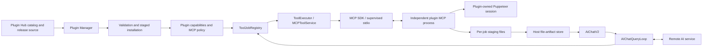
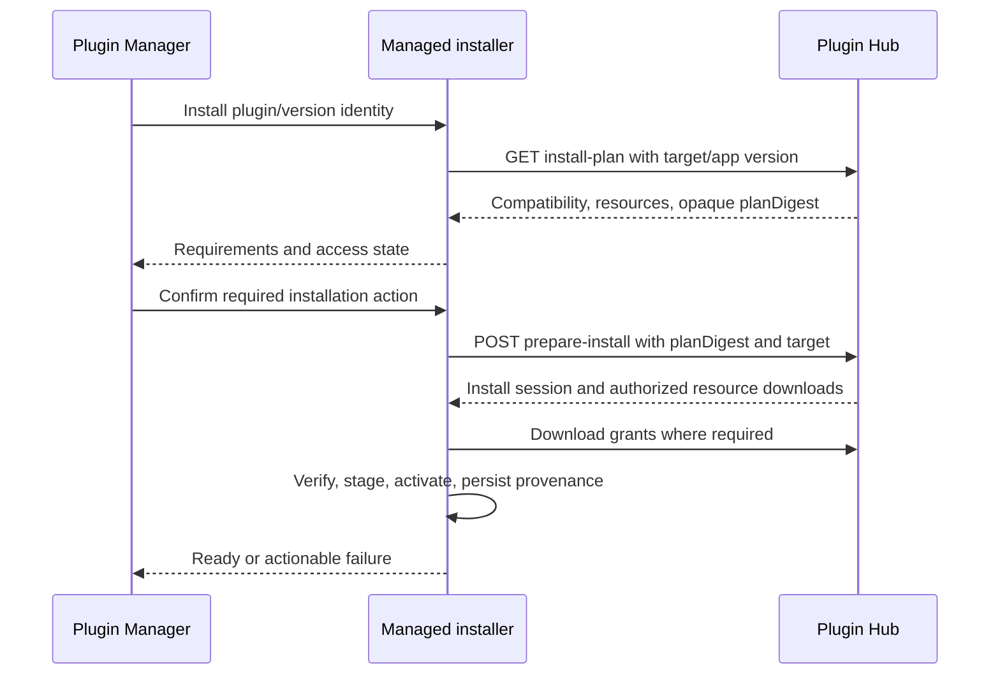

# Yellow Pages Scraper Plugin — Technical Design

## Document information

| Field | Value |
| --- | --- |
| Version | 1.0 |
| Status | Proposed implementation design; no implementation or publication is claimed |
| Date | 2026-10-14 |
| Product requirements | [Yellow Pages scraper plugin PRD](yellow-pages-scraper-plugin-prd.md) |
| Repositories | `aiFetchly`, proposed independent `yellow-pages-scraper-plugin`, `aifetchly-hub-go` |
| Reviewed baseline | Desktop `58fb0b54`; Hub working tree based on `71b8c84` |
| Primary surface | Existing Plugin Manager and AiChatV2 |
| Execution | One plugin-owned MCP stdio process per scrape; host-managed async job |
| Persistence | Host-owned generic artifact files/metadata; no new Yellow Pages entities |

The Hub working tree includes unrelated publishing/source edits. This design describes observed local code, not deployed service readiness. Names marked **new** are proposed files/services/contracts. Existing file references describe integration points, not completed support. Numeric defaults marked **proposed** are engineering starting points and must be confirmed against the PRD’s release decisions.

## 1. Decisions and scope

1. Extract browser scraping, directory adapters, selectors, deterministic recovery, and result writing into an independent repository. Core must not keep a production Yellow Pages fallback.
2. Use the existing Plugin Manager for discovery, installation, enablement, repair, and removal. Use AiChatV2 for scraping and result export; do not build a replacement directory-management UI.
3. Run the scraper behind one high-level MCP tool. The model does not operate low-level Puppeteer steps.
4. Extend the existing MCP SDK/supervised stdio path with a host-supplied JavaScript runtime, execution context, progress, deadline, and artifact registration.
5. Keep scheduling, cancellation, cross-call recovery budgets, permissions, and conversation identity in the host. The plugin receives only the capabilities required for its call.
6. Prefer a public Hub `direct` entry referencing a **prebuilt GitHub commit** for v1, conditional on the product’s access policy. A protected/managed release requires the additional desktop installer work in §16.
7. Persist completed data as JSON and CSV files outside plugin installation directories. Preserve existing Yellow Pages database records during cutover.
8. Defer in-session AI sampling, authenticated browser sessions, detached jobs, and restart-resumable scraping. Authentication deferral remains a product decision; required authentication blocks v1 scope approval until designed.

No implementation may assume that the illustrative manifest in the PRD already works. Runtime, policy, capability, and artifact contracts below require coordinated host and Hub validation.

## 2. Current implementation and required changes

| Area | Existing behavior | Required change |
| --- | --- | --- |
| Plugin package | Native manifest and MCP declaration import; owned MCP rows and component registration | Typed host compatibility, runtime, policy, and capability declarations |
| Hub discovery | Catalog recognizes `direct`, `ticket`, `managed` | Keep existing UI; diagnose unsupported modes correctly |
| Hub install | `installCommunityPlugin` installs only allowed/direct object sources | Prove prebuilt GitHub route; implement managed flow only if selected |
| GitHub acquisition | Archive fetch resolves ref to commit, records provenance; native-git fallback is configurable | Pin release SHA; verify archive path is enabled in packaged app |
| ZIP acquisition | Hub `zip` source is catalog-only; generic URL download lacks expected-digest verification | Do not select ZIP delivery without implementing mapping and checksum plumbing |
| MCP stdio | SDK client with `SupervisedStdioTransport` and owned process spawn | Extend transport; do not replace with raw unmanaged spawn |
| MCP client | `callToolContent` preserves content and accepts signal/timeout | Add progress callback, call metadata, partial notifications, absolute deadline handling |
| MCP service | Fixed 240-second race; disconnect per call | Preserve legacy foreground behavior; async path uses remaining deadline |
| Tool executor | Drops MCP execution context and wraps returned results in success | Carry trusted context; normalize domain and MCP tool errors |
| Jobs | In-memory queue, max four concurrent jobs by default, registry-owned signal | Add plugin ownership/admission, cleanup completion, deadline, terminal idempotence |
| Query loop | Passes `handle.signal`; polls every 15 seconds; 30-minute cap can leave job running | Cancel and await cleanup at deadline; expose structured final results |
| Browser | Existing configured/cache/system executable resolver | Reuse through generic main-process plugin capability |
| Artifacts | `AIArtifactModule` stores HTML; generated-artifact export is image-oriented | Add generic file-artifact ownership/storage/export; do not put CSV into HTML content |
| Legacy scraper | Two worker targets, built-in tools, startup tasks, IPC, UI, entities | Remove complete feature dependency graph after Hub acceptance |

The installed SDK exposes `onprogress`, `signal`, `timeout`, `resetTimeoutOnProgress`, and `maxTotalTimeout` in `shared/protocol.d.ts`. Its request implementation allocates the progress token when `onprogress` is supplied. Use that implementation instead of inventing a second JSON-RPC request correlator. Pin and test the resolved SDK version during implementation.

## 3. Architecture and ownership



The remote AI response that contains the tool call completes before local scraping starts. The host retains `conversationId` and `toolCallId`, waits locally, and issues a new model request after a terminal result. A per-call MCP process is sufficient; browser work never continues after a normal tool response.

| Owner | Responsibilities |
| --- | --- |
| Desktop main process | Trust and AI gates, admission, stable policy identity, runtime/browser resolution, jobs, process supervision, recovery ledger, artifact validation/export, installation state |
| Plugin process | Input/domain validation, platform selection, navigation, extraction, bounded deterministic retries, incremental output, cleanup |
| Renderer | Display catalog, compatibility, progress, errors, artifact actions; send validated requests through preload |
| Hub | Version/source/catalog records, access decisions, static validation, supported distribution contracts; no browser execution or business results |
| Plugin CI | Build and fixture tests, dependency/license inventory, exact distributable, immutable revision, target smoke tests |

Database access remains main-process Module → Model → TypeORM. Worker/plugin processes never import Models, `Token`, Electron `app`, or the application database. A filesystem artifact store is not a Yellow Pages database replacement.

## 4. Independent repository and release tree

Proposed source layout:

```text
yellow-pages-scraper-plugin/
├── .aifetchly-plugin/plugin.json
├── .mcp.json
├── skills/yellow-pages-scraper/SKILL.md
├── commands/yellow-pages.md
├── contracts/
│   ├── scrape-input.v1.schema.json
│   ├── scrape-result.v1.schema.json
│   ├── host-context.v1.schema.json
│   ├── progress.v1.schema.json
│   ├── partial.v1.schema.json
│   └── fixtures/
├── src/
│   ├── childprocess/
│   │   ├── mcp-server.ts
│   │   ├── HostContextReader.ts
│   │   ├── McpToolHandlers.ts
│   │   └── ShutdownCoordinator.ts
│   ├── scraper/
│   │   ├── ScrapeCoordinator.ts
│   │   ├── BrowserSession.ts
│   │   ├── DeterministicRecovery.ts
│   │   ├── RecordNormalizer.ts
│   │   ├── ResultWriter.ts
│   │   └── ScraperError.ts
│   ├── platforms/
│   │   ├── PlatformAdapter.ts
│   │   ├── PlatformCatalog.ts
│   │   └── adapters/
│   └── contracts/
├── assets/                       # Explicit runtime assets, if required
├── test/{unit,contracts,integration,fixtures}/
├── scripts/{build,verify-package,publish-metadata}.ts
├── dist/yellow-pages-mcp.cjs
├── package.json
├── yarn.lock
├── THIRD_PARTY_NOTICES
└── .github/workflows/
```

The process entrypoint lives in `src/childprocess/`. Other scraper files are pure plugin domain code; worker-specific messaging/shutdown stays under `childprocess`. The new repository must set its own equivalent architecture rules. It must not depend on a relative checkout of the desktop, its `@/` alias, its `node_modules`, or Electron source modules.

The runtime bundle includes MCP SDK, `puppeteer-core`, adapters, and extraction dependencies. Browser binaries are external host-managed dependencies. Hub canonical packaging excludes `node_modules`, so all needed runtime code must be bundled and any dynamic assets copied explicitly. No install/build/postinstall script runs on customer machines or during Hub static validation.

Maintain developer source on the normal branch. CI produces a release commit/tree containing the distributable at the repository root plus required metadata; the Hub points to that exact commit. Do not assume fetching a source commit will run the build. The manifest version and release inventory agree before publishing. Optional hooks can be added later; they are not necessary to enforce retry policy.

## 5. Versioned manifest and compatibility contract

### 5.1 Proposed native manifest

This is a **new schema**, not a currently executable package. `hostRequirements` and `capabilities` are typed extensions proposed here. Capability names are separate from existing `SkillPermissionCategory` values.

```json
{
  "name": "yellow-pages-scraper",
  "displayName": "Yellow Pages Scraper",
  "version": "1.0.0",
  "description": "Find and export business listings from supported directories.",
  "skills": ["skills/yellow-pages-scraper"],
  "mcpServers": [".mcp.json"],
  "permissions": ["network", "automation", "filesystem"],
  "hostRequirements": {
    "contractVersion": 1,
    "capabilities": {
      "mcp-host-node": 1,
      "mcp-managed-async": 1,
      "browser-executable": 1,
      "plugin-file-artifacts": 1
    }
  },
  "capabilities": {
    "browserExecutable": true,
    "fileArtifacts": ["json", "csv"]
  },
  "toolPolicies": {
    "scraper/scrape_yellow_pages": {
      "contractVersion": 1,
      "timeoutClass": "async",
      "maxRunMs": 1800000,
      "supportsProgress": true,
      "supportsPartialResult": true,
      "cancellable": true,
      "maxConcurrentPerConversation": 1,
      "resultContract": "aifetchly.plugin-result.v1"
    },
    "scraper/list_yellow_pages_platforms": {
      "contractVersion": 1,
      "timeoutClass": "fast",
      "maxRunMs": 30000,
      "supportsProgress": false,
      "supportsPartialResult": false,
      "cancellable": true,
      "maxConcurrentPerConversation": 1
    }
  }
}
```

`permissions` expresses requested categories; it does not grant them. Grant evaluation remains host-owned. `filesystem` is constrained by the file-artifact capability in host code; it must not become permission for model-supplied paths. The PRD’s illustrative `plugin-storage` name maps to this concrete file-artifact contract. No `ai-recovery` permission is requested in v1.

`aifetchly.plugin-result.v1` identifies the generic host envelope for status, safe error/recovery metadata, and artifact candidates. The business-record/summary schema is plugin-owned and advertised through the MCP tool output schema; the host must not add a Yellow Pages-specific result parser or import plugin domain types. The TypeScript scrape types in §10 describe plugin contracts and shared fixtures.

Validate extension versions, enums, bounds, referenced servers/tools, and path confinement. Reject unknown fields within these typed extension blocks; preserve unrelated manifest extras only under existing compatibility behavior. Unknown required host capability prevents activation. Add a stable unsupported-host diagnostic, mapped to existing `needs_configuration`/`invalid` health semantics as appropriate; do not report healthy readiness.

At release, fill target metadata with the actual minimum desktop version that implements these capabilities. No fictional minimum app version appears in this example. Older clients that ignore extensions must still fail closed on the runtime declaration: there is no fallback `command` in §5.2.

### 5.2 MCP server declaration

```json
{
  "mcpServers": {
    "scraper": {
      "transport": "stdio",
      "runtime": "aifetchly-node",
      "entry": "dist/yellow-pages-mcp.cjs",
      "timeout": 30000,
      "description": "Local Yellow Pages tools"
    }
  }
}
```

The `timeout` is the default foreground/discovery request ceiling. Async execution uses policy and remaining job budget, not this value. `runtime`/`entry` and legacy `command`/`args` are mutually exclusive. Reject plugin-provided runtime command-line overrides, absolute entries, `..`, symlink escape, and conflicting launch environment.

Extend `PluginMcpServerDeclaration` and `NormalizedMcpServer` as discriminated variants. Keep manually configured external MCP commands working under their current validation; do not silently convert them to host runtime mode.

### 5.3 Persistence and launch authority

Keep existing generic InstalledPlugin/MCP entities. Store the normalized runtime descriptor in a reserved host-owned MCP metadata field such as `_aifetchlyRuntimeV1`, containing only runtime kind, relative entry, and contract version. `PluginImportService` must reject that reserved field from package metadata, then write its own normalized value through `MCPToolModule`. Do not persist an absolute Electron executable path or trusted environment injection.

At every discovery/execute, cross-check the descriptor against the installed manifest, component path, plugin enablement, and active installation generation. Revalidate on startup and invalidate on update/reload. A database row claiming host runtime mode without a valid owning plugin is rejected. This metadata approach avoids a new table; schema validation and provenance checks are mandatory.

### 5.4 Tool policy registry

Add **`PluginToolPolicyRegistry`** in main-process services. It loads validated policies from active plugin generations and keys them by `(pluginName, serverName, toolName)`; e.g. `yellow-pages-scraper/scraper/scrape_yellow_pages`.

Resolve policy in this order:

1. Explicit registered built-in skill metadata.
2. Policy for the parsed canonical plugin MCP tool name.
3. Existing tool-name timeout inference.

An unsupported required plugin policy is an activation failure, not a silent fallback to 90 seconds. Clamp plugin limits to host maxima. Register on successful activation; unregister/invalidate on disable, uninstall, or update. Recheck policy/enablement when queued work actually starts. AI names remain `mcp__yellow-pages-scraper__scraper__scrape_yellow_pages`; database IDs never enter the public policy identity.

## 6. Host runtime and browser provisioning

### 6.1 Trusted launch preparation

Add **`PluginMcpRuntimeResolver`**. It returns an internal launch descriptor only after installation/trust/capability validation:

```typescript
interface ResolvedPluginLaunch {
  readonly pluginName: string;
  readonly generation: string;
  readonly runtime: "aifetchly-node";
  readonly executable: string;
  readonly entry: string;
  readonly cwd: string;
  readonly ownerId: string;
  readonly hostContextFile: string;
}
```

The descriptor is not an IPC input and cannot be constructed from raw plugin metadata. The resolver uses `process.execPath`, the canonical installed entry, plugin-root `cwd`, and a host-generated process owner ID. Extend `SupervisedStdioTransport` with a trusted launch variant rather than adding another spawn implementation.

Environment assembly order:

1. Build the existing sanitized inherited/declared environment.
2. Reject forbidden declaration variables with diagnostics; keep existing generic sanitization behavior for legacy callers.
3. Inject only host-created `ELECTRON_RUN_AS_NODE=1` in the runtime branch **after** sanitization.
4. Launch with `shell: false`, piped stdio, and the existing ownership/supervision mechanism.

The sanitizer currently denies `ELECTRON_*` and `AIFETCHLY_*`. Passing the override through ordinary `config.env` will lose it; do not remove those deny rules. Use an internal descriptor/factory with no renderer/package-controlled “trusted” boolean.

Validate the shipped Electron run-as-node fuse and packaged executable behavior on each target. If unsupported, block this runtime and design a signed managed Node alternative; never fall back to system `node` silently. Native module ABI compatibility is avoided by shipping pure JavaScript dependencies; any future native dependency needs an explicit target build contract.

### 6.2 Host context delivery

Before execution, write an atomic, permission-restricted JSON context file in a host-owned temporary directory and pass its path as a fixed host-generated argument, `--host-context-file`. This is launcher data, not AI tool arguments. The package may not override that option.

```typescript
interface PluginHostContextV1 {
  readonly version: 1;
  readonly mode: "discovery" | "execute";
  readonly executionId: string;
  readonly pluginName: string;
  readonly pluginVersion: string;
  readonly outputDirectory?: string;
  readonly browser?: {
    readonly executablePath: string;
    readonly version: string;
  };
  readonly deadlineEpochMs?: number;
}
```

The context contains no AI token, Hub ticket, database path, cookies, profile path from another task, or provider credentials. Discovery mode has no output/browser allocation. The plugin supports initialize/list-tools without launching Chrome. Runtime/tool schema health can therefore be tested during installation without a real scrape.

A file path is a capability contract, not an OS sandbox. The host owns trusted identity and validates every file it accepts back; the plugin is still installed local code. Delete transient context files after process exit, including failed handshake and cancellation paths.

### 6.3 Browser descriptor and profile

Reuse the existing resolution order: configured executable, managed Chrome cache, supported system paths, then a typed missing-dependency result. Extract reusable resolution into a shared module if main-process code needs it; leave worker entrypoints/worker-specific logic under `src/childprocess/`.

Add **`PluginBrowserCapabilityService`** to obtain the approved descriptor without exposing application settings. Verify browser/client compatibility against the plugin’s tested matrix. Missing/incompatible browser yields a dependency diagnostic and prevents scraping. Browser installation runs only through the existing user-visible dependency flow; the scraper does not download binaries.

Each scrape uses a fresh temporary profile under its job root. Close pages, browser, and profile on all terminal paths. Shared cached browser binaries survive plugin uninstall while needed by other features. v1 passes no authenticated profile/cookies. Proxy support, if retained by the parity decision, needs an opaque host-resolved configuration and secret-safe channel; do not place proxy credentials in AI arguments or the public result schema.

## 7. Execution context and job admission

### 7.1 Host-only context

Extend the execution-context chain from `SkillExecutionContext` through `ModuleExecutionContext` to MCP. Fields below are host-generated and never accepted from tool arguments:

```typescript
interface PluginToolExecutionContextV1 {
  readonly executionId: string;
  readonly jobId: string;
  readonly conversationId: string;
  readonly toolCallId: string;
  readonly pluginName: string;
  readonly pluginGeneration: string;
  readonly deadlineEpochMs: number;
  readonly signal: AbortSignal;
  readonly emitProgress: (progress: ToolJobProgress) => void;
  readonly emitPartial: (partial: PluginPartialSnapshotV1) => void;
}

interface PluginPartialSnapshotV1 {
  readonly version: 1;
  readonly executionId: string;
  readonly sequence: number;
  readonly collectedCount: number;
  readonly expectedCount: number | null;
  readonly phase: "queued" | "running" | "fetching" | "extracting" | "finalizing";
  readonly outputReady: boolean;
}
```

Keep new fields optional for existing non-plugin callers; require a validated complete context when resolving an async plugin policy. `MCPToolService` receives an execution options object rather than reconstructing identity from model input. The MCP branch of `ToolExecutor` and `SkillExecutor` must retain this context.

The registry currently allocates `jobId` internally and may invoke the spawn callback before `start()` returns. Add `jobId` to `ToolJobSpawnHandle` or an equivalent registration-before-start API. Do not capture the returned ID in a callback that may run synchronously. Extend partial snapshots to allow an unknown expected count rather than inventing a total.

### 7.2 Admission and duplicate suppression

Add **`PluginExecutionCoordinator`** with an atomic per-plugin/generation admission gate. Before creating a job:

1. Check `USER_AI_ENABLED` using `Token`; the AI IPC handler already performs the first check before parsing, and execution rechecks before work.
2. Resolve installed plugin/component/tool state, contract compatibility, permissions, and active generation.
3. Validate public arguments and normalize strings/field order.
4. Validate and reserve recovery authorization if this is a retry.
5. Acquire the plugin/conversation admission lease and canonical request fingerprint.
6. Register the job and its authoritative deadline; allocate runtime resources only when execution begins.

Fingerprint input is plugin identity, conversation identity, query, location, selected/auto platform, detail setting, requested fields, and result limit. Normalize deterministically; never hash secrets. Recovery ledger identity separately tracks the original logical search, so changing `maxResults` or platform cannot reset the retry budget.

For duplicate queued/running calls, return a bounded `JOB_ALREADY_RUNNING` outcome associated with the caller’s own `toolCallId`; do not attach two model tool calls to one result without an explicit mapping. The model should wait for the existing task or ask the user. The plugin/conversation lease remains held until browser cleanup finishes, not just until the UI says cancelled.

### 7.3 Lifecycle and cleanup ownership

The public job states remain `queued`, `running`, `completed`, `failed`, `cancelled`. Track internal `cleanupPending`/cleanup promise separately. Current registry `cancel()` aborts and labels cancellation immediately, and its callbacks are synchronous; that alone is not proof of resource release.

Required generic extensions:

- `waitForCleanup(jobId, deadline)` or equivalent completion handle.
- An owned execution map keyed by plugin/generation/job, retained through cleanup.
- Exactly-once resolve/reject/cancel settlement and capacity release. For executions with registered cleanup, keep the running-capacity reservation until cleanup settles; do not start replacement browser work solely because public state changed to cancelled. Preserve the existing behavior for legacy jobs without a cleanup contract until they are migrated.
- Terminal jobs ignore late progress, duplicate resolution, and late MCP results.
- Cancellation of queued jobs removes them without launching a process.
- Registry shutdown seals admission, aborts jobs, and lets the application lifecycle await owned cleanup before clearing records.

Registry public state and tool outcome are distinct: an MCP call can complete successfully as transport while returning `ToolExecutionResult.success = false`. The existing completed-job envelope must preserve that result; do not reclassify it as success based on job state alone.

## 8. Managed async execution sequence

```mermaid
sequenceDiagram
    participant UI as AiChatV2
    participant Loop as Query loop
    participant AI as AI server
    participant Jobs as Job registry
    participant MCP as MCP service/client
    participant P as Plugin
    participant Files as Artifact store
    UI->>Loop: User search request
    Loop->>AI: Conversation request
    AI-->>Loop: Tool call; model response completes
    Loop->>Jobs: Admit and start async job
    Jobs->>MCP: Trusted context + registry signal
    MCP->>P: Supervised launch and initialize
    MCP->>P: tools/call + progress callback
    loop Browser work
        P-->>MCP: Progress / bounded partial snapshot
        MCP-->>Jobs: Update job snapshot
        MCP-->>UI: tool_progress
    end
    P-->>MCP: Structured outcome + candidate files
    MCP->>P: Close and await process cleanup
    MCP->>Files: Validate and promote finalized outputs
    Files-->>MCP: Host artifact references
    MCP-->>Jobs: Normalized ToolExecutionResult
    Jobs-->>Loop: Terminal result after cleanup
    Loop->>AI: New request with bounded tool result
    AI-->>UI: Summary, artifact availability, or recovery choice
```

`tools/list` and platform discovery do not start browsers. The scraper process supports one active scrape; host policy provides admission. Discovery processes can be short-lived independently of a scrape.

On completion, close the plugin and browser before promoting outputs into the immutable host artifact store. This prevents accepted output files from changing during export. Do not wait for normal browser teardown indefinitely; cleanup escalation is bounded.

## 9. Deadlines, progress, and cancellation

### 9.1 Timeout budget

| Budget | Proposed value / rule |
| --- | --- |
| Total admitted job | At most 30 minutes, including queue wait and cleanup |
| Connection/initialize | Minimum of existing connection ceiling and remaining budget |
| Cleanup reserve | Final 5 seconds of total budget |
| Browser action | Adapter-specific, bounded by remaining work budget |
| Foreground platform discovery | 30 seconds maximum |
| Progress | At most 4 updates/second; phase changes delivered promptly |
| Partial snapshot | At most once/second; 16 KiB maximum |
| Model-facing result | 32 KiB maximum before any stricter chat serializer limit |

At admission, record wall-clock deadline for diagnostics and a monotonic deadline for enforcement. The host timer is authoritative. Compute remaining work budget before connection and before `tools/call`; reject already-expired work without spawning.

For the async SDK call set `timeout` and `maxTotalTimeout` to remaining work budget and use `resetTimeoutOnProgress: false`. Progress never extends lifetime. Exempt only validated async plugin calls from the service’s fixed 240-second race. Preserve existing foreground behavior and test it.

When the work deadline expires, abort, perform bounded cleanup in the reserve, then finalize a timeout result. The query-loop polling cap must trigger the same cancellation/cleanup path; it must not return “job may still be running” and allow an automatic retry. Wall-clock changes must not extend the monotonic budget.

### 9.2 Protocol progress

Use the SDK’s `onprogress` option; it supplies `_meta.progressToken` on `tools/call`. The plugin echoes the received token in standard progress notifications:

```json
{
  "jsonrpc": "2.0",
  "method": "notifications/progress",
  "params": {
    "progressToken": 17,
    "progress": 38,
    "total": 100,
    "message": "Extracted 38 businesses"
  }
}
```

Here units are collected records, not elapsed-time percentage. Omit `total` when unknown; exhaustion may complete with fewer results than requested. Validate finite, non-negative counters and bound/redact the message. The SDK callback is bound to the owning execution; no model-provided job ID can select a registry record.

For phase/count snapshots use a versioned custom notification, `notifications/aifetchly/plugin-partial`, carrying `PluginPartialSnapshotV1`. Register its schema on the SDK client before calling the tool. The plugin receives `executionId` through its host context. Verify execution identity, monotonically increasing sequence, limits, and live job state before accepting it. Reject malformed/oversized updates with safe diagnostics; repeated protocol abuse terminates the call.

Standard progress updates the fraction/message; partial snapshots add phase/counts. Coalesce both into one host `ToolJobProgress` view and emit it to registry and renderer. No full records or raw artifact paths appear in notifications. `outputReady` means candidate files were finalized, not yet registered as user-downloadable artifacts.

### 9.3 Stop, disconnect, and process descendants

The registry signal reaches the SDK call, which sends cancellation according to its implementation. The plugin handler uses the SDK request’s abort signal, stops scheduling pages, cancels waits, flushes useful output if time permits, and closes Puppeteer in `finally`.

Cancellation does not guarantee plugin cooperation. The host uses the supervised close sequence, then platform-appropriate process-tree termination under existing lifecycle ownership. Browser children must be included even if the MCP parent exits early. Verify Windows, macOS, and Linux behavior on advertised targets; observing only parent PID exit is insufficient.

The user may see “stopping” while cleanup is pending. Release admission leases only after verified cleanup. If cleanup cannot be confirmed, return a stable cleanup failure, prevent automatic retry and file replacement, and keep the owned-process cleanup task visible to shutdown handling. Never claim success while a known browser process remains active.

## 10. MCP tool and business record contracts

### 10.1 Public input

```typescript
type ListingField =
  | "businessName" | "phone" | "email" | "website" | "address"
  | "categories";

type RecoveryStrategy =
  | "fallback_adapter" | "reduced_scope" | "switch_platform"
  | "retry_after_delay";

interface ScrapeInputV1 {
  readonly query: string;
  readonly location: string;
  readonly platform?: string;
  readonly maxResults?: number;
  readonly includeDetailPages?: boolean;
  readonly fields?: readonly ListingField[];
  readonly recovery?: {
    readonly previousErrorId: string;
    readonly strategy: RecoveryStrategy;
  };
}
```

Proposed validation: trim query/location; each 1–256 characters; default `platform: "auto"`; default 100 results, hard cap 1,000; default detail pages enabled; deduplicated allowlisted fields. Reject extra top-level fields and all caller-supplied paths, scripts, cookies, browser flags, host context, and retry counters. The host validates schema before admission; the plugin revalidates its domain schema.

`auto` chooses only an adapter advertised as ready for the supplied region. If region cannot be determined reliably, return an actionable ambiguity/unsupported-platform outcome; do not silently scrape an unrelated country. `list_yellow_pages_platforms` returns bounded IDs, labels, countries, supported fields, and availability. Importing an adapter does not establish live site support.

### 10.2 Normalized records

```typescript
interface BusinessRecordV1 {
  readonly recordId: string;
  readonly platform: string;
  readonly businessName: string;
  readonly phone?: string;
  readonly email?: string;
  readonly website?: string;
  readonly address?: {
    readonly formatted: string;
    readonly countryCode?: string;
  };
  readonly categories?: readonly string[];
  readonly sourceUrl: string;
  readonly collectedAt: string;
}
```

Use a versioned normalization strategy. Prefer a stable directory listing ID for deduplication; otherwise hash platform plus normalized canonical source URL and business identity. Do not merge unrelated businesses merely because phone numbers match. Return only requested business fields plus minimal provenance; missing values are absent, never AI-invented. Cap individual fields and URLs before serialization.

`EMPTY_RESULTS` is not automatically an error. Confirmed no-results UI with valid selectors produces `completed` and zero records. Missing result containers without no-results evidence produces `RESULT_SELECTOR_NOT_FOUND`. Do not confuse exhaustion with a block or parser failure.

### 10.3 Domain result envelope

```typescript
interface ScrapeSummaryV1 {
  readonly platform: string;
  readonly query: string;
  readonly location: string;
  readonly recordCount: number;
  readonly pagesVisited: number;
  readonly detailPagesVisited: number;
  readonly durationMs: number;
}

interface ScrapeErrorV1 {
  readonly id: string;
  readonly code: string;
  readonly category: "transient" | "site_changed" | "rate_limited"
    | "blocked" | "invalid_input" | "dependency" | "permission"
    | "plugin_bug" | "cancelled";
  readonly stage: string;
  readonly message: string;
  readonly recoverable: boolean;
  readonly allowedStrategies: readonly RecoveryStrategy[];
  readonly retryAfterMs?: number;
}

type ScrapeResultV1 =
  | {
      readonly schemaVersion: 1;
      readonly success: true;
      readonly status: "completed" | "partial";
      readonly summary: ScrapeSummaryV1;
      readonly preview: readonly BusinessRecordV1[];
      readonly warnings: readonly string[];
    }
  | {
      readonly schemaVersion: 1;
      readonly success: false;
      readonly status: "failed" | "cancelled";
      readonly error: ScrapeErrorV1;
      readonly summary?: ScrapeSummaryV1;
      readonly preview: readonly BusinessRecordV1[];
    };
```

Artifact candidates are a separate plugin-to-host field (§13); the host adds registered artifact references to the public envelope. Optional safe observations use a separately capped schema from the PRD, not arbitrary nested objects. `schemaVersion` is required. The primary model-facing `artifact` reference remains compatible with the PRD; an optional `artifacts` array can carry both JSON and CSV.

Useful incomplete data is `success: true, status: "partial"` only after at least one usable artifact is registered. Artifact registration failure cannot become a completed success. Cancellation remains `success: false` even when a partial artifact is retained. A cancelled turn must not automatically resume AI recovery.

### 10.4 Normalization precedence

| Input | Host outcome |
| --- | --- |
| Valid domain envelope, `isError` false/absent | Preserve its `success` and status after artifact checks |
| `isError: true` with safe structured diagnostics | `success: false`; preserve validated error; recoverability follows policy |
| `isError: true` with nested `success: true` | Failure; reject contradictory success |
| Invalid structured content or unsupported result version | Stable invalid-result failure; no raw payload in chat/logs |
| Transport/handshake/JSON-RPC failure | Sanitized infrastructure failure; no automatic scraper retry |
| Legacy MCP tool without this contract | Existing generic normalization, with no new interpretation of arbitrary nested fields |

Prefer `structuredContent`; use the bounded JSON text representation only as a fallback. For this contract, reject contradictory structured/text envelopes rather than allowing different consumers to see different results. Do not parse arbitrary prose as a domain envelope. Avoid globally changing semantics for unrelated MCP tools.

`ToolExecutor` must stop blindly returning `{success: true, result}` for this path. `SkillExecutor` preserves the normalized success value, and the query loop routes failures through `PostToolUseFailure` with the complete safe error. An MCP `isError` is a tool failure, not synonymous with transport failure.

## 11. Plugin scraper implementation

### 11.1 Adapter interface

```typescript
interface PlatformAdapter {
  readonly id: string;
  readonly countries: readonly string[];
  readonly supportedFields: readonly ListingField[];
  search(context: AdapterContext, input: ScrapeInputV1): Promise<void>;
  extractListings(context: AdapterContext): Promise<readonly BusinessRecordV1[]>;
  nextPage(context: AdapterContext): Promise<boolean>;
  enrichListing(context: AdapterContext, record: BusinessRecordV1): Promise<BusinessRecordV1>;
  classifyPage(context: AdapterContext): Promise<PageClassification>;
}
```

`AdapterContext` is plugin-local and supplies typed Puppeteer page access, cancellation, time budget, rate limiting, and safe diagnostics. `PageClassification` distinguishes listings, confirmed empty results, consent, authentication, challenge, and unexpected layout. These types live in the plugin; the host does not import Puppeteer or site selectors for this feature.

### 11.2 Scrape pipeline

1. Validate context/input and choose a supported adapter.
2. Open output staging and launch a browser with an isolated profile.
3. Navigate to the directory through the adapter’s allowed origins.
4. Classify the page before extraction; handle packaged consent logic only.
5. Extract, normalize, validate, and deduplicate listings.
6. Optionally enrich from directory detail pages with bounded concurrency.
7. Append records incrementally; publish counts and periodic finalized checkpoints.
8. Stop at result cap, pagination exhaustion, deadline, cancellation, or terminal block.
9. Finalize JSON/CSV and candidate manifest; close browser; return a bounded result.

Proposed detail concurrency is two pages per job, clamped by platform policy. Retries use abortable backoff and a per-origin limiter. A detail failure preserves the base listing with a warning. Use an upper page/visit budget in addition to record count to avoid looping through duplicate pages indefinitely.

Linked business websites are not implied by directory detail permission. v1 collects emails only when available on permitted directory pages unless the product explicitly includes linked-site crawling. That extension requires redirect/DNS/private-network policy, origin budget, and field-specific tests. No captcha bypass, arbitrary model-generated script, or raw HTML transfer is part of this plugin.

### 11.3 Adapter migration matrix

Current active configuration imports include:

| Config source | Migration check |
| --- | --- |
| `yell-com.ts` | Search/location, pagination, directory details |
| `11880-de.ts`, `gelbeseiten-de.ts` | German location normalization and field extraction |
| `paginegialle-it.ts`, `pagesjaunes-fr.ts` | Country-specific search and consent fixtures |
| `yelp-com.ts`, `yellowpages-com.ts` | Platform selection, detail fields, block classification |
| `itownpage-jp.ts`, `usonar-yellowpage-jp.ts` | Japanese text/location handling and pagination |
| `korealocalpages-kr.ts`, `yellowpages-com-sg.ts` | Regional selection and detail extraction |

This is a source inventory, not a claim that every adapter works or must ship in 1.0. Build fixture and staging evidence for each; publish only the approved subset in `PlatformCatalog`. Existing extra adapter files, such as Canadian adapters, need consumer tracing before deletion. Preserve dependencies shared with other features.

## 12. Recovery across process lifetimes

### 12.1 Deterministic recovery

Plugin-owned retries cover navigation reloads, packaged fallback selectors, backoff after transient errors, lower detail concurrency, and skipping malformed records. Proposed default is two retries per transient operation, bounded by total job deadline and per-origin limits. Auth/captcha/permission/dependency failures stop without retry.

### 12.2 Host recovery ledger

Add **`PluginRecoveryLedger`**, keyed by user session, conversation, plugin, and a host-generated logical search ID. The ledger stores:

- Original canonical scope and version/generation.
- Host-issued error reference and sanitized error classification.
- Allowed strategy set, attempt count, and earliest retry timestamp.
- Strategy/argument fingerprints already attempted.
- In-flight reservation and terminal/cancelled state.

The plugin may return a diagnostic error ID, but the host replaces or binds it to its own public error reference before sending it to the model. A model-supplied `previousErrorId` must resolve to the same conversation/plugin and an eligible prior failure. Reserve the attempt atomically before spawn; simultaneous retries cannot both consume the same authorization.

Default outer recovery limit is two retries, hard maximum three per logical search as in the PRD. Record reservations/attempt outcomes even when the child fails to start; do not allow repeated crashes to evade the budget. Reject repeated strategy fingerprints and rate-limit retries before their timestamp. A model call that omits `recovery` but repeats a recent failed scope remains tied to the existing ledger unless a new user request explicitly starts a new search. Do not rely on optional hooks or model honesty.

Send only the validated recovery strategy and host-approved budget context to the plugin using a host-owned `_meta` extension on `tools/call` or its context file. Never merge authority fields into untrusted public arguments. Reject conflicting values. Plugin-side enforcement covers the current call; the host enforces history.

Ledger memory survives MCP process exit but not application restart. On restart, old retry IDs are invalid; completed artifacts remain accessible. The user can explicitly start another search. Automatic resume tokens/browser continuation are not supported.

### 12.3 Recovery outcome policy

| Failure | Automatic action |
| --- | --- |
| Changed selector with packaged fallback | One eligible new call using `fallback_adapter` |
| Recoverable detail pressure | `reduced_scope`, preserving already exported data |
| Rate limit | Retry only after allowed time and within deadline/budget; otherwise explain delay |
| Supported alternate directory | `switch_platform` with retained logical-search budget |
| Confirmed no results | Completed zero-result output, no automatic retry |
| CAPTCHA/login required | Stop and explain; no live-session handoff is promised in v1 |
| Missing browser, denied permission, crash, invalid result | Repair/intervention; no automatic repeated scrape |
| User cancellation or cleanup failure | Stop; no automatic retry |

A subsequent scrape starts fresh. Combining outputs requires deduplication by record identity; `resumeStrategy` does not promise continuation of the previous browser session.

## 13. File artifacts, export, and retention

### 13.1 Storage layout and identity

Add a generic **`PluginFileArtifactService`** plus **`PluginFileArtifactModule`** for ownership/authorization. Use a host-resolved per-user data root; never let renderer/model/plugin select that root. Derive a non-PII user scope from the authenticated host context, not an untrusted email string.

```text
<host-user-data>/plugin-artifacts/<user-scope>/
├── staging/<execution-id>/
│   ├── records.ndjson.partial
│   ├── records.json
│   ├── records.csv
│   └── candidates.json
├── artifacts/<artifact-id>/
│   ├── content.json             # Or content.csv
│   └── metadata.json            # Written by host only
└── journal/<execution-id>.json  # Host lifecycle/registration journal
```

The plugin receives only its staging directory. It writes no ownership metadata in the final store. Host metadata records schema version, artifact ID, user/conversation/job/plugin/version identity, MIME/format, byte count, record count, checksum, creation/expiry, and completion status. Write files and metadata atomically; metadata is authoritative only after validated content has been promoted.

Use JSON metadata/files for v1, no new database table. All metadata mutation goes through the host service/module, serialized per artifact/job. If a generic database index is later necessary, add a generic Entity/Model and resolve its database path through `Token`/`USERSDBPATH`; IPC never accesses repositories directly. Do not extend HTML-only `AIArtifactEntity` by storing arbitrary CSV in `content`.

### 13.2 Candidate and registered reference

The plugin returns a candidate manifest separately from its public result:

```typescript
interface PluginArtifactCandidateV1 {
  readonly version: 1;
  readonly relativePath: "records.json" | "records.csv";
  readonly format: "json" | "csv";
  readonly recordCount: number;
  readonly complete: boolean;
}

interface RegisteredPluginArtifactV1 {
  readonly id: string;
  readonly format: "json" | "csv";
  readonly recordCount: number;
  readonly sizeBytes: number;
  readonly createdAt: string;
  readonly expiresAt?: string;
}
```

Proposed v1 fixed filenames simplify validation. The host assigns opaque IDs and computes size/digest; it does not trust plugin assertions about ownership, paths, size, or checksum. The host strips candidates from model/renderer output and replaces them with registered references.

After the browser/plugin has stopped, validate candidate files with canonical path containment, regular-file checks, no symlinks/reparse escape, allowed extension/MIME, size limits, and data schema. Reject device files and suspicious hard links; copy into newly created host-owned files rather than accepting mutable links. Bound parsing and compare actual record counts. Staging/root directories themselves must be owned and validated. This reduces accidental/path-based access; it does not sandbox a malicious installed program with the same OS user privileges.

### 13.3 Incremental output and partial recovery

Stream normalized records into NDJSON staging to avoid retaining the full dataset twice. Finalization produces a valid JSON document with schema version, summary, and records, plus CSV using stable column order. The JSON artifact preserves original string values; CSV must escape quotes/newlines and neutralize formula-like cells (`=`, `+`, `-`, `@`, leading control characters) under a documented spreadsheet-safe export policy.

Write completed candidates to temporary names and rename atomically. `candidates.json` lists only files fully finalized. On graceful cancellation the plugin may finalize useful records within the remaining cleanup budget. On crash/forced kill, the host registers only already-finalized, validated candidate files; it never exposes a half-written JSON file as complete. Automatic salvage of raw NDJSON is deferred unless separately schema-validated and marked partial.

Proposed limits: 100 MiB per finalized artifact, two artifacts per scrape, five preview records, and 32 KiB model-facing result budget. Host quota/disk-space checks run before launch and during finalization. Apply any stricter existing chat budget after redaction; truncation must preserve valid JSON and stable error/summary fields.

### 13.4 Renderer/API contract

Add generic typed IPC operations (proposed channel names):

- `plugin-artifact:list` with conversation ID.
- `plugin-artifact:preview` with conversation ID and artifact ID; bounded JSON/rows only.
- `plugin-artifact:export` with conversation ID and artifact ID; destination chosen by the native save dialog.
- `plugin-artifact:delete` with conversation ID and artifact ID, following the application’s deletion UX.

Authenticate the sender/session and verify conversation ownership in the Module before reading. Request IDs are references, not authorization. Renderer-supplied absolute paths, protocol URLs, plugin names, and MIME overrides are rejected. Export copies validated bytes and never opens arbitrary content as HTML. Generic file export does not require an AI API call; any handler that does invoke AI must apply the existing early AI gate.

Reuse existing tool cards and artifact-action visual patterns, but implement the actual CSV/JSON pointer and ownership semantics. New UI text requires en/zh/es/fr/de/ja translations. A model can mention an artifact only after host registration; no fabricated download URL is emitted.

### 13.5 Retention and restart

Proposed retention is 30 days for unexported completed artifacts and immediate cleanup of transient context/profile data after shutdown. Final retention/uninstall policy is a release decision, visible to the user. Exported copies are user files and never deleted by plugin cleanup.

At startup, reconcile host journals: incomplete executions become interrupted, orphan staging is quarantined/expired, and complete registered artifacts stay readable without the plugin installed. Registration is idempotent by execution/candidate identity so crash recovery cannot duplicate artifacts. Conversation deletion follows the application’s data policy and removes its generic artifact references/content without touching user exports.

## 14. Plugin activation, update, disable, and uninstall

### 14.1 Activation transaction

1. Acquire source into staging using the existing acquisition service.
2. Validate archive, manifest, typed extensions, confined entry, and required host capabilities without executing code.
3. Resolve requested permissions/trust and browser availability. Missing browser may leave the installed plugin `needs_configuration`; no scrape tool is exposed until ready.
4. Under an activation gate, persist installed plugin/MCP metadata through existing Modules, with components unavailable to the AI catalog until activation commits. Existing early hot-registration in import must be deferred for this runtime.
5. Run an authorized, bounded discovery-mode MCP smoke test: initialize, list tools, verify names/input/output contracts, close. This executes installed plugin code and therefore happens after trust checks, not as static validation.
6. Commit active installation generation; atomically refresh policies, commands, skill instructions, hooks if present, and tool exposure.
7. Roll back staged files/rows/components on failure. Never advertise a partially activated scrape tool.

Existing import code persists MCP entities and may hot-register skills before all lifecycle checks. Add explicit staging/effective-enablement coordination; do not assume the existing pipeline already provides this complete transaction. Filesystem and database operations require compensating rollback, not a false claim of one cross-resource SQL transaction.

### 14.2 Update and repair

The coordinator seals new admission for the plugin, waits for or cancels current jobs under the chosen UI action, and waits for cleanup. Stage and validate the new generation without overwriting files used by the old process. Promote only after smoke tests pass; update component state and invalidate caches/policies as one coordinated operation. Reopen admission afterward.

Keep the previous installation generation until the new one activates. Failure restores the prior registered metadata and files. Preserve per-component user enablement where identifiers remain compatible; removed tools must not keep stale policies. Repair reacquires the same immutable source unless the user explicitly selects an update.

### 14.3 Disable/uninstall

First seal admission and suppress tool discovery. Abort owned jobs and await cleanup. Unregister policies, skill instructions, commands, optional hooks, and MCP availability. Only then remove installed code/rows on uninstall. If cleanup fails, do not delete files underneath a still-running process; surface a retryable removal error.

Keep completed artifacts according to retention policy; offer separate deletion if required. Never uninstall a shared Chrome runtime solely because this plugin was removed. Re-enabling repeats compatibility/health checks and registers a new generation lease.

## 15. Hub direct distribution implementation

### 15.1 First-release acquisition contract

For public distribution, publish a GitHub source whose repository/ref identify the **prebuilt release commit**, not a moving development branch. Illustrative catalog source fragment:

```json
{
  "source": "github",
  "repo": "OWNER/yellow-pages-scraper-plugin",
  "ref": "0123456789abcdef0123456789abcdef01234567",
  "sha": "0123456789abcdef0123456789abcdef01234567"
}
```

`OWNER` and the SHA are placeholders, not release coordinates. The current desktop normalizer prefers `sha` over `ref`, then GitHub acquisition resolves/downloads the commit archive and records `resolvedCommitSha`. Validate the SHA shape at the catalog boundary and compare installed provenance with the selected version. Do not use `/tree/<ref>` or `/commit/<sha>` browser URLs; the fetcher expects repository identity plus the ref field.

The fetched archive must have a discoverable manifest at its root (or supported single enclosing directory) and built `dist`. Verify the archive-install feature flag in packaged apps; a native-git compatibility fallback cannot satisfy the no-git acceptance test. No npm source is selected for v1 because acquisition must not require customer-side package tooling.

A commit pin identifies source content, not an independent archive signature. If stronger signed/checksummed ZIP delivery is required, implement and select the corresponding integrity route; do not claim that the current direct source verifies a Hub artifact SHA256.

### 15.2 Hub validation changes

Reuse native manifest discovery, capability scanning, static validation reports, version/source attachment, and catalog publication. Add validators for host requirements, tool policies, and the `aifetchly-node` declaration. Ensure declaration scanning reads the manifest’s declared `.mcp.json` rather than assuming only `mcp/servers.json`.

The current managed declaration parser expects a Python runtime object; this design uses a host runtime string. Add explicit runtime dispatch before Python parsing:

- Legacy command server → existing validation.
- `runtime: "aifetchly-node"` → host-runtime/entry/compatibility validator; no Python environment/resource rows.
- Managed/uv Python object → existing managed normalization.
- Unknown runtime → unsupported declaration error.

Inspect the validation-to-normalization enqueue path so a valid host-runtime plugin is not rejected later by the Python normalizer. A host capability does not imply a downloadable Hub-managed runtime. Direct v1 should retain `resource_status: not_required` only when it truly has no Hub-managed resources; browser dependency readiness is supplied by desktop and shown in compatibility diagnostics.

### 15.3 Publishing workflow

The independent plugin CI builds/tests the release and produces source revision, package inventory, dependency notices, checksums, and target compatibility evidence. Use existing Hub admin workflow:

1. Create/update plugin identity.
2. Create draft version with matching manifest version.
3. Create source metadata and attach source to version.
4. Complete static validation/review for the exact release content.
5. Set tested target/minimum-host compatibility metadata supported by the selected catalog/detail route.
6. Publish and verify the refreshed catalog contains the correct access/install mode and source.
7. Install that catalog entry in a packaged desktop staging test before general availability.

No Yellow Pages-specific Hub endpoint is necessary. Hub code/flags and public metadata vary by deployment; staging acceptance must verify actual behavior. Existing uncommitted SHA-optional changes in the Hub do not relax this plugin’s immutable-release requirement.

### 15.4 Canonical packaging constraints

Although direct GitHub acquisition does not necessarily download the canonical Hub ZIP, CI should test canonicalization to keep future delivery compatible. The Hub strips `node_modules`, caches, VCS data, credential-shaped files, and fixes file modes to 0644. Do not depend on executable bits, symlinks, or install scripts.

Current desktop limits are 50 MiB compressed, 250 MiB extracted, 5,000 files. Hub canonical defaults permit 512 MiB uncompressed and 20,000 files. Enforce the stricter desktop limits in release CI. Exclude fixtures/source maps containing unnecessary source or secrets from the distributable; keep required runtime assets and licenses. Test the resulting bytes by launching MCP and exercising fixtures after canonicalization.

## 16. Conditional managed/ticketed distribution

This section is required only if product policy chooses protected delivery or Hub-managed resources. It is not assumed completed and must not be used to block a public direct v1 unnecessarily.

The Hub exposes ID-based install-plan and prepare-install routes, but desktop currently rejects non-direct Community installs. Implement a generic managed installer according to the [managed installation PRD](plugin-hub-managed-installation-prd.md), reconciled with the existing unified Plugin Manager:



Use the plan’s authoritative target, compatibility, resource identity, sizes, digests, and signatures where provided. Treat `planDigest` as opaque. Keep credentials/tickets/download URLs in main process; never pass them to AI or the plugin. Re-fetch on stale plans, renew expired grants through supported APIs, and stop on denied access/revocation. Never fall back to a public source for a protected plugin.

The runtime declaration validators support Python/uv today, not managed Node/Chrome. If this route needs Node/browser resources, add generic Hub resource schema, target/artifact builders, desktop cache/provisioning, compatibility checks, and cleanup/reference counting. Do not disguise Node as Python or assume uv installs the browser.

For public ZIP delivery instead, implement catalog `zip` → installable source mapping and a typed expected-SHA256 field through acquisition, streaming hash verification before extraction, provenance, and mismatch tests. Existing URL installation without such plumbing is not sufficient.

## 17. Migration and legacy removal

### 17.1 Extract behavior before deleting infrastructure

Create fixtures and a per-adapter parity matrix before moving code. Separate pure extraction and domain types from Electron settings, logger initialization, database queries, browser manager imports, child IPC protocols, and app-owned task IDs. Replace these couplings with plugin-local dependencies and explicit host capabilities.

Move Yellow Pages-only behavior; retain shared browser/AI/contact-extraction helpers until all consumers have been checked. Removing the feature does not imply removing Puppeteer from the whole application. The plugin’s independent CI must pass with no desktop checkout available.

### 17.2 Core removal checklist

| Surface | Required removal/update |
| --- | --- |
| Workers/build | Both `YellowPagesScraper.ts` and `YellowPagesScraperProcess.ts` core entries; both Forge targets and Vite configs; obsolete worker schemas |
| Core domain | Controller, process manager, orchestrator, Yellow Pages modules/health/init/recovery handlers after extracting shared responsibilities |
| Adapters | Yellow Pages-only adapters/config/registration and factories; preserve unrelated/shared consumers |
| AI | `search_yellow_pages`, `get_available_yellow_pages_platforms`, tool definitions/registry branches, executor and result formatter, domain persistence hooks, name-based timeout branch |
| Startup | Yellow Pages boot initialization, previous-task resume, orphan-task checks in `background.ts`/`bootuprun.ts` |
| IPC/preload | Handler registration, schemas/channels, preload allowlists and typed frontend API |
| Renderer | Pages, components, menu links, both route sources and UI migration registry; corresponding tests/translations |
| Persistence | Entity/model imports and registrations, legacy SQL initializers; reviewed upgrade policy below |
| Packaging/docs/tests | Exclusive dependencies/scripts, old worker bundle tests, obsolete user docs; adapter fixtures move to plugin |

Verify removal through imports/build output and behavior tests, not merely a search with zero occurrences: migration notes and historical fixtures may legitimately retain the name.

### 17.3 Existing records and upgrade behavior

No plugin code reads old tables. Before UI removal, provide/document an export or backup path and communicate that legacy scheduled tasks will no longer run. Preserve database files/tables by default. Check TypeORM synchronization and migrations when removing entity registrations; test with a copy containing real-shaped legacy rows.

Do not auto-convert old tasks into plugin jobs or silently reinstall/enable the plugin for every user. Opt-in installation is the product requirement. Unsupported old route/bookmark handling should explain feature availability through the existing plugin surface without exposing a hidden legacy backend.

Stage removal only after the staging Hub install → scrape → export/cancel tests pass on the advertised target matrix. Rollback may restore the previous application release/data backup, but must not introduce a permanent dual production scraper path. A faulty plugin release can be delisted and clients returned to a prior known-good plugin generation through supported update/repair behavior.

## 18. Implementation ownership and change map

These are proposed units of work; names may be adjusted to existing naming conventions, but responsibility boundaries must remain.

| Unit | Desktop files/services | Plugin / Hub work | Done when |
| --- | --- | --- | --- |
| TD-01 Contracts | Extend `pluginTypes`, manifest/MCP declaration validators; new schemas | Versioned JSON schemas and fixtures; Hub host-runtime validation | Same positive/negative fixtures accepted/rejected across consumers |
| TD-02 Runtime | New runtime resolver; extend MCP client, supervised transport and trusted environment path | Discovery-mode MCP server | Packaged app launches without system Node and rejects unsafe entry/env |
| TD-03 Policies | New policy registry; loader/component/cache integration; query-loop resolution | Typed policy declaration | Disabled/incompatible plugin cannot register async policy/tool |
| TD-04 Jobs/context | Extend skill context, ToolExecutor/SkillExecutor, registry cleanup/admission and coordinator | Tool handler cancellation/deadline support | Long tool works beyond four minutes; bounded Stop/timeout cleanup |
| TD-05 Progress/results | SDK callbacks, notification validation, result normalizer | Progress/partial/result envelopes | Correct job/card and next-model failure semantics |
| TD-06 Browser | Generic capability service over existing executable resolution | Plugin-owned BrowserSession | Approved browser only; separate dependency diagnosis |
| TD-07 Recovery | New recovery ledger and admission reservation | Deterministic recovery/strategy validation | Cross-process attempts cannot bypass budgets |
| TD-08 Artifacts | New file-artifact service/module, IPC/preload/API and tool-card actions | Incremental writers/candidate manifest | Authorized JSON/CSV preview/export and restart retention |
| TD-09 Lifecycle | Import staging, activation gates, enable/update/disable/uninstall integration | Release identity/health fixtures | Failed update keeps prior working version and outputs |
| TD-10 Distribution | Verify direct archive/provenance path; optional ZIP/managed gaps | Release CI; Hub validation/publication metadata | Real Hub-to-packaged-app acceptance passes |
| TD-11 Extraction | Remove legacy graph and preserve data | Migrate approved adapters and fixtures | No production core scraper; unrelated features pass |

Likely new desktop files: `src/service/PluginToolPolicyRegistry.ts`, `PluginMcpRuntimeResolver.ts`, `PluginExecutionCoordinator.ts`, `PluginBrowserCapabilityService.ts`, `PluginRecoveryLedger.ts`, `PluginFileArtifactService.ts`, `src/modules/PluginFileArtifactModule.ts`, `src/entityTypes/pluginExecutionTypes.ts`, and `src/main-process/communication/plugin-artifact-ipc.ts`. These paths are proposals, not existing files.

Avoid introducing a separate new job system, MCP connection pool, artifact HTML database, Yellow Pages host service, or generic plugin daemon for this task. Reuse and extend existing ownership boundaries.

## 19. Verification plan

### 19.1 Contract and unit coverage

| Area | Cases |
| --- | --- |
| Manifest/policy | Unknown required capability/version, conflicting command/runtime, limits, missing server/tool, reserved metadata injection, disabled generation |
| Launcher | Missing system Node, packaged exec path, spaces/Unicode paths, traversal/symlink escape, forbidden env/args, handshake timeout, discovery without Chrome |
| Registry | Queue cancellation, expiry while queued, concurrent duplicate admission, double resolve/reject, late progress, cleanup lease retention, shutdown sealing |
| MCP | Four-minute-plus call, absolute deadline despite continuous progress, cancellation forwarding, progress-token association, oversized/bad notification, malformed output |
| Normalization | Domain failure, `isError`, contradictory text/structured output, invalid version, unrelated legacy MCP behavior |
| Recovery | Forged/wrong-conversation error ID, concurrent retries, missing recovery field on repeated scope, altered args, cooldown, exhausted budgets, restart invalidation |
| Artifacts | Traversal/symlink/reparse/hard-link candidates, wrong ownership, actual counts/digests, quota, disk full, partial writes, CSV formulas, expiry, update/uninstall retention |
| Adapters | Region selection, genuine empty results, selector failure, consent, rate limit, pagination loop, duplicate listing, detail failure, abort |

Use fake timers for long deadlines and a controllable fake MCP server/browser for most tests. Include at least one real packaged process-tree cancellation test per advertised OS; mocks cannot prove descendant cleanup.

### 19.2 Existing suites and additions

Extend existing test areas rather than creating a parallel framework:

- `test/modules/ToolJobRegistry.test.ts` and `test/vitest/main/service/ToolJobRegistry.signal.test.ts`.
- `test/vitest/utilitycode/pluginManifestService.test.ts`, `pluginMcpDeclaration.test.ts`, `pluginImportService.test.ts`, and acquisition/provenance tests.
- `test/vitest/main/MCPToolServiceTimeout.test.ts` and `test/vitest/main/modules/mcp/SupervisedStdioTransport.test.ts`.
- New host tests under `test/vitest/main/` for coordinator, ledger, artifact Module/IPC, and context/result flow.
- Component tests under `test/vitest/main/components/` for plugin health/actions and chat artifact/progress states.
- Playwright E2E under `test/e2e/specs/`, extending the fake Hub fixture for deterministic tests and a separately controlled staging-Hub smoke run.
- Independent plugin tests under its `test/`; Hub Go validation/package/route tests under the relevant `internal/` package.

Required implementation checks include `yarn test:components`, targeted main/utility suites using the repository’s configured runners, non-watch TypeScript/Vue checks, and `yarn test:e2e` for the critical flow. Run Hub `go test` for changed packages and integration tests with their required database/services. Run plugin build, typecheck, unit/contract tests, archive validation, and packaged-runtime smoke tests. Do not call a skipped environmental test a pass.

### 19.3 End-to-end release scenarios

1. Clean supported machine with no Node/git/npm: discover Hub plugin, install pinned prebuilt version, resolve browser requirement, enable, scrape, export JSON and CSV.
2. Plugin absent/disabled: no Yellow Pages skill, command, MCP tool, legacy route, worker startup, or hidden built-in fallback.
3. Scrape exceeds four minutes: progress continues and one final result reaches the next model request without a held remote AI stream.
4. Cancel, timeout, disable, uninstall, and application shutdown: browser descendants terminate, no automatic retry starts, and leases release once.
5. Selector change: bounded deterministic failure → structured outer-chat error → one allowed retry; repeated failure stops within budget.
6. Crash after partial finalization: useful validated partial artifact survives; malformed/incomplete files are never presented as completed.
7. Failed update: previous plugin generation and existing outputs remain usable.
8. Legacy database upgrade: records remain preserved and old scheduled tasks do not restart.
9. Unsupported host/runtime/browser/target: accurate dependency or upgrade diagnosis; no unusable tool exposed.
10. If managed/ZIP route selected: denied access, stale plans, expired grants, revoked artifacts, checksum mismatch, and incompatible targets fail without alternate-source fallback.

### 19.4 PRD traceability

| PRD acceptance | Design sections | Evidence |
| --- | --- | --- |
| AC-01–03 Optional execution and persistence | 3–7, 14, 17 | Absence tests, independent plugin build, database boundary tests |
| AC-04–06 Long jobs/progress/cancel | 7–9 | Fake-clock long run plus real packaged process cleanup |
| AC-07–09 Failure/recovery budgets | 10, 12 | Result precedence and ledger tests |
| AC-10 Result size | 10, 13 | Size caps, bounded previews, artifact export |
| AC-11–13 Privacy/cleanup/AI gate | 6–9, 13–14, 20 | Redaction, early gate, ownership and shutdown tests |
| AC-14–15 Runtime/browser | 5–6 | No-system-Node target smoke and browser diagnosis |
| AC-16–17 Repository/Hub/update | 4, 14–16 | Exact release identity and staged update acceptance |
| AC-18 Removal/data preservation | 17 | Legacy upgrade and build/import graph checks |
| AC-19 Cross-call state/artifacts | 12–13 | Process restart retries and actual authorized exports |

## 20. Security, diagnostics, and operational limits

Installed MCP code is trusted local execution, not an OS sandbox. Static validation, confined paths, scoped IPC, and declared permissions prevent accidental/boundary misuse but do not restrict arbitrary same-user code. Do not market these controls as process isolation.

Keep AI credentials, Hub tokens, cookies, and application database locations out of plugin environment/context. Separate host-only artifacts from model-visible envelopes. Redact URLs to approved bounded origins/paths when diagnosing failures; page titles/content remain untrusted data. Do not log complete MCP payloads or stringify error content without caps.

Record plugin/version/generation, execution/job IDs, tool identity, duration, counts, outcome/error code, attempt count, cleanup duration, and dependency state. Business records, page HTML, screenshots, raw local paths, environment values, and signed URLs are excluded. Diagnostic export should use safe codes and IDs, with user-visible consent for any additional content.

Use explicit TypeScript types and return types, `unknown` at untrusted boundaries, versioned schemas, and typed stable errors. Unit tests must cover resource exhaustion bounds as well as happy paths. New AI IPC handlers check `USER_AI_ENABLED` before parsing; ordinary file export reuses ownership checks and does not need to invoke AI.

## 21. Delivery sequence and unresolved release decisions

| Phase | Deliverable | Exit condition |
| --- | --- | --- |
| 1 | Shared contracts, host runtime, policies, supervised launch | Synthetic plugin can discover and start safely in packaged app |
| 2 | Async context, cancellation, progress, result normalization | Long synthetic job completes/fails/cancels with correct chat semantics |
| 3 | Independent scraper, approved adapters, artifact bridge, recovery ledger | Fixture-driven scrape and actual export work without legacy database |
| 4 | Hub validation, release CI, selected acquisition path, lifecycle tests | Staging Hub → clean packaged desktop flow passes |
| 5 | Non-destructive migration and full core removal | Opt-in plugin restores capability; absent plugin leaves no production scraper |
| Later | Optional sampling/auth/session/resumable work | Separate contract, permissions, and acceptance plan |

Resolve before publication:

- Repository owner/URL, release branch/commit production and signing policy.
- Public/direct versus protected/managed access policy.
- Minimum compatible desktop version and exact OS/architecture/browser matrix.
- Shipping adapters and explicit parity gaps, proxy/authentication and linked-website scope.
- Result/page limits, preview quota, retention and uninstall behavior.
- Legacy export/backup UX and removal timing.
- Packaged Electron run-as-node support and browser descendant cleanup proof.

These decisions do not prevent implementing the generic host foundation or plugin fixtures. They do prevent claiming release readiness. The PRD remains the product authority; numeric proposals or scope changes here require alignment with it before release.

## 22. Source references

Desktop implementation references:

- `src/entityTypes/pluginTypes.ts`, `src/entityTypes/skillTypes.ts`.
- `src/service/PluginManifestService.ts`, `src/service/PluginMcpDeclaration.ts`, `src/service/PluginImportService.ts`, `src/service/PluginInstallService.ts`.
- `src/service/PluginComponentRegistryService.ts`, `src/service/PluginRuntimeCache.ts`, `src/modules/PluginManagementModule.ts`.
- `src/service/PluginMarketplaceService.ts`, `src/service/pluginMarketplaces/AiFetchHubMarketplaceFetcher.ts`.
- `src/service/pluginSources/GitHubPluginFetcher.ts`, `src/service/pluginSources/UrlPluginFetcher.ts`, `src/service/pluginSources/pluginSourceTypes.ts`.
- `src/service/ToolJobRegistry.ts`, `src/service/AIChatQueryLoop.ts`, `src/service/ToolTimeoutPolicy.ts`, `src/service/ToolExecutor.ts`, `src/service/SkillExecutor.ts`.
- `src/service/MCPToolService.ts`, `src/modules/MCPClient.ts`, `src/modules/mcp/SupervisedStdioTransport.ts`, `src/modules/mcp/mcpSpawnPolicy.ts`.
- `src/childprocess/managed-browser/BrowserExecutableResolver.ts`.
- `src/entityTypes/aiArtifactTypes.ts`, `src/modules/AIArtifactModule.ts`, `src/service/agentTools/exportGeneratedArtifactsTool.ts`.
- `src/childprocess/YellowPagesScraper.ts`, `src/childprocess/YellowPagesScraperProcess.ts`, `src/config/platforms/index.ts`.
- `src/config/skillsRegistry.ts`, `src/config/aiTools.config.ts`, `src/service/ToolExecutionService.ts`, `src/background.ts`, `src/modules/bootuprun.ts`, `src/config/SqliteDb.ts`, `src/preload.ts`, `forge.config.js`.
- Installed dependency: `node_modules/@modelcontextprotocol/sdk/dist/cjs/shared/protocol.d.ts` and `protocol.js` for the actual request/progress implementation; release CI must pin the resolved dependency.

Hub references, relative to `/home/robertzeng/project/aifetchly-hub-go`:

- `internal/artifacts/plugin_package.go`.
- `internal/validation/manifest.go`, `internal/validation/handler.go`.
- `internal/resources/declaration.go`, `internal/resources/plan.go`, `internal/managed/normalize.go`.
- `internal/httpapi/routes/install_plan.go`, `internal/httpapi/routes/prepare_install.go`, `internal/publish/publish.go`.

Related product documents:

- [Yellow Pages scraper plugin PRD](yellow-pages-scraper-plugin-prd.md).
- [Plugin Hub managed installation PRD](plugin-hub-managed-installation-prd.md).
- [Unified plugin page discovery PRD](unified-plugin-page-discovery-prd.md).
- [Git-free GitHub plugin installation technical design](git-free-github-plugin-installation-technical-design.md).
